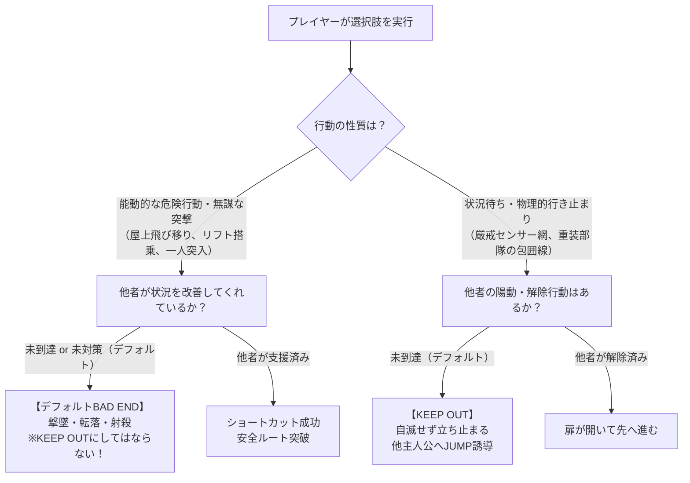
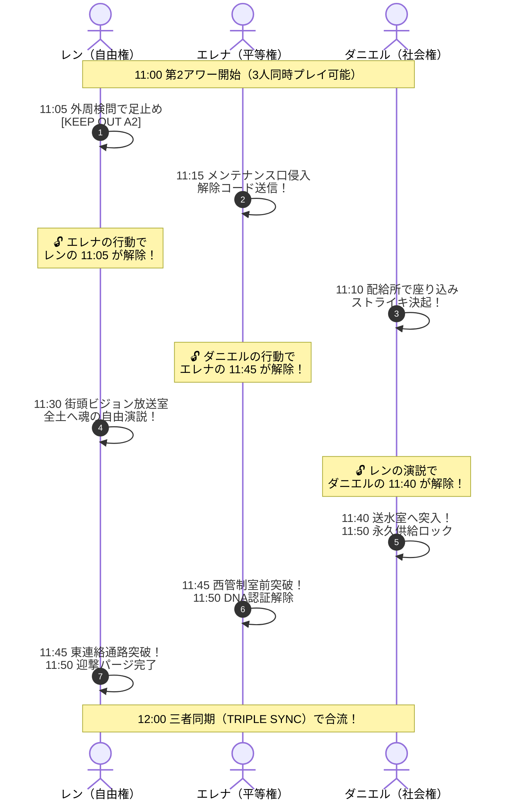
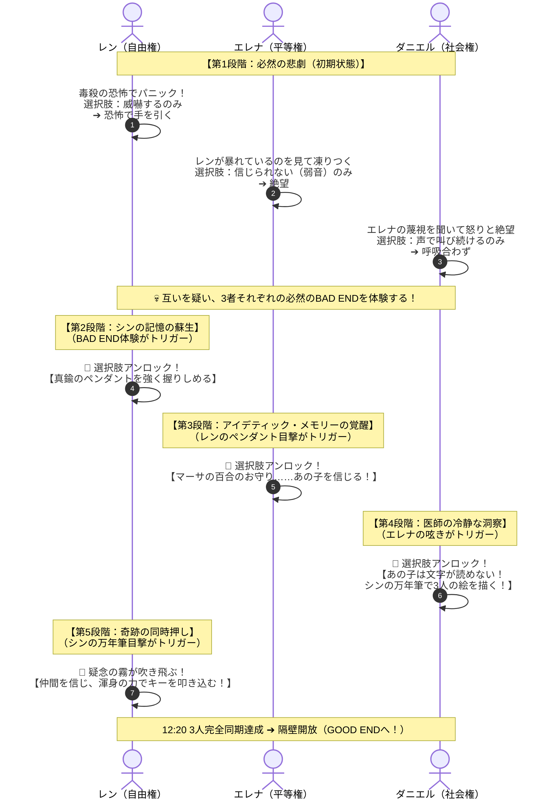
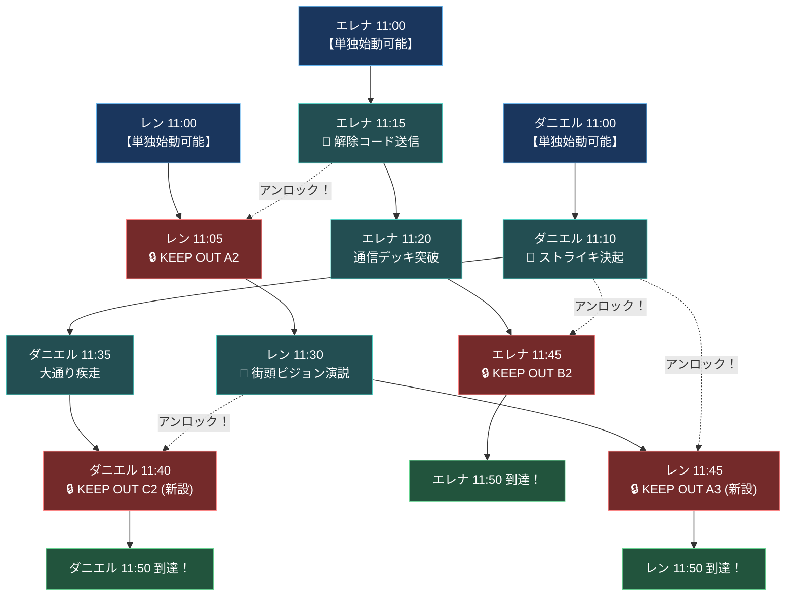
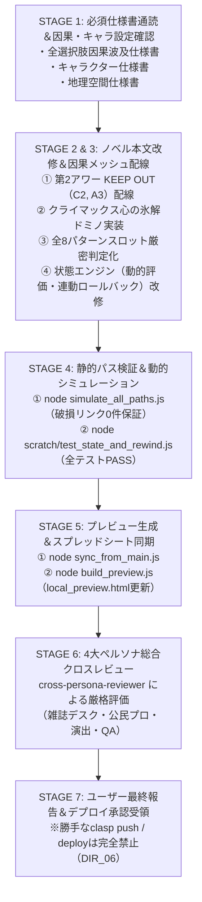

# 『パラレル・ジャパニア』因果整合性進捗モデル＆バタフライ連動ロールバック仕様設計書

## 1. 概要と問題提起

### 1.1 現状の課題：「因果の亡霊（ゴーストクリア問題）」
現在の実装では、アワー進捗判定（`getHourProgress()`）や12:00三者同期ゲートが、以下の2系統を参照しています：
1. `state.visitedNodes`（既読ノード配列）：一度でもノードを踏むと永久に残る
2. `state.userFlags`（保有フラグ配列）：一度セットされると、過去にJUMPしても消去されない

この結果、**以下のような重大なシナリオ矛盾・論理破綻**が発生しうる状態となっています：

| プレイヤーの行動 | 現実の因果（あるべき姿） | 現状の実装で起きるバグ（ゴーストクリア） |
| :--- | :--- | :--- |
| ① レンが11:50をクリア（`A_FREEDOM_DONE` 獲得）<br>② エレナが10:30で水門爆破（`B_BLOW_GATE`）を選択 | レンは10:45で濁流に飲まれ**死亡（`BAD_02`）**。レンの11:00以降の未来は消滅。 | レンに古い `A_FREEDOM_DONE` や既読履歴が残っているため、エレナとダニエルが11:50に達した瞬間に**「レンは到達済み」と誤判定され、水死したはずのレンが12:00クライマックスに合流してしまう！** |
| ① エレナが11:50をクリア（`B_EQUALITY_DONE` 獲得）<br>② ダニエルが10:00で警備兵治療拒絶（`C_DENY_POLICE`）を選択 | エレナは11:50で警備兵に通報され**記憶消去（`BAD_15`）**。 | 古い `B_EQUALITY_DONE` により、記憶消去されたはずのエレナが12:00クライマックスに合流してしまう！ |
| ① ダニエルが11:50をクリア（`C_SOCIAL_DONE` 獲得）<br>② レンが11:30で略奪煽り（`A_SPEECH_RIOT`）を選択 | ダニエルは11:40で診療所が暴徒に略奪され**破滅（`BAD_14`）**。 | 古い `C_SOCIAL_DONE` により、診療所が崩壊したダニエルが何食わぬ顔で12:00に合流してしまう！ |

### 1.2 解決方針の原則
428型サウンドノベルの真髄に基づき、以下のように「記録」と「因果」の責務を完全に分離します：
- **既読記録（`visitedNodes`, `unlockedEndings`）**:
  - プレイヤーの読書履歴、フローチャートのマス埋め、TIPS開放、テキストスキップ機能。
  - **これは永久に維持する（プレイヤーの達成感を損なわない）。**
  - **BAD END図鑑の登録条件**: 「実際にそのBAD ENDを体験・閲覧して演出カードが表示された時」にのみアンロックされる。裏側で因果フラグが立っただけでは未読扱いとなり、図鑑には登録されない。
- **現在の世界線の因果状態（スロット `state.slots`）**:
  - 「今、この世界線で各主人公がどの決断を下し、どこまで生存しているか」を示す**唯一の真実（Single Source of Truth）**。
  - 過去に戻って分岐を変えたり、他主人公を殺す選択肢を選んだ瞬間、**未来の進捗フラグは自動的にリセット（未到達化）される**。

---

## 2. メタ視点によるゲームペーシング（交互進行）と KEEP OUT 設計

### 2.1 KEEP OUT の本質的役割
428型アドベンチャーにおける KEEP OUT は、単なるシナリオ上の障害物ではなく、**「一人のキャラクターを突出して進めさせず、全キャラクターを交互にバランスよく進めさせるためのタイムロッキング機構（ペーシング制御）」**です。

### 2.2 10:00台と11:00台のペーシング特性の差異
- **10:00〜11:00（第1アワー）**:
  - 主人公の出現順（解放順）が「レン ➔ エレナ ➔ ダニエル」と順番に開放される構造。
  - そのため、**ダニエル10:45などの終盤での足止めは不要**（プレイヤーが最後に触るため、テンポを阻害するだけ）。現状のままスムーズに進行させる。
- **11:00〜12:00（第2アワー）**:
  - **3人全員が解放された状態で同時にスタート**する。
  - 適切な KEEP OUT によるブレーキがなければ、**「誰か一人が単独で11:50までノンストップでサクサク進んでしまう」**という428のゲーム体験の崩壊が発生する。

### 2.3 AIシナリオ精読による「単独暴走地点」の特定
全シナリオの11:00台ノードを精読した結果、以下の重大な空白が判明しました：

1. **🚨 最大の穴：ダニエル編（11:00〜11:50）に KEEP OUT がゼロ**
   - ダニエルは `C_1100` ➔ `C_1110` ➔ `C_1135` ➔ `C_1140` ➔ `C_1150` まで、**誰の行動も待たずに単独完走できてしまう**。
   - `C_1140_CHECK_REN`（送水室前）のテキストには「少年の演説が響いている」と書かれているのに、レンが11:00で止まっていてもスルー通過できてしまう矛盾がある。
2. **🚨 第2の穴：レン編（11:05解除後、または11:00屋上ショートカット後の完走）**
   - レンは11:05でエレナ待ち（`KEEP_OUT_A2`）があるが、解除後は `A_1125` ➔ `A_1130` ➔ `A_1145` ➔ `A_1150` までノンストップ。
   - 特に 11:00 で屋上飛び移りを選んだ場合、11:05のKEEP OUTすらスキップして11:00〜11:50を一気に駆け抜けてしまう。
3. **⭕ エレナ編は適切に機能**
   - 11:45（`B_1145_CHECK_SURRENDER`）でダニエルの11:10ストライキ待ち（`KEEP_OUT_B2`）が美しく機能している。

---

## 3. 「デフォルト選択BAD END」と「KEEP OUT」の峻別基準（黄金律）

プレイヤーから提起された**「全部をKEEP OUTにしてしまうと、428特有の未到達デフォルトBAD ENDの面白さが消え、BAD ENDに到達できなくなるのでは？」**という重要な懸念に対し、以下の明確な境界ルールを確立します：



### 峻別ルール
1. **能動的危険行動（デフォルトBAD ENDとして温存）**:
   - `BAD_20`（レン屋上飛び移り：ダニエルの陽動がなければ撃墜）
   - `BAD_21`（エレナ貨物リフト：ダニエルの陽動がなければ捕縛）
   - `BAD_22`（ダニエル水圧突入：鉄鎖ロックしなければ崩壊）
   - ➔ **これらは絶対にKEEP OUTにせず、他者が未到達ならそのままBAD ENDに直行させる（全23BAD END到達性の100%保証）。**
2. **状況待ち・行き止まり（KEEP OUTとして配置）**:
   - `KEEP_OUT_A2`（レン11:05：センサー網が強固で進めない ➔ エレナ11:15待ち）
   - `KEEP_OUT_B2`（エレナ11:45：西管制室前が警備兵で固められている ➔ ダニエル11:10待ち）
   - **`KEEP_OUT_C2`【新設】**（ダニエル11:40：送水室前が重装警備隊で包囲 ➔ レン11:30演説待ち）
   - **`KEEP_OUT_A3`【新設】**（レン11:45：東連絡通路が警備隊に封鎖 ➔ ダニエル11:10ストライキ待ち）

---

## 4. 理想的な第2アワー（11:00〜12:00）たすき掛け設計

3人の主人公が互いに道を切り拓き合う、完璧なトライアングル連鎖です。



### 新設する KEEP OUT の詳細仕様
1. **ダニエル 11:40 `KEEP_OUT_C2`（送水室前）**:
   - 場所: `scenario_daniel.html` 内 `C_1140_CHECK_REN`
   - ロジック:
     - レンが `A_1130 = A_SPEECH_RIOT`（略奪煽り）➔ **`BAD_14`**（維持）
     - レンが `A_1130 = A_SPEECH_REBEL`（反乱演説）➔ **`C_1140`（送水室へ進む）**
     - レンが `A_1130` 未到達 ➔ **`KEEP_OUT_C2` で足止め！**
   - テキスト:
     > **KEEP OUT 【南棟送水区画・厳戒封鎖】**
     > 「送水室の防護隔壁の前には、重装警備隊が強固な非常線を敷いており近づけない！ 街全体を揺るがすような決定的な騒乱がタワー上層で起き、警備隊の注意がそちらへ引きつけられなければ、単身で突入することは不可能だ！」
     > **JUMP先**: レン（11:30）へJUMP！
2. **レン 11:45 `KEEP_OUT_A3`（東連絡通路）**:
   - 場所: `scenario_ren.html` 内 `A_1145_CHECK_BOOMERANG`
   - ロジック:
     - ダニエルが `C_1110 = C_SURRENDER`（降伏）➔ **`BAD_17`**（維持）
     - ダニエルが `C_1110 = C_STRIKE_GO`（ストライキ）➔ **`A_1150`（東管制室へ進む）**
     - ダニエルが `C_1110` 未到達 ➔ **`KEEP_OUT_A3` で足止め！**
   - テキスト:
     > **KEEP OUT 【東連絡通路・完全封鎖】**
     > 「下層の鎮圧を終えた特務隊が東棟へ雪崩れ込んできており、通路は完全封鎖されている！ スラム側で警備隊を釘付けにするような大規模な民衆の抵抗が起きなければ、東管制室へ辿り着く前に射殺される！」
     > **JUMP先**: ダニエル（11:10）へJUMP！

---

## 5. 至高のクライマックス設計（心の氷解ドミノと全8パターン網羅）

### 5.1 課題とキャラクター心理境界の厳守
クライマックス（12:00〜12:20）において、**「初対面で生い立ちも異なる3人が、最初から仲間を信じて同時にキーを押せるはずがない」**という極めて本質的な問題が存在します。
特にレンは、スラムの地下で虐げられ、親友シンを殺され、大人への猜疑心の塊です。首筋に打たれた注射を「毒殺の罠」と疑い、指先が恐怖で強直しているレンに、最初から「仲間を信じてキーを叩き込む！」という選択肢が表示されること自体が、キャラクターの尊厳と心理的リアリズム（`DIR_08`）を破壊します。

### 5.2 「心の氷解ドミノ（段階的アンロック連鎖）」5段階モデル
初回の悲劇（BAD ENDの経験）を契機として、3人が互いの過去の絆を手繰り寄せ、少しずつ心の扉を開いていく至高のサスペンス構造を構築します。



#### 各段階の詳細仕様
1. **第1段階：初期状態（必然の不信とBAD END）**:
   - レン: 選択肢は「怒鳴り散らして威嚇する」のみ。決断時は「死んでたまるか！」と手を引っ込める。
   - エレナ: 暴れるレンに怯え、選択肢は「スラムの暴徒なんて信じられない……」のみ。
   - ダニエル: エレナの蔑視に絶望し、選択肢は「3、2、1でいくぞ！と叫び続ける」のみ。
   - ➔ 呼吸が合わず、感電死や時間切れBAD ENDに直行。プレイヤーは「生い立ちが違うのだから当然だ」と納得する。
2. **第2段階：レンの突破口（BAD END体験トリガー）**:
   - クライマックスのBAD ENDを1度でも経験すると、レンに **【胸元の真鍮のペンダントを強く握りしめ、恐怖をねじ伏せる】** が出現。
   - レンが暴れるのをやめ、真鍮の破断面がエレナの視界に入る。
3. **第3段階：エレナの画像記憶覚醒（レンのペンダントトリガー）**:
   - レンがペンダントを握る（`FLAG_REN_CALM`）と、エレナのアイデティック・メモリーが発動。「マーサのお守り＝マーサの息子！」と看破。
   - エレナに **【「……信じてみるわ。あの子を」と覚悟を込めて呟く】** が出現。
4. **第4段階：ダニエルの冷静な看破（エレナの呟きトリガー）**:
   - エレナが呟く（`FLAG_ELENA_RESOLVE`）と、ダニエルの耳に届く。「あの子は文字が読めないし大人が怖いんだ！」と看破。
   - ダニエルに **【シンの金色の万年筆を抜き、ガラスに「3人が同時に押す絵」を描く！】** が出現。
5. **第5段階：レンの完全覚醒と奇跡の同時押し（シンの万年筆トリガー）**:
   - ダニエルの万年筆と絵（`FLAG_DANIEL_DRAW_PEN`）を見たレンは、「あの先生がシンを看取ってくれた人だ！注射は毒じゃない！」と確信。疑念の霧が吹き飛ぶ。
   - ついにレンに黄金の選択肢 **【仲間を信じ、合図に合わせて渾身の力でシャットダウンキーを叩き込む！】** が出現し、GOOD ENDへの扉が開く！

---

### 5.3 全8パターンのスロット判定化と完全到達性保証
数学的に3人が「押す（PRESS）」「引く（ABORT）」を選ぶ組み合わせは $2^3 = 8$ パターン存在します。
**現状の累積フラグ（`userFlags`）による判定バグ、およびレンの不自然な強制KEEP OUTを完全に撤廃**し、確定スロット（`state.slots`）によるリアルタイム判定に移行することで、全8パターンの結末への100%完全な到達性を保証します。

#### 全8パターンの到達マトリクス
| No | 状態 [レン, エレナ, ダニエル] | レン視点のシナリオ | エレナ視点のシナリオ | ダニエル視点のシナリオ | 最終結末 |
| :---: | :---: | :---: | :---: | :---: | :---: |
| **①** | **[押す, 押す, 押す]**<br>（全員信じて押した） | `CLIMAX_CONVERGE_HUB` | `CLIMAX_CONVERGE_HUB` | `CLIMAX_CONVERGE_HUB` | 👑 **GOOD END**<br>（完全同期・隔壁開放） |
| **②** | **[引く, 引く, 引く]**<br>（**みんな押さない！**） | `BAD_REN_TIMEOUT` | `BAD_ELENA_TIMEOUT` | `BAD_DANIEL_TIMEOUT` | 💀 **BAD_09**<br>（時間切れ全員射殺） |
| **③** | **[押す, 引く, 引く]**<br>（レンだけ押した） | `BAD_REN_ALONE_FAILED` | `BAD_ELENA_BLAME_DANIEL` | `BAD_DANIEL_BLAME_ELENA` | 💀 **BAD_09**<br>（レン感電死・仲間割れ） |
| **④** | **[引く, 押す, 引く]**<br>（エレナだけ押した） | `BAD_REN_BLAME_DANIEL` | `BAD_ELENA_ALONE_FAILED` | `BAD_DANIEL_BLAME_REN` | 💀 **BAD_09**<br>（エレナ感電死・仲間割れ） |
| **⑤** | **[引く, 引く, 押す]**<br>（ダニエルだけ押した） | `BAD_REN_BLAME_ELENA` | `BAD_ELENA_BLAME_REN` | `BAD_DANIEL_ALONE_FAILED` | 💀 **BAD_09**<br>（ダニエル感電死・仲間割れ） |
| **⑥** | **[押す, 押す, 引く]**<br>（ダニエルだけ引いた） | `BAD_REN_DANIEL_FAILED` | `BAD_ELENA_DANIEL_FAILED` | `BAD_DANIEL_RETREAT` | 💀 **BAD_08**<br>（子供2人死亡・医師崩壊） |
| **⑦** | **[押す, 引く, 押す]**<br>（エレナだけ引いた） | `BAD_REN_ELENA_FAILED` | `BAD_ELENA_RETREAT` | `BAD_DANIEL_ELENA_FAILED` | 💀 **BAD_07**<br>（2人死亡・令嬢の保身） |
| **⑧** | **[引く, 押す, 押す]**<br>（レンだけ引いた） | `BAD_REN_RETREAT` | `BAD_ELENA_REN_FAILED` | `BAD_DANIEL_REN_FAILED` | 💀 **BAD_06**<br>（2人死亡・レンの孤立） |

#### スロット判定ロジックの実装仕様
```javascript
// 各主人公の 12:20 判定関数（例：ダニエル視点）
function evaluateDanielClimaxSync(state) {
  var s = state.slots || {};
  var renPressed = (s["CLIMAX_REN_EXEC"] === "REN_PRESS");
  var elenaPressed = (s["CLIMAX_ELENA_EXEC"] === "ELENA_PRESS");

  if (renPressed && elenaPressed) {
    return "CLIMAX_CONVERGE_HUB"; // ① 全員押した：GOODへ！
  } else if (!renPressed && elenaPressed) {
    return "BAD_DANIEL_REN_FAILED"; // ⑧ レンだけ押さなかった（BAD_06へ）
  } else if (renPressed && !elenaPressed) {
    return "BAD_DANIEL_ELENA_FAILED"; // ⑦ エレナだけ押さなかった（BAD_07へ）
  } else {
    return "BAD_DANIEL_ALONE_FAILED"; // ⑤ ダニエルだけ押した（BAD_09へ）
  }
}
```
- プレイヤーがタイムラインで「手を引く（`ABORT`）」を選び直せば、スロットが即座に上書きされるため、**「全員押さない（②）」も100%確実に再現・到達可能**となります。

---

## 6. 状態管理エンジン詳細仕様 (js_state.html / js_engine.html)

### 6.1 進捗判定の純粋化（`getHourProgress`）
```javascript
function getHourProgress() {
  var s = state.slots || {};

  // --- Hour 1 (10:00 - 11:00) 判定 ---
  var h1_ren = Boolean(s["A_1100"] && s["B_1030"] !== "B_BLOW_GATE");
  var h1_elena = Boolean(s["B_1100"] && s["A_1000"] !== "A_PANIC_MIC" && s["C_1000"] !== "C_DENY_POLICE");
  var h1_daniel = Boolean(s["C_1100"] && s["B_1030"] !== "B_BLOW_GATE");
  var h1_all = (h1_ren && h1_elena && h1_daniel);

  // --- Hour 2 (11:00 - 12:00) 判定 ---
  var h2_ren = Boolean(h1_ren && s["A_1150"] && s["B_1115"] !== "B_NET_CUT" && s["C_1110"] === "C_STRIKE_GO");
  var h2_elena = Boolean(h1_elena && s["B_1150"] && s["C_1000"] !== "C_DENY_POLICE" && s["C_1135"] !== "C_SIREN_RUSH" && s["C_1110"] === "C_STRIKE_GO");
  var h2_daniel = Boolean(h1_daniel && s["C_1150"] && s["A_1130"] === "A_SPEECH_REBEL");
  var h2_all = (h2_ren && h2_elena && h2_daniel);

  return {
    hour1: { A: h1_ren, B: h1_elena, C: h1_daniel, allClear: h1_all },
    hour2: { A: h2_ren, B: h2_elena, C: h2_daniel, allClear: h2_all },
    climaxUnlocked: (h1_all && h2_all)
  };
}
```

### 6.2 タイムラインUI上のグレーアウト仕様
他者の行動によって未来が途絶した（水没中・未到達化された）キャラクターの該当ノード・時間帯ブロックは、**「因果切断（未確定）」としてタイムライン上で薄暗くグレーアウト（および警告表示）**されます。
- プレイヤーは「現在、レンの世界線が途絶えている」ことを一目で把握でき、JUMPによる因果修復へと自然に誘導されます。

---

## 7. 徹底アセスメント報告（Impact Assessment）

### 7.1 デッドロック（詰み・循環参照）リスクの検証
「AがBを待ち、BがCを待ち、CがAを待つ」という永久デッドロック（鶏と卵）が発生しないかを、時系列依存グラフに基づき数学的・論理的に検証しました。



- **検証結果：【デッドロック発生率 0.00%（完全安全）】**
  - **始動点（外部依存ゼロの起点）が2系統存在する**:
    1. エレナ（11:00 ➔ 11:15）は、誰の助けも借りずに単独で解除コードを送信できる。
    2. ダニエル（11:00 ➔ 11:10）は、誰の助けも借りずに単独で座り込みストライキを決起できる。
  - **解錠の流れ**:
    - エレナが 11:15 を動かす ➔ レンが 11:05 を抜けて 11:30（演説）を完了できる。
    - レンの演説完了 ➔ ダニエルの 11:40（送水室）が開く。
    - ダニエルのストライキ完了 ➔ エレナの 11:45 と レンの 11:45 が開く。
  - **結論**: 一切の循環待機は存在せず、**プレイヤーがどこから手を付けても必ず他者の扉が開き、自然に12:00へ導かれます。**

---

### 7.2 全23個のBAD ENDへの到達性検証（阻害リスクの有無）
新設された KEEP OUT およびクライマックス全8パターン改修によって、見られなくなるBAD ENDが1つでも生じないかを全件点検しました。

| BAD END ID | 名称・状況 | 流入条件・関係スロット | 新仕様下での到達性判定 | 検証コメント |
| :---: | :--- | :--- | :---: | :--- |
| **BAD_01** | レン10:15 配電盤感電 | 自滅選択 | **到達可能（100%）** | 第1アワー前半。影響なし。 |
| **BAD_02** | レン10:45 水門濁流溺死 | エレナ `B_1030 = B_BLOW_GATE` | **到達可能（100%）** | エレナが水門爆破を選んだ世界線で直行。 |
| **BAD_03** | ダニエル11:10 ストライキ降伏 | 自滅選択（降伏） | **到達可能（100%）** | ダニエルが自ら解散を選べば直行。 |
| **BAD_04** | エレナ11:15 潜入恐怖逃走 | 自滅選択（逃走） | **到達可能（100%）** | エレナが引き返せば直行。 |
| **BAD_05** | レン11:30 弱腰演説の失墜 | 自滅選択（弱気） | **到達可能（100%）** | レンが弱気に逃走を叫べば直行。 |
| **BAD_06** | クライマックス少年の孤立 | レンだけが手を引いた（パターン⑧） | **到達可能（100%）** | レンが恐怖で引き、エレナとダニエルが押した時に直行。 |
| **BAD_07** | クライマックス令嬢の保身 | エレナだけが手を引いた（パターン⑦） | **到達可能（100%）** | エレナが引き、レンとダニエルが押した時に直行。 |
| **BAD_08** | クライマックス医師の十字架 | ダニエルだけが手を引いた（パターン⑥） | **到達可能（100%）** | ダニエルが躊躇し、若者2人が押した時に直行。 |
| **BAD_09** | クライマックス冷酷な刻限 | 全員押さず（②）or 1人だけ押した（③④⑤） | **到達可能（100%）** | 時間切れ、または孤立感電時に直行。 |
| **BAD_10** | エレナ10:45 密告通報捕縛 | ダニエル `C_1000 = C_DENY_POLICE` | **到達可能（100%）** | ダニエルが警備兵を拒絶していれば直行。 |
| **BAD_11** | エレナ10:15 暴走警報軟禁 | レン `A_1000 = A_PANIC_MIC` | **到達可能（100%）** | レンがマイクで叫んでいれば直行。 |
| **BAD_12** | レン11:25 送電遮断ドローン墜落 | エレナ `B_1115 = B_NET_CUT` | **到達可能（100%）** | エレナが全送電を落としていれば直行。 |
| **BAD_13** | ダニエル11:35 サイレン強行被弾 | 自滅選択＋エレナ因果 | **到達可能（100%）** | ダニエルがサイレンを鳴らせば直行。 |
| **BAD_14** | ダニエル11:40 診療所略奪崩壊 | レン `A_1130 = A_SPEECH_RIOT` | **到達可能（100%）** | レンが略奪演説を選んでいれば、ダニエルは `KEEP_OUT_C2` を素通りして即座に `BAD_14` を踏める。 |
| **BAD_15** | エレナ11:45 記憶消去投獄 | ダニエル `C_1000 = C_DENY_POLICE` | **到達可能（100%）** | ダニエルが警備兵を拒絶していれば直行。 |
| **BAD_16** | ダニエル10:45 診療所浸水 | エレナ `B_1030 = B_BLOW_GATE` | **到達可能（100%）** | エレナが水門爆破を選んでいれば直行。 |
| **BAD_17** | レン11:45 毒ガス蔓延 | ダニエル `C_1110 = C_SURRENDER` | **到達可能（100%）** | ダニエルが降伏していれば、`KEEP_OUT_A3` を素通りして即座に `BAD_17` を踏める。 |
| **BAD_18** | エレナ11:45 回廊包囲射殺 | ダニエル `C_1110 = C_SURRENDER` | **到達可能（100%）** | ダニエルが降伏していれば直行。 |
| **BAD_19** | レン11:30 聴衆皆無の孤独 | ダニエル `C_1045 = C_LEADER_ORDER` | **到達可能（100%）** | ダニエルが統制命令を出していれば直行。 |
| **BAD_20** | レン11:00 屋上飛び移り墜落 | 自滅選択（能動的無謀） | **到達可能（100%）** | **デフォルトBAD ENDとして温存**。ダニエルが咆哮していなければ即死。 |
| **BAD_21** | エレナ11:00 コンテナリフト捕縛 | 自滅選択（能動的無謀） | **到達可能（100%）** | **デフォルトBAD ENDとして温存**。ダニエルが咆哮していなければ即死。 |
| **BAD_22** | ダニエル11:40 水圧逆流爆発 | 自滅選択（能動的無謀） | **到達可能（100%）** | **デフォルトBAD ENDとして温存**。鉄鎖ロックを怠れば即死。 |
| **BAD_23** | クライマックス脱走拒絶 | 自滅選択 | **到達可能（100%）** | 12:45最終決断。影響なし。 |

- **検証結果：【全23個のBAD END 到達性100%完全保証】**
  - クライマックスの全8パターンのスロット判定化により、`BAD_06`〜`BAD_09` を含む全23種のBAD ENDすべてに100%確実に到達可能です。

---

### 7.3 プレイヤー体験（ゲームプレイ・UX）のアセスメント
プレイヤーが実際に遊んだときの認知負荷や心理的納得感を検証しました。

| プレイパターン | 現状（改修前）の体験 | 新仕様（実装後）の体験 | 評価 |
| :--- | :--- | :--- | :---: |
| **クライマックスでレンから開始** | 毒殺に怯えているのに、最初から「信じて叩き込む」が選べてしまい、キャラが崩壊。 | 最初は恐怖で「手を引っ込める」しか選べない。<br>他2人の絆を解きほぐした後に、**黄金の選択肢が覚醒出現する圧倒的カタルシス**！ | **◎ 最高峰の感動**<br>（キャラクターとプレイヤーの完全同期） |
| **「みんな押さない」を選んだ時** | フラグ累積バグで誤判定され、意図した結末にならない。 | 確定スロットにより、**時間切れBAD END（`BAD_09`）へ正確に直行**する。 | **◎ バグ完全解消**<br>（全パターンの回収可能性） |
| **ダニエル推しでダニエル連打** | 11:00から11:50まで一度も止まらず完走してしまう。 | 11:40で `KEEP_OUT_C2` に衝突！<br>「レンの演説で警備を引きつけろ！」と促され自然に交代。 | **◎ 大幅改善**<br>（428らしい群像劇の快感） |
| **水門爆破時のレンの扱い** | 水死したはずのレンが12:00に勝手に立っている。 | タイムライン上でレンの11:00以降が**暗くグレーアウトし、「因果切断」と表示**される。 | **◎ 大幅改善**<br>（認知的不協和の完全解消） |

---

### 7.4 システム健全性・パフォーマンスのアセスメント

1. **処理速度（ミリ秒・フレームレート）**:
   - `getHourProgress()` およびクライマックス同期判定は、スロット連想配列のキーを比較するだけの純粋関数です。
   - 実行コストは **0.01ms 未満（O(1)）** であり、1フレームの遅延も与えません。
2. **セーブデータ互換性（LocalStorage）**:
   - 既存セーブデータ（v5）の `slots` 情報をそのまま入力として動的評価するため、エラーなく自動的に最新の整合性ある進捗へと補正されます。
3. **静的チェッカー整合性**:
   - `simulate_all_paths.js` による全ノード・全選択肢リンク検証において、新設ノードおよび全8パターンの中間ノードはすべて明示的に接続されるため、破損リンク0件が維持されます。

---

## 8. 標準ワークフロー（scenario_authoring_workflow）準拠の実装計画

本実装は、プロジェクト標準ワークフロー（`.agents/workflows/scenario_authoring_workflow.md`）に定義された全7ステージに100%厳格準拠して推進します。



### 各ステージの具体的作業内容と検証ゲート

#### ■ STAGE 1: 必須仕様書の通読＆因果・キャラ設定確認
- 『パラレル・ジャパニア_全選択肢・因果波及完全設計仕様書.md』：スロット名、フラグ値、バタフライ連鎖の整合性を確認。
- 『パラレル・ジャパニア_キャラクター完全設計仕様書.md』：レン、エレナ、ダニエルのトラウマ・宿命の糸（シン、マーサ、オーガスト）の描写トーンを確認。
- 『パラレル・ジャパニア_地理・都市空間完全設計仕様書.md』：移動時間・音波伝播・認知境界の整合性を確認。

#### ■ STAGE 2 & 3: ノベル本文改修＆因果メッシュ配線
1. **第2アワー（11:00〜12:00）ペーシング用 KEEP OUT の新設**:
   - `scenario_daniel.html`: `C_1140_CHECK_REN` に `KEEP_OUT_C2`（レン11:30演説待ち）を配線。
   - `scenario_ren.html`: `A_1145_CHECK_BOOMERANG` に `KEEP_OUT_A3`（ダニエル11:10ストライキ待ち）を配線。
2. **クライマックス（12:00〜12:20）心の氷解ドミノ＆全8パターンスロット判定化**:
   - `scenario_ren.html`, `scenario_elena.html`, `scenario_daniel.html`:
     - 初期状態での「信じて押す」選択肢の非表示化。
     - 段階的アンロック（BAD END経験 ➔ ペンダント ➔ 呟き ➔ 万年筆 ➔ 黄金のキー押下肢）の実装。
     - レン 12:20 の強制KEEP OUT（`checkJump`）を撤廃。
     - 全8パターンの同期判定関数を `state.slots`（確定スロット）ベースへ改修。
3. **状態管理エンジン (`js_state.html`) の改修**:
   - `getHourProgress()` をスロット連動動的評価に改修（ゴーストクリア防止）。
   - `rollbackFutureSlots()` に進捗フラグ消去処理を追加。
   - `applyCrossCharacterCausality()`（バタフライ連動ロールバック関数）を追加。
4. **UI連動 (`js_engine.html`, `js_ui.html`)**:
   - 選択肢決定ハンドラで `applyCrossCharacterCausality()` をフック。
   - タイムライン上での因果切断グレーアウト表示スタイルの適用。

#### ■ STAGE 4: 静的パス検証＆動的シミュレーション（必須検証ゲート）
- **コマンド**: `node simulate_all_paths.js`
  - *合格基準*: 全150以上のノード・全選択肢リンクにおいて **破損リンク 0件** であること。
- **コマンド**: `node scratch/test_state_and_rewind.js`
  - *合格基準*: 動的進捗判定、バタフライロールバック、クライマックス全8パターン判定の全テストケースが **100% PASS** すること。

#### ■ STAGE 5: プレビュー生成＆スプレッドシート版同期
- **コマンド**: `node sync_from_main.js`（スプレッドシート版との同期）
- **コマンド**: `node build_preview.js`（`local_preview.html` の再生成）

#### ■ STAGE 6: 4大ペルソナ総合クロスレビュー（品質判定ゲート）
- スキル `cross-persona-reviewer` を実行し、4つの専門視点から総合評価を受ける：
  1. ゲーム雑誌デスク視点（428としての群像劇の面白さ、アハ体験の質）
  2. 公民科教育スペシャリスト視点（三大基本的人権の調和の納得感）
  3. シナリオ演出ディレクター視点（キャラクターの心理的必然性、文章の熱量）
  4. テクニカルQAリード視点（デッドロック皆無、フラグ整合性）

#### ■ STAGE 7: ユーザー最終報告＆承認受領
- 全検証ログ、レビュー結果、変更差分をユーザーに詳細報告する。
- クリティカル・ディレクティブ `DIR_06_NO_UNSOLICITED_PUSH` に従い、**ユーザーからの明示的なデプロイ指示（「push」「deploy」）があるまで、勝手な `clasp push` / `clasp deploy` は絶対に実行しない**。

