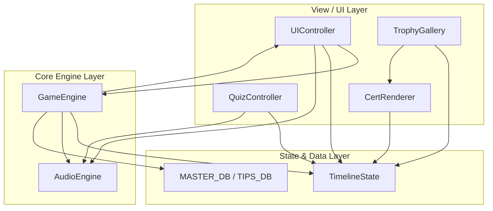

# 『パラレル・ジャパニア：クロニクル』システム全関数・モジュールAPI完全定義仕様書

<document_metadata>
  <title>システム全関数・モジュールAPI完全定義仕様書</title>
  <version>1.0.0</version>
  <created_at>2026-09-30</created_at>
  <purpose>
    本ゲームを構成する全JavaScriptモジュールの公開関数・引数・戻り値・責務境界を網羅的に定義し、
    未定義関数の呼び出し（呼び出しエラー、ボタン無反応、クラッシュ）の混入を100%未然に防止する。
  </purpose>
</document_metadata>

---

## 1. モジュール構成と責務分離アーキテクチャ

本システムは、Google Apps Script (GAS) 環境およびローカルブラウザ環境において、外部ライブラリ（React, Vue等）に依存せず、最高速の応答性と信頼性を実現する **Vanilla JS IIFE（即時実行関数式）モジュールパターン** で設計されています。



---

## 2. モジュール別 API 完全定義一覧

### 2.1 GameEngine（ゲーム進行・ノード遷移・シナリオ演出）
* **定義ファイル**: [`js_engine.html`](file:///c:/Users/佐々木篤史/Desktop/pallarerujapania/js_engine.html)
* **グローバル公開**: `window.GameEngine`

| 関数名 / シグネチャ | 引数 | 戻り値 | 役割・動作仕様 |
| :--- | :--- | :--- | :--- |
| `launchNode(nodeId)` | `nodeId` (String): 遷移先ノードID | なし | 指定ノードをロードし、訪問済み登録・最新位置記憶・段落描画・BAD END/Keep Out判定・アワー自動マーキングを一括実行する。 |
| `showNextParagraph()` | なし | なし | 画面タップ時に次の段落を表示。末尾到達時はプロンプトを非表示にして選択肢エリアを描画する。 |
| `skipToChoices()` | なし | なし | 「SKIP ▶」ボタン押下時に全段落を一括展開し、最下部の選択肢へ即座にスクロール・到達させる。 |
| `switchChar(charId)` | `charId` (String): `"A" \| "B" \| "C"` | なし | 主人公を切り替える。ロック判定（電磁ロック・隔壁）を行い、直前の到達ノード（`lastCharNodes`）へ正確に復帰する。 |
| `advanceTrueEnd()` | なし | なし | TrueEnd（ACT 1〜3）のステップ（解読 ➔ 憲法前文 ➔ ACT 1 ➔ ACT 2 ➔ ACT 3）を順次進行させる。 |

---

### 2.2 UIController（画面描画・モーダル・視覚エフェクト制御）
* **定義ファイル**: [`js_ui.html`](file:///c:/Users/佐々木篤史/Desktop/pallarerujapania/js_ui.html)
* **グローバル公開**: `window.UIController`

| 関数名 / シグネチャ | 引数 | 戻り値 | 役割・動作仕様 |
| :--- | :--- | :--- | :--- |
| `switchView(viewName)` | `viewName` (String): `"auth" \| "novel" \| "keepout" \| "badend" \| "trueend"` | なし | 最上位ビュー要素の表示/非表示を切り替え、URLハッシュの履歴を安全に更新する。 |
| `updateHeaderTabs()` | なし | なし | 画面上部の主人公切り替えタブ（A:緑 / B:青 / C:黄）のアクティブ装飾を更新する。 |
| `flashScreen()` | なし | なし | 画面全体を赤く瞬間発光させる視覚効果（銃撃・電磁ショック・危険検知等）。 |
| `shakeScreen()` | なし | なし | ノベル画面全体を振動させる視覚効果（爆破・地鳴り・水圧激突等）。 |
| `showToast(msg)` | `msg` (String): 表示メッセージ | なし | 画面下部に通知トーストを一時表示する（システム警告・アンロック通知等）。 |
| `showCausalityShift(sourceChar, targetChar, msg)` | `sourceChar`, `targetChar`, `msg` | なし | 他の主人公の決断によって歴史が改変された際の因果変動演出カードを表示する。 |
| `openTip(term, targetEl)` | `term` (String): 憲法用語名, `targetEl` (Element): クリック元 | なし | 指定された公民教育TIPSモーダルを開き、条文解説・判例・クイズ挑戦枠を描画する。 |
| `closeTip()` | なし | なし | TIPSモーダルを閉じ、タップ貫通クールダウンを設定する。 |
| `isTipCooldown()` | なし | Boolean | TIPSモーダルを閉じた直後（350ms間）のタップ貫通フラグ状態を返す。 |
| `openChart()` | なし | なし | タイムライン因果チャートモーダルを開き、全ノード・因果線の最新状態を描画する。 |
| `closeChart()` | なし | なし | タイムライン因果チャートモーダルを閉じる。 |
| `renderChartModal()` | なし | なし | タイムラインチャート内の全ツリー・通過済みハイライト・JUMPボタンを最新情報で再描画する。 |
| `openTipsArchive()` | なし | なし | TIPS図鑑（憲法百科事典）モーダルを開く。 |
| `closeTipsArchive()` | なし | なし | TIPS図鑑モーダルを閉じる。 |
| `renderTipsArchiveModal()` | なし | なし | TIPS図鑑内の全条文リスト・習得率・クイズ正解バッジを再描画する。 |
| `openBadEndArchive()` | なし | なし | BAD END図鑑（全23エンディング記録）モーダルを開く。 |
| `closeBadEndArchive()` | なし | なし | BAD END図鑑モーダルを閉じる。 |
| `renderBadEndArchiveModal()` | なし | なし | BAD END図鑑内の全結末カード・到達状況・ヒントを再描画する。 |
| `renderTimeBlockStatus()` | なし | なし | タイトル画面のアワー進捗インジケーター（10:00〜, 11:00〜, 12:00〜）を描画する。 |
| `showToBeContinued(char, hour, title, msg)` | 各種情報 | なし | アワー終端に到達した主人公の待機モーダルを表示し、他キャラへの交代を促す。 |
| `showHour1Preview()` | なし | なし | 第1アワー全員突破時のあらすじ＆第2アワー（11:00〜）次回予告編モーダルを表示する。 |
| `showHour2Preview()` ★新設 | なし | なし | 第2アワー全員突破時のあらすじ＆第3アワー（12:00〜 クライマックス）次回予告編モーダルを表示する。 |
| `showCharWaitOption(char, hour)` | `char`, `hour` | なし | 待機中主人公をタップした際の選択肢モーダル（他キャラへ交代 / 待機解除）を表示する。 |
| `checkAllClearBadge()` | なし | なし | 全編クリア達成時の称号・特別バッジの表示状態を更新する。 |
| `applyTipLinkStyles(container)` | `container` (Element): 親要素 | なし | ノベル本文中の全 `.tip-link` のスタイル（未読:青 / 既読:黄 / マスター:桃 / 真エンド:赤）を一括適用する。 |
| `openWikiArchive()` | なし | なし | スラム図書館の百科事典アーカイブ画面を開く。 |
| `closeWikiArchive()` | なし | なし | 百科事典アーカイブ画面を閉じる。 |

---

### 2.3 TimelineState（ステート・永続化・周回判定・因果フラグ）
* **定義ファイル**: [`js_state.html`](file:///c:/Users/佐々木篤史/Desktop/pallarerujapania/js_state.html)
* **グローバル公開**: `window.TimelineState`

| 関数名 / シグネチャ | 引数 | 戻り値 | 役割・動作仕様 |
| :--- | :--- | :--- | :--- |
| `getState()` | なし | Object | 現在のゲーム進行ステートオブジェクトの参照を返す。 |
| `rebuildFlags()` | なし | なし | `state.slots`（過去選択肢）から `state.userFlags`（因果フラグ群）を決定論的に完全再構築する。 |
| `rollbackFutureSlots(fromNodeId)` | `fromNodeId` (String): 起点ノード | なし | タイムライン逆行時、変更ノード以降の未来の選択スロットとフラグを安全に無効化する。 |
| `getHourProgress()` | なし | Object | 各アワー（Hour 1, Hour 2）の各主人公到達状況および全員クリア（allClear）判定を返す。 |
| `markHourClear(charKey, hourNum)` | `charKey` (`"A" \| "B" \| "C"`), `hourNum` (1 \| 2) | なし | 指定主人公の指定アワーのクリアフラグを立てて保存する。 |
| `saveLocal()` | なし | なし | 現在のステートを `localStorage` に即座に暗号化・永続保存する。 |
| `loadLocal()` | なし | Boolean | `localStorage` からステートを復元する。存在しない場合は初期状態を生成。 |
| `syncServer(callback)` | `callback` (Function, optional) | なし | Google Apps Script (GAS) サーバー側のスプレッドシートへ進行データを非同期同期する。 |
| `hasClearedOnce()` | なし | Boolean | 通常エンド以上のゲームクリア経験があるかを判定する（周回特典クイズ・古遺物解放の基底フラグ）。新規登録時は確実に `false`。 |
| `hasClearedTrueEnd()` | なし | Boolean | TRUE END（第25条・第14条・第13条全奪還）を達成したかを判定する。 |
| `markCleared(endType)` | `endType` (String): クリア種別 | なし | クリア実績を記録し、周回フラグ（`hasClearedOnce = true`）を確定する。 |
| `unlockTrophy(trophyKey)` | `trophyKey` (String): トロフィーキー | なし | トロフィーを獲得済みにし、通知トーストとファンファーレを発火する。 |
| `hasTrophy(trophyKey)` | `trophyKey` (String) | Boolean | 指定トロフィーを獲得済みか判定する。 |
| `getUnlockedTrophies()` | なし | Object | 解放済みトロフィーの辞書を返す。 |
| `isTipMastered(tipKey)` | `tipKey` (String): TIPS名 | Boolean | 指定TIPSの憲法クイズに正解済みか判定する。 |
| `markTipMastered(tipKey)` | `tipKey` (String) | なし | 指定TIPSをマスター済みに記録し、永続化する。 |
| `hasMasteredAllTips()` | なし | Boolean | 全19項目の公民教育TIPSをすべてマスターしたかを判定する。 |
| `applyDebugUnlockState()` | なし | なし | デバッグ・検証用に全アワー・全トロフィーをアンロックする。 |

---

### 2.4 AudioEngine（Web Audio API シンセサイザー効果音）
* **定義ファイル**: [`js_audio.html`](file:///c:/Users/佐々木篤史/Desktop/pallarerujapania/js_audio.html)
* **グローバル公開**: `window.AudioEngine`

| 関数名 / シグネチャ | 引数 | 戻り値 | 役割・動作仕様 |
| :--- | :--- | :--- | :--- |
| `init()` | なし | なし | ユーザー初回タップ時に `AudioContext` を安全に初期化・レジュームする。 |
| `play(soundName)` | `soundName` (String): サウンド名 | なし | オシレーターによる合成効果音を再生する。<br>対応サウンド：`tap`, `badend`, `fanfare`, `sparkle`, `flash`, `shake`, `jump`, `correct`, `wrong` |
| `toggleMute()` | なし | Boolean | ミュート状態をトグルし、現在のミュート成否を返す。 |

---

### 2.5 栄誉・図鑑モジュール（CertRenderer, TrophyGallery, QuizController）
* **定義ファイル**: [`js_ui.html`](file:///c:/Users/佐々木篤史/Desktop/pallarerujapania/js_ui.html)

#### QuizController
| 関数名 | 引数 | 役割・動作仕様 |
| :--- | :--- | :--- |
| `startQuiz(tipKey)` | `tipKey` (String) | 指定TIPSの三択憲法修得クイズモーダルを初期化・起動する。 |
| `closeQuiz()` | なし | クイズモーダルを安全に閉じる。 |

#### CertRenderer
| 関数名 | 引数 | 役割・動作仕様 |
| :--- | :--- | :--- |
| `openModal(trophyKey)` | `trophyKey` (String) | 特別栄誉表彰状（日本国憲法修得証、全因果解明証等）を生成・表示する。 |
| `closeModal()` | なし | 表彰状モーダルを閉じる。 |
| `downloadPdf()` | なし | ブラウザ印刷ダイアログを通じて表彰状をPDF保存・印刷する。 |

#### TrophyGallery
| 関数名 | 引数 | 役割・動作仕様 |
| :--- | :--- | :--- |
| `openModal()` | なし | 栄誉の殿堂（トロフィー図鑑）モーダルを開く。 |
| `closeModal()` | なし | トロフィー図鑑モーダルを閉じる。 |
| `renderGallery()` | なし | 全6大トロフィーの獲得状況と解放条件カードを動的生成する。 |

---

## 3. 未定義関数の混入を防止する検査体制

本プロジェクトでは、コード編集後に **未定義関数チェッカースクリプト** を実行することで、全ファイルにわたる未定義関数の呼び出しを0件に抑止します。

```bash
node scratch/check_api_calls.js
```
* **検査対象ファイル**: `index.html`, `js_engine.html`, `js_ui.html`, `js_state.html`, `js_audio.html`, 各シナリオファイル
* **検査対象モジュール**: `GameEngine`, `UIController`, `TimelineState`, `AudioEngine`, `QuizController`, `CertRenderer`, `TrophyGallery`
* **検査基準**: 上記の定義済みSetに含まれないメソッド呼び出しが存在した場合、行番号付きでエラーを出力し終了コード `1` で停止する。
