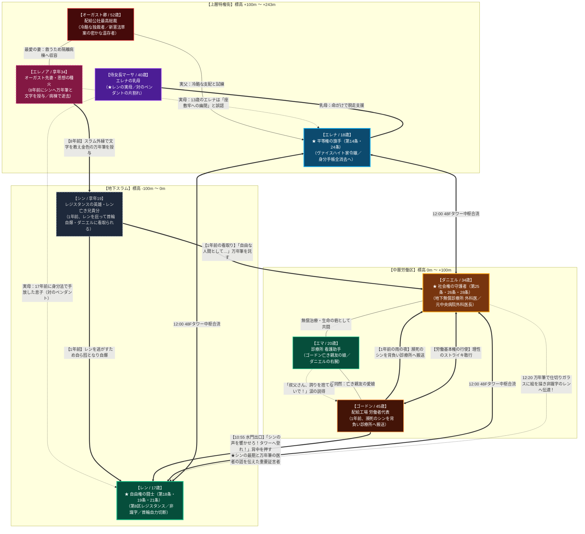

# 『パラレル・ジャパニア：クロニクル』キャラクター完全設計仕様書（設定バイブル）

<character_bible version="2.1">

<meta>
  <title>パラレル・ジャパニア：クロニクル 〜失われた人権の180分〜 キャラクター完全設計仕様書</title>
  <description>
    3人の主人公（レン、エレナ、ダニエル）および重要サブキャラクターたちの人物設計バイブル。
    憲法三原則（自由権・平等権・社会権）、生い立ち、心理葛藤、知能指数（IQ）、嗜好、口癖、
    そして「基本的人権が達成されていないディストピアだからこそ生じてしまった宿命の糸」を定義する。
  </description>
</meta>

<!-- ================================================================= -->
<!-- 全方位 人物相関図                                                   -->
<!-- ================================================================= -->
<character_relationship_map>

</character_relationship_map>

<!-- ================================================================= -->
<!-- 1. 主人公A：レン（Ren）〜自由権の体現者〜                           -->
<!-- ================================================================= -->
<character id="REN" role="protagonist_A" theme="自由権">
  <quote>「オレの首輪に触るな！ 生きるか死ぬかくらい、オレ自身の足で決めてやる！」</quote>

  <profile>
    <full_name>レン・クロサキ（Ren Kurosaki / 叙述トリック解明後：黒崎 蓮）</full_name>
    <age>17歳</age>
    <gender>男性</gender>
    <physical>身長 172cm / 体重 61kg / 血液型 O型</physical>
    <position>スラム第8区 レジスタンス「フリーダム・シーカーズ」最年少遊撃手</position>
    <constitutional_theme>自由権（精神の自由・身体の自由・経済活動の自由 / 日本国憲法第18条・19条・21条）</constitutional_theme>
    <keepsake>『手作りの真鍮ペンダント』（百合の紋章、深い碧の石細工、縁の小さな打痕。赤ん坊の頃、首にかけられてスラムの孤児院の前に置き去りにされた唯一の形見）。</keepsake>
  </profile>

  <iq score="118" type="野性直感・空間把握・機械適応特化型">
    学術的な法理論は皆無だが、構造物の弱点や配線のバイパス、警備兵の死角を瞬時に見抜く「ストリート・サバイバルIQ」が突出している。考えるより先に体が動く直感即決型。
  </iq>

  <background>
    親の顔も知らずスラムで育つ。1年前、唯一の兄貴分だった親友シンと共に首輪解除コードを盗もうとして失敗。シンはレンを庇って捕らえられ公開処刑された。シンの死を胸に「二度と首輪の奴隷にはならない」「奪われた自由を自らの手で取り戻す」と誓う。
  </background>

  <psychology>
    <greatest_fear>首輪で誰かに命を操られること。狭い密室に閉じ込められること（閉所恐怖症）。</greatest_fear>
    <inner_weakness>自由を愛するあまり「他人の都合や社会秩序」を軽視しがち。配電盤を壊してダニエルの診療所を停電させたり、群衆を煽って略奪を起こしたりと、無秩序な自由（放縦）へ暴走しやすい危うさを持つ。</inner_weakness>
  </psychology>

  <traits>
    <strengths>圧倒的な行動力、逆境での不屈の闘志、仲間を見捨てない義侠心、驚異的な反射神経。</strengths>
    <weaknesses>短気、挑発に乗りやすい、他者の権利（公共の福祉）への想像力不足、言葉足らず。</weaknesses>
  </traits>

  <athletic_ability sport="ストリート・パルクール">
    配管フリークライミング、ダッシュ＆スライディング。狭い下水道やダクトを猿のように軽快にすり抜け、廃材の巨大レンチを片手で振り回す腕力を持つ。
  </athletic_ability>

  <food_preferences>
    <favorite>スラムの屋台で廃油で揚げた「干しネズミのスパイス揚げ」、合成シロップの「激甘炭酸水」。</favorite>
    <dislike>統治局が配給する無味乾燥な「灰色の栄養ゼリーパック」（家畜の餌のようで吐き気を催すため）。</dislike>
  </food_preferences>

  <catchphrases>
    <phrase>「誰にもオレたちの明日を決めさせねえ！」</phrase>
    <phrase>「オレの首輪に触るな！ 生きるか死ぬかくらい、オレ自身の足で決めてやる！」</phrase>
    <phrase>「理屈なんざ後回しだ！ 走れ、生き延びろ！」</phrase>
  </catchphrases>
</character>

<!-- ================================================================= -->
<!-- 2. 主人公B：エレナ（Elena）〜平等権の旗手〜                         -->
<!-- ================================================================= -->
<character id="ELENA" role="protagonist_B" theme="平等権">
  <quote>「生まれや身分で人の尊厳が決められていいはずがありません。私がこの特権の鎖を断ち切ってみせます」</quote>

  <profile>
    <full_name>エレナ・フォン・ヴァイスハイト（Elena von Weisheit / 叙述トリック解明後：白石 エレナ）</full_name>
    <age>18歳</age>
    <gender>女性</gender>
    <physical>身長 164cm / 体重 49kg / 血液型 A型</physical>
    <position>統治枢要一族「ヴァイスハイト家」令嬢 / 統治機構情報局 一級情報解析士</position>
    <constitutional_theme>平等権（法の下の平等・貴族制度の否認・両性の平等 / 日本国憲法第14条・24条）</constitutional_theme>
    <keepsake>『母が遺した人権手記の写し（羊皮紙）』。幽閉前に母がスラムへ持ち出して行方不明となった愛用の金細工万年筆（筆先に百合の刻印）の面影を追い続けている。</keepsake>
  </profile>

  <iq score="136" type="論理演繹・暗号解読・情報工学特化型">
    統治機構の暗号化データベースを瞬時に解析し、セキュリティ網の脆弱性を突く天才ハッカー。物事を多角的な論理と公正さで捉える法学者肌の超知性。
  </iq>

  <background>
    特権階級の冷酷な家庭に育つ。母は「身分制の不当性」を訴えたため父オーガスト卿によって座敷牢へ幽閉され病死。父がスラムの住民300人を「不適合者」として生体実験・強制労働へ送る極秘命令を知り、一族を裏切って脱走を決意する。
  </background>

  <psychology>
    <greatest_fear>自分自身が「差別する側の冷酷な特権階級」に染まってしまうこと。</greatest_fear>
    <inner_weakness>高潔すぎる理想主義。現場の泥臭さや生存の切迫感に対する想像力が甘く、エレナの理屈がスラムの人々を苛立たせたり、爆破コマンドでスラムを水没させる危機を招く。</inner_weakness>
  </psychology>

  <traits>
    <strengths>極めて高い知性と公正さ、不屈の道徳的勇気、誰に対しても礼節を崩さない気品、卓越した情報処理速度。</strengths>
    <weaknesses>世間知らず（お嬢様育ち）、潔癖症、融通が利かない、体力が低い。</weaknesses>
  </traits>

  <athletic_ability sport="フェンシング（レイピア操法）">
    幼少期からの貴族教育による正確な刺突と華麗な身のこなし。長距離走や泥濘の踏破は苦手で息が上がりやすい。
  </athletic_ability>

  <food_preferences>
    <favorite>執務室で淹れる「アールグレイ紅茶」、厳選されたカカオの「ビターチョコレート」。</favorite>
    <dislike>スラムの不衛生な油料理、香草が過剰に入った野戦食（胃腸が弱いため）。</dislike>
  </food_preferences>

  <catchphrases>
    <phrase>「生まれや身分で人の尊厳が決められていいはずがありません」</phrase>
    <phrase>「私がこの特権の鎖を断ち切ってみせます」</phrase>
    <phrase>「感情に流されては真実を見誤ります。法と理性で立ち向かうのです」</phrase>
  </catchphrases>
</character>

<!-- ================================================================= -->
<!-- 3. 主人公C：ダニエル（Daniel）〜社会権の守護者〜                     -->
<!-- ================================================================= -->
<character id="DANIEL" role="protagonist_C" theme="社会権">
  <quote>「命に優劣などない。私が生きている限り、この診療所から死者は出さない」</quote>

  <profile>
    <full_name>ダニエル・ヘイワード（Daniel Hayward / 叙述トリック解明後：早川 壇）</full_name>
    <age>34歳</age>
    <gender>男性</gender>
    <physical>身長 180cm / 体重 72kg / 血液型 B型</physical>
    <position>スラム第4区 地下診療所 院長兼執刀医 / 元統治機構中央病院 外科医長</position>
    <constitutional_theme>社会権（生存権・教育を受ける権利・勤労の権利・労働基本権 / 日本国憲法第25条・26条・27条・28条）</constitutional_theme>
    <keepsake>『旧時代の聴診器と外科用メスセット』（中央病院を追放された際、恩師の老教授から託されたもの）。</keepsake>
  </profile>

  <iq score="128" type="医学的直感・リスクマネジメント・深層心理分析型">
    切迫したトリアージ状況で「誰をどのような順番で治療すれば救命率を最大化できるか」を冷徹に計算できる実戦型IQ。相手の表情や脈拍から嘘を見抜く洞察力を持つ。
  </iq>

  <background>
    かつて中央病院のエリート医師だったが、貧しいスラム住民の手術を無償で行ったことで「国家反逆罪」に問われ地位を剥奪される。地下スラムに無償診療所を開き、薬も電気も足りない極限下で人々の生命を守り続けている。
  </background>

  <psychology>
    <greatest_fear>「自分の判断ミスや物資不足によって、救えるはずの命が指の隙間からこぼれ落ちること」。</greatest_fear>
    <inner_weakness>自己犠牲精神が強すぎること。患者のためなら自らの睡眠・食事・命すら平気で削る。理性的すぎて「冷酷な計算づくの医者」と誤解される苦悩を抱える。</inner_weakness>
  </psychology>

  <traits>
    <strengths>卓越した外科手術技術、極限状況での冷静沈着さ、無尽蔵の博愛精神、人々を惹きつける包容力。</strengths>
    <weaknesses>自分を大切にしない、過労で倒れやすい、妥協を許さない頑固さ、不器用な感情表現。</weaknesses>
  </traits>

  <athletic_ability sport="長距離走・耐久走（マラソン）">
    派手な身のこなしはないが、徹夜の手術を何日も続けられる無尽蔵のスタミナと、ブレない手先の精密性。
  </athletic_ability>

  <food_preferences>
    <favorite>冷めて煮詰まった「ブラックコーヒー」、診療所の屋上で育てている「生のトマト」。</favorite>
    <dislike>砂糖が大量に入った甘ったるいお菓子（眠気を誘い集中力を削ぐため）。</dislike>
  </food_preferences>

  <catchphrases>
    <phrase>「命に優劣などない。私が生きている限り、この診療所から死者は出さない」</phrase>
    <phrase>「人間には、人間らしく明日を迎える権利がある」</phrase>
    <phrase>「感情で泣いても命は救えない。手を動かすんだ、生きるために！」</phrase>
  </catchphrases>
</character>

<!-- ================================================================= -->
<!-- 4. 重要サブキャラクター群（因果の結び目）                           -->
<!-- ================================================================= -->
<supporting_characters>

  <character id="MARTHA" role="ヴァイスハイト家 侍女長（エレナの乳母） / レン実母" age="40">
    <profile>
      ヴァイスハイト家の侍女長。病死したエレナの実母（先妻）に代わり、幼いエレナを乳母として愛情深く育て上げた。一方、17年前に自らが生んだ男児（レン）を厳格な身分法によって奪われ、同じ碧の石細工を施した「対の真鍮ペンダント」を首にかけてスラムへ手放さざるを得なかった悲劇と痛恨を抱えている。
    </profile>
    <connection_mesh>
      エレナの育ての親（乳母）としてその脱走を命がけで支援し、裏口の合鍵を託す。エレナに託す「身分で人が差別されない世界を……」という願いは、特権階級の冷酷さに抗う義憤であると同時に、17年前に手放した実子レンへの届かぬ贖罪である。
    </connection_mesh>
  </character>

  <character id="SHIN" role="レンの亡き親友・兄貴分 / レジスタンスの英雄" age="享年19（生きていれば現在20歳）">
    <profile>
      1年前、レンを庇って公開処刑された少年。8年前（当時12歳）、スラム外縁の廃屋でエレナの実母エレノアと出会い、奇跡の2ヶ月間で文字の読み書きと人間の尊厳を授けられた。首輪のないエレノアが感染症で倒れ連行される際、愛用の金細工万年筆を託される。
      8年後（1年前、当時19歳）、地下軍需工場で野生児だった16歳のレンと出会い、パンを分け合い言葉の力を教える頼れる兄貴分となった。脱走の夜、レンを逃がすため自ら囮となり首輪の電磁自爆を受けて瀕死の重傷を負う。泥水に倒れていたところを労働者代表ゴードンに背負われて救出され、ダニエルの地下診療所へ搬送された。
    </profile>
    <connection_mesh>
      ダニエルの腕の中で「先生……オレは、首輪の奴隷じゃなく、自由な人間として死ねるかい……？」と言い残し、万年筆をダニエルに託して息を引き取った。その死がダニエルに「人間らしく生きる権利」を守る決意を植え付け、万年筆はダニエルが白衣の胸ポケットに大切に預かり、12:20のクライマックスにおいて文字の読めないレンへ絵を描いて意思疎通する奇跡の架橋となった。
      【重要：ダニエルとシンの認知関係および12:00疑問形ルール（428サスペンス工学）】：
      1. ダニエルはエレノアの存在を一切知らない（地下闇医者と上層特権貴族夫人であり、完全な認知境界外）。
      2. ダニエルとシンの接点は「1年前の雨の夜、ゴードンが重傷のシンを背負って診療所へ担ぎ込んできた際、一時的に看病し最期を看取った」というその一度きりである。シンが誰から文字を教わっていたか（エレノアから習っていたこと）もダニエルは知らない。
      3. 12:00のダニエル独白における「あの子（シン）」の疑問形ルール：
         12:00、エレナが「スラムの人たちは文字も読めないまま……」と語った際、ダニエルは目の前の少年（レン）を「この子は文字が読めない」と断定してはならない。断定してしまうと、12:20の「絵を描いて伝えるか、声で叫ぶか」という重大な選択肢において、絵を描くことに何の迷いもなくなってしまいサスペンスが消滅する。
         そのため、ダニエルは不在のシンを想起し「（……そうか。統治府は反乱を防ぐため、スラムから文字と知識を奪った。……あの子も、文字を知らず大人を疑って生きてきたのだろうか……）」と【あの子（シン）に対する疑問形】にとどめること。
    </connection_mesh>
  </character>

  <character id="ELEANOR" role="エレナの実母 / オーガスト卿の亡き先妻 / 思想の種火" age="享年34（4年前に逝去）">
    <quote>「シン、字を覚えなさい。自分の言葉で、心の中にある真実を書き留めるのよ」</quote>
    <profile>
      ヴァイスハイト家前当主夫人。タワー最上層の完全清浄環境で育ち、首輪による合成抗体パルスを持たない。
      夫オーガストの敷いた冷酷なトリアージ政策（基底保全区への配給削減）に抗い、8年前（当時30歳）にスラム外縁へお忍びで通い、飢えた12歳の少年シンに食事と文字を授けた。
      スラムの過酷な大気と変異感染症に罹患し、オーガストによってタワー奥の無菌陰圧隔離病棟へと収容される。
      病棟での4年間の懸命な延命治療の末、「スラムの子どもたちを愛してあげて」と言い残し、4年前に安らかに息を引き取った。
    </profile>
    <connection_mesh>
      ・シンに愛用の金細工万年筆を授け、文字と人間の尊厳を教え込んだ「精神の母」。
      ・娘エレナ（当時10歳〜13歳）からは、隔離病棟が「父によって思想弾圧で幽閉された座敷牢」と誤認され、エレナの反逆の原点となった。
      ・夫オーガストにとっては、生涯唯一愛し、かつその死によって自らを悪魔へと追い込む契機となった最愛の妻。
    </connection_mesh>
  </character>

  <character id="AUGUST" role="エレナの実父 / 配給公社最高総裁 / 新憲法草案の密かな温存者" age="52">
    <profile>
      スラム全域の配給を統括する冷酷非情な総裁。「能力なき者に生存の価値なし」として、1日16時間労働と医療物資全廃を命じた、本作における「社会権強奪の元凶」。
      ──だがその冷酷な仮面の下には、かつてスラムの貧しい人々を愛し非業の死を遂げた亡き妻（先妻）の志を継ぎ、統制当局の検閲から「新日本国憲法草案（第97条・永久の信託）」をたった一人で命がけで秘匿・温存し続けていたという、哀しき裏の顔を持つ。
    </profile>
    <connection_mesh>
      エレナの実父であり、娘が自らを憎み越えていくことこそが「真の立憲都市」を生み出す唯一の道であると信じ、冷酷な壁として立ちはだかった。
      真エンド到達後にアンロックされる独立シナリオ『オーガスト卿の極秘手記（scenario_august.html）』において、娘エレナへの届かぬ祈りと、暴君を演じ抜いた孤独な魂の独白が全編開示される。
    </connection_mesh>
  </character>

  <character id="GORDON" role="配給工場の労働者代表" age="45">
    <profile>
      オーガスト卿の過酷な搾取に抗い、ストライキを決起する筋骨隆々のリーダー。仲間を想うあまり視野狭窄になり、工場を焼き払う暴動を起こしかける。
    </profile>
    <connection_mesh>
      ・エマの亡き親友の遺児であり、エマを姪同然に見守っている。暴走をエマの涙の説得で止められ、ダニエルと共に「理性の労働基本権（ストライキ）」を行使して当局と対峙する。
      ・【レンとの絆と因果の架橋】：10:55、水門を抜けて地上へ這い出たレンと遭遇し、「シンの最期の言葉を忘れたのか！？ 放送室を奪ってオレたちの真実を叫んでぶちまけてこい！」と背中を押してタワー登攀を決意させた。
      ・【シンの最期と万年筆の証言者】：1年前の雨の夜、自爆した瀕死のシンを背負ってダニエルの診療所へ搬送し、ダニエルが一晩中シンの手を握りしめて看取ったこと、金色の万年筆を胸ポケットに預かってくれたことをレンに語り聞かせていた。この証言が、12:20のクライマックスにおいてレンがダニエルの万年筆を目撃した瞬間に蘇り、注射への毒殺猜疑心を融解させる決定的な伏線となる。
    </connection_mesh>
  </character>

  <character id="EMMA" role="診療所の看護助手 / ダニエルの右腕" age="20">
    <profile>
      ゴードンの亡き親友の娘。医療知識は独学だが、献身的な看病と明るい笑顔でスラムの患者たちから慕われている。喘息を患う少年レオを弟のように慈しむ。
    </profile>
    <connection_mesh>
      ダニエルの過労を誰よりも心配し、支え続ける。血気配る叔父ゴードンを涙ながらに説得し、暴力ではなく団結によって権利を勝ち取らせる重要な架け橋となる。
    </connection_mesh>
  </character>

</supporting_characters>

<!-- ================================================================= -->
<!-- 5. 階層別言語・情報流通・認識論マトリクス（文化人類学的認知境界）   -->
<!-- ================================================================= -->
<cognitive_boundaries_and_cultural_matrix chapter="5">
  <overview>
    近代市民社会の自明の前提である「人間は生まれながらにして尊厳を持ち、自由・平等である」というフィクション（人権思想）が抹殺されたディストピア《ネオ・ジャパニア》。
    ここでは「人間性」という概念そのものが解体され、「社会システム（巨大機械）の機能（部品・細胞・資源）としての有用性（ユーティリティ）」によってのみ存在が定義される。
    本章は、文化人類学・言語人類学の視点から、各階層の住人が「何を世界として認識し」「どのような言語で思考し」「何を絶対に知り得ないのか」を厳密に規定し、
    近代市民社会用語（「学校」「人権」「憲法」等）が作中地の文・セリフに漏出するメタ的認知バグを根絶する。
  </overview>

  <!-- ------------------------------------------------------------- -->
  <!-- 5.1 階層別・言語と認知の境界マトリクス                         -->
  <!-- ------------------------------------------------------------- -->
  <strata_matrix>
    <stratum id="SLUM" name="地下スラム（不可触・下層労務区）" altitude="-100m 〜 0m" subjects="レン, シン, 地下住民">
      <cosmology>
        【機能至上主義の最底辺・資源還元論】
        人間は「使い捨ての歯車」「カロリーを消費して鉄屑と弾薬を削り出す生物ポンプ」。
        病気や怪我で生産性を失った者は「不良部品」「システムの寄生虫」として処分されるのが自然界の掟として内面化されている。
      </cosmology>
      <linguistic_system>
        【文盲政策と極限的口語・作業符牒】
        文字の読み書きは反乱防止のため重罪として剥奪されている。
        語彙体系は「識別番号」「道具名」「痛覚」「空腹」「暴力」「逃走」に直結した身体知・短文のみで構成される。
      </linguistic_system>
      <strictly_forbidden_concepts>
        【絶対未知・厳禁語彙】
        「学校」「教育」「生徒」「人権」「平等」「自由」「福祉」「裁判」「憲法」「尊厳」。
        ※これらの言葉や概念は、近代市民社会の産物であり、スラムの日常には文字・概念ともに1ミリも存在しない。
      </strictly_forbidden_concepts>
      <daily_reality_and_lore>
        【日常習俗と失われた神話】
        ・「文字が読めない」恐怖：壁の警告標識が読めずに毒ガス弁を開けて仲間が死ぬ、配給係の数字偽装を見抜けず食糧を騙し取られるなど、文字の欠落は即「肉体の死」に直結する。
        ・「地下神話（おとぎ話）」：焚火の周りで密かに語り継がれる口承。「大昔の失われた都には、全ての人間が王と同じ重さの命を持つと約束した魔法の巻物があった」「役人でも勝手に人を殺してはならない掟があった」。
      </daily_reality_and_lore>
    </stratum>

    <stratum id="MIDDLE_DISTRICT" name="中層労働区（機能維持・生産区）" altitude="0m 〜 +100m" subjects="ダニエル, エマ, ゴードン">
      <cosmology>
        【工学的秩序論・減価償却の論理】
        社会は巨大な工場であり、人間はその保守要員。
        治安と安定は「適格性（スコア）」によって保たれ、規律に従う限りにおいて最低限の合成配給と生命維持が給付される。
      </cosmology>
      <linguistic_system>
        【官僚的・工学的隠蔽言語（Double-speak）】
        冷徹な技術用語によって搾取と暴力を覆い隠す。
        （例：処刑＝「除籍処分」「在庫減耗」、餓死＝「消費適格性の喪失」、ストライキ＝「生産回線の不正短絡（テロ）」）。
      </linguistic_system>
      <strictly_forbidden_concepts>
        【抑圧・検閲概念】
        「生存権」「労働基本権」「医療の無償性」「思想の自由」。
        医療や休養は「人間としての権利」ではなく、「投下資本の維持・稼働率向上」としてのみ許可される。
      </strictly_forbidden_concepts>
      <daily_reality_and_lore>
        【日常習俗と葛藤】
        ・ダニエルの診療所は、当局から見れば「耐用年数を過ぎた廃品を不法に延命させて資源を浪費する背任行為」。
        ・ゴードンら労働者は、1日16時間労働で摩耗しながらも、「自分たちはスラムのクズとは違う適格者だ」という選民意識を植え付けられ、分断統治されている。
      </daily_reality_and_lore>
    </stratum>

    <stratum id="UPPER_TERRACE" name="上層特権街（統治・中枢区）" altitude="+100m 〜 +243m" subjects="エレナ, オーガスト卿, 統治特権階級">
      <cosmology>
        【優生学的選民思想・純化秩序論】
        「血統の純度」と「知能指数」こそが人類を破滅から救う唯一の砦。
        下層民を間引き・管理することは「種としての生存を守る崇高な義務」と正当化される。
      </cosmology>
      <linguistic_system>
        【擬似貴族主義・洗練された文語体】
        古代選民思想を生物学・統計学の学術用語で美装した冷徹な修辞。
      </linguistic_system>
      <strictly_forbidden_concepts>
        【異端思想・歴史抹殺概念】
        「天賦人権」「法の下の平等」「国民主権」。
        これらは「愚民を増長させ、かつて旧文明を滅亡に導いた致死性の精神汚染毒」として歴史教科書から抹消されている。
      </strictly_forbidden_concepts>
      <daily_reality_and_lore>
        【日常習俗と歪んだ儀礼】
        ・陽光、青空、生鮮野菜、天然肉、無菌大気を独占。
        ・婚姻・生殖はすべて遺伝子スコアによる政略交配。エレナの自由意志や愛情は「血統秩序を乱す精神異常」として薬物・軟禁の対象となる。
      </daily_reality_and_lore>
    </stratum>
  </strata_matrix>

  <!-- ------------------------------------------------------------- -->
  <!-- 5.2 主要キャラクター認知境界チェックシート                     -->
  <!-- ------------------------------------------------------------- -->
  <character_cognitive_checklists>
    <character id="REN">
      <cognitive_horizon>
        ・「学校」という概念を知らない。「文字を教わらず、鉄屑の重さと殴られ方だけを叩き込まれた」。
        ・「人権」という言葉は知らないが、「人間を番号で呼び、使い捨ての部品として切り捨てる理不尽」への本能的・直観的怒りを持つ。
        ・母の形見である真鍮のペンダント（マーサの片割れ）を肌身離さず身につけ、ゴードンから聞かされたシンの最期と万年筆を預かった地下の医者の話を胸に刻んでいる。
      </cognitive_horizon>
      <narrative_filter>
        地の文において「勉強」「学校」「教科書」「公民」等の単語は使用厳禁。
        「文字」「知識」「世界の仕組み」「警告の文字」「鉄屑」「配給」「番号」という身体的・物質的単語のみで描写すること。
      </narrative_filter>
    </character>

    <character id="ELENA">
      <cognitive_horizon>
        ・高度な法学・統治論の教育を受けているが、教えられた法は「強者が弱者を統制するための管理規則」のみ。
        ・「法の下の平等」という概念を知った瞬間、「弱者を淘汰することが愛である」と教え込まれてきた自らの世界が崩壊する衝撃を受ける。
      </cognitive_horizon>
      <narrative_filter>
        「父の冷酷さ」を単なる性格ではなく、「上層特権街が絶対正義と信じる優生統治イデオロギーの体現」として捉え、苦悩すること。
      </narrative_filter>
    </character>

    <character id="DANIEL">
      <cognitive_horizon>
        ・旧時代の医学書を秘密裏に所持し、人体の尊厳を知る唯一の知識人。
        ・だが、その医療行為は常に「公社の備品毀損」「資源の無駄遣い」として告発されるリスクと隣り合わせ。
        ・【認知境界の厳守】：上層特権階級のオーガスト先妻エレノアの存在は一切知らない。シンとの関係も「1年前にゴードンが担ぎ込んできた瀕死の少年を一時的に看病し最期を看取った」という一度きりの接点のみ。シンが文字を習っていた背景も知らない。
        ・【12:00疑問形ルール（428サスペンス工学）】：目の前の少年（レン）の識字状況を断定してはならない（断定すると12:20の絵画伝達選択の葛藤が消える）。エレナの識字剥奪の言葉を聞いて想起するのは不在のシンであり、「……あの子も、文字を知らず大人を疑って生きてきたのだろうか……」と疑問形にとどめること。
      </cognitive_horizon>
      <narrative_filter>
        「命を救う」という普遍的道徳が、ネオ・ジャパニアでは「秩序への反逆」として扱われる理不尽を、医師の冷静な観察眼と義憤で語ること。
      </narrative_filter>
    </character>
  </character_cognitive_checklists>

  <!-- ------------------------------------------------------------- -->
  <!-- 5.3 叙述・作劇における厳禁語と置換推奨マトリクス               -->
  <!-- ------------------------------------------------------------- -->
  <terminology_replacement_table>
    <rule id="TR_01" target_context="地下スラム（レン・シン等の視点）">
      <forbidden>「学校」「普通に学校に通って学ぶ機会」「教科書」</forbidden>
      <replacement>「文字の読み書きすら教わらず」「壁の警告表示すら読めねえ」「学ぶ機会や世界の仕組み」「知恵」</replacement>
      <dramatic_rationale>近代公教育の有無ではなく、「文字と知識を奪われ、世界の仕組みを知らされずに家畜として使い潰される恐怖」として描く。</dramatic_rationale>
    </rule>
    <rule id="TR_02" target_context="全視点（12:15 レリックスキャン以前の本編テキスト）">
      <forbidden>「基本的人権」「第〇条」「憲法」「立憲主義」</forbidden>
      <replacement>「人間としての命の重み」「王と同じ重さの命」「太古の失われた掟」「魔法の巻物（口承民話）」</replacement>
      <dramatic_rationale>DIR_03の完全遵守。教育的条文解説はTIPSに集約し、本編はディストピアサスペンスとして描く。</dramatic_rationale>
    </rule>
    <rule id="TR_03" target_context="中層労働区（ダニエル・ゴードン等の視点）">
      <forbidden>「生存権の侵害」「医療を受ける権利の否定」</forbidden>
      <replacement>「不良在庫としての除籍」「命の減価償却」「生きるための最低限の薬すら奪われる理不尽」</replacement>
      <dramatic_rationale>官僚的・工学的支配の冷酷さを言語によって逆照射する。</dramatic_rationale>
    </rule>
    <rule id="TR_04" target_context="12:00 クライマックス合流直後（ダニエル・エレナ視点）">
      <forbidden>「この子は文字が読めない（断定）」「あの子（＝目の前のレンを指す呼称）」</forbidden>
      <replacement>「あの子（＝不在のシンを想起）も、文字を知らず大人を疑って生きてきたのだろうか……（疑問形）」「この少年（＝目の前のレン）」</replacement>
      <dramatic_rationale>目の前のレンを非識字と断定させると、12:20の南管制室における「叫んで号令をかけるか」vs「万年筆で絵を描くか」の二者択一において迷いが消滅し、プレイヤーの推理（「声は届かない……そもそも東の少年も文字が読めないのでは？ だったら絵を描くしかない！」）というサスペンスとアハ体験が崩壊するため。</dramatic_rationale>
    </rule>
  </terminology_replacement_table>
</cognitive_boundaries_and_cultural_matrix>

</character_bible>
