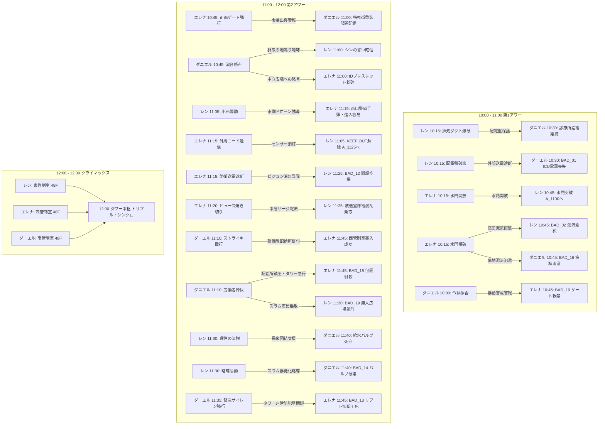
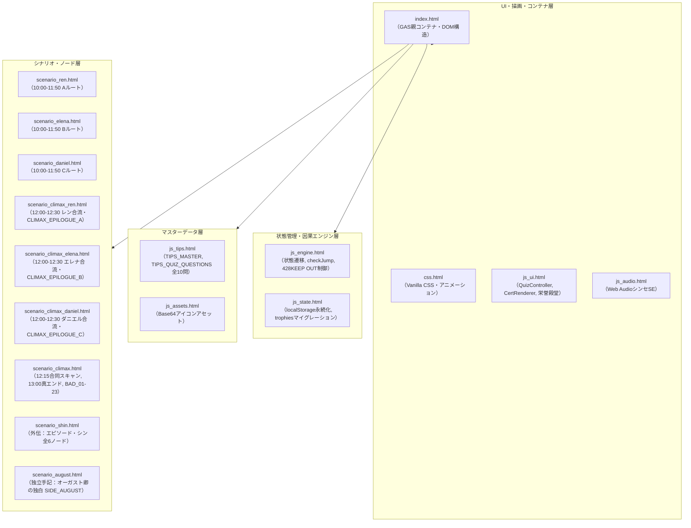
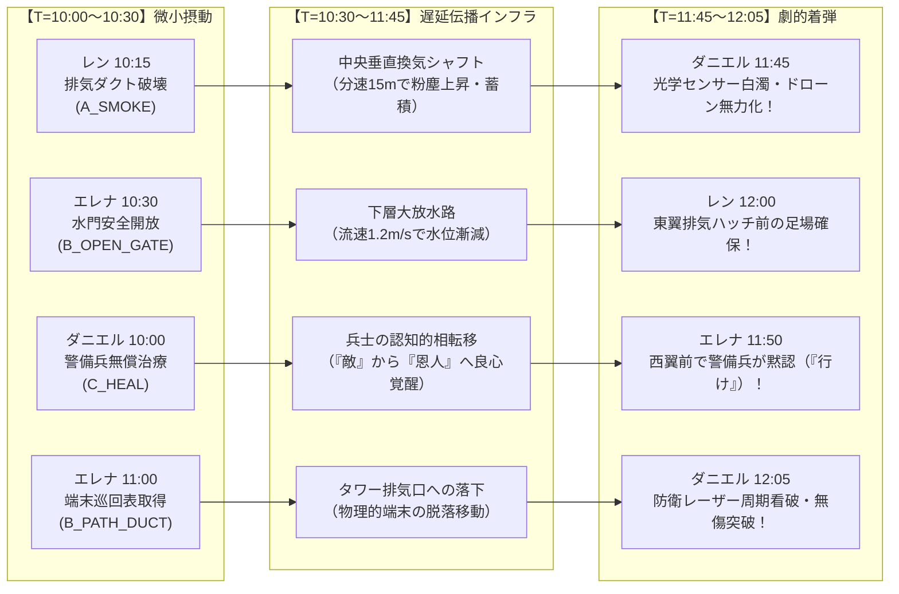
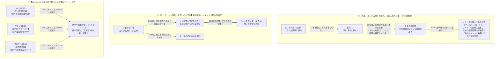
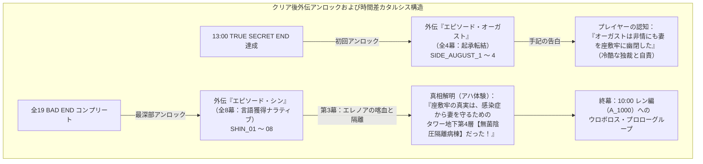

# 『パラレル・ジャパニア：クロニクル』全選択肢・因果波及完全設計仕様書

<document_metadata>
  <title>パラレル・ジャパニア：クロニクル 〜失われた人権の180分〜</title>
  <subtitle>428型因果交錯タイムライン・全選択肢バタフライエフェクト完全マトリクス</subtitle>
  <version>1.4.0</version>
  <status>Official Architecture Specification</status>
  <date>2026-09-08</date>
</document_metadata>

---

## 1. 428型バタフライ・エフェクト設計原則

本作における選択肢は、単なる「その場での主観的行動の分岐」や「ローカルなテキストの変化」にとどまらない。
ある主人公の決断は、都市空間の物理法則（音響伝播・電気配電・水流力学・警備配置）を通じて、**時間差や遠隔地を超えて別の主人公の状況・難易度・心理・生死（BAD END / KEEP OUT）へ波及する「因果の小石（バタフライ・エフェクト）」**として設計される。



---

## 2. 全シナリオ選択肢・因果波及完全マトリクス

### 2.1 シナリオA（レン：自由権）の選択肢と各ルートへの影響

| 時刻・ノード | 選択肢（レンの決断行動） | シナリオA（レン）への影響 | シナリオB（エレナ）への影響 | シナリオC（ダニエル）への影響 |
| :--- | :--- | :--- | :--- | :--- |
| **10:00**<br>`A_1000` | ① 非常用大型レンチで首輪の制御部を一撃で叩き割る！ (`A_BROKE_FORCE`) | 自力で首輪を破壊し、静かに地上検問路地 `A_1015` へ向かう。 | `-`（警報が出ず、エレナは通常通り管理棟へ進める） | `-` |
| **10:00**<br>`A_1000` | ② 構内マイクで「毒ガス発生！全員退避！」と叫んで混乱を起こす！ (`A_PANIC_MIC`) | パニックに乗じて首輪を破壊するが、全区画へ毒ガス警報が誤発報される（`A_1000_MIC` ➔ `A_1015`）。 | **【BAD_11 誘発】** スラム毒ガス誤警報により特権街全域に非常戒厳令が発令。エレナが管理棟前で拘束・自室軟禁される。 | `-` |
| **10:15**<br>`A_1015` | ① 配電盤をショートさせて街路灯を消し、闇に紛れて逃げる (`A_BLACKOUT`) | 闇に紛れて脱出（`A_1030_DARK`）。古遺物（青い泥板）を回収できず、11:45で止血薬不足（BAD_17伏線）。 | `-` | **【BAD_01 誘発】** スラム地下診療所への外部送電が完全遮断。ICUの生命維持装置が停止しレオが心肺停止に陥る。 |
| **10:15**<br>`A_1015` | ② 排気ダクトを破壊し、粉塵爆煙でドローンの赤外線センサーを狂わせる (`A_SMOKE`) | 瓦礫から古遺物【青い泥板（刑事手続記録板・憲法31条）】を発見・回収（真エンド条件 `PIECE_A`）。 | 貴族街の高層テラスに通気ダクトから爆破音と焦げ臭い風が五感ノイズとして届く。 | 配電盤が無傷で守られ、地下診療所の給電が正常維持される（`C_1030_SURVIVE`）。 |
| **10:30**<br>`A_1030` | ① 頑丈そうだ。防弾板として上着の胸元に差し込んで先を急ぐ (`A_TAKE_PLATE`) | 古遺物【青い泥板】を所持（真エンド到達に必須）。 | `-`（12:15合流時に3つの古遺物として共鳴） | `-`（12:15合流時に3つの古遺物として共鳴） |
| **10:30**<br>`A_1030` | ② 余計な荷物は命取りだ。瓦礫を蹴り飛ばし、身軽な体一つで水門へダッシュする (`A_IGNORE_PLATE`) | 古遺物を破棄（通常クリアエンド行き確定）。 | `-` | `-` |
| **10:45**<br>`A_1045` | ① 閉ざされた水門の制御レバーを力任せに引いてみる | エレナの選択（`B_1030`）を照会。正常開放なら脱出（`A_1100`）、爆破ならBAD_02、未操作ならKEEP OUT_A1。 | `-` | `-` |
| **10:45**<br>`A_1045` | ② 水門脇の排水パイプの隙間から脱出できないか強行突破を試みる | エレナの選択（`B_1030`）を照会。正常開放なら脱出（`A_1100`）、爆破ならBAD_02、未操作ならKEEP OUT_A1。 | `-` | `-` |
| **11:00**<br>`A_1100` | ① 検問の死角を突き、高架下の放棄コンテナから警備無線レシーバーを拾って駆け抜ける (`A_HIGHWAY`) | 敵無線の傍受フラグ獲得（`A_TAKE_TRANSCEIVER`）。タワー外周の警備無線の焦燥を察知する。 | `-` | `-` |
| **11:00**<br>`A_1100` | ② 雑居ビルの非常階段を登り、崩れた救護所跡から滅菌包帯と止血薬を拾ってタワー外周へ接近する (`A_ROOFTOP`) | 医療品フラグ獲得（`A_CLEAN_BANDAGE`）。首輪切断創の火照りと出血を応急処置できる。 | `-` | `-` |
| **11:05**<br>`A_1105` | ① センサーの照射周期をじっと監視し、死角を探る (`A_TIMING`) | 息を潜め、レーザーが東へ振れるコンマ数秒の死角を無音で突く（`A_1105_TIMING`）。 | **【東側警戒音なし】** タワー外周のドローンは所定巡回。エレナの11:15進入時に西口に索敵が残る。 | `-` |
| **11:05**<br>`A_1105` | ② ダミーの小石をセンサー網へ投げ込み、反応パターンを試す (`A_PEBBLE`) | 小石を廃ドラム缶へ当て、甲高い金属音でドローンの銃口を一瞬逸らす（`A_1105_PEBBLE`）。 | **【東側陽動】** ドローン群が東側へ急行！ 11:15に西口に着いたエレナの潜入が手薄になり容易に。 | `-` |
| **11:25**<br>`A_1125` | ① 放送室のメインコンソールに直接飛び込み、マイクを握る！ | エレナの選択（`B_1115_NET`）を照会。送電遮断時はBAD_12、正常時は演説準備（`A_1130`）へ。 | `-` | `-` |
| **11:25**<br>`A_1125` | ② 配電盤の外部端子にショートピンを挿し、特区全域の画面を強制同期する！ | エレナの選択（`B_1115_NET`）を照会。送電遮断時はBAD_12、正常時は演説準備（`A_1130`）へ。 | `-` | `-` |
| **11:30**<br>`A_1130` | ① 「恐れるな！ 奪われた自由を取り戻すため理性の声を上げろ！」と叫ぶ (`A_SPEECH_REBEL`) | 理性の演説を行い、全市民が正当な抗議の隊列を組んで立ち上がる。東管制室へ到達可能に。 | `-` | 市民が暴徒化せずダニエルを応援。給水バルブ室を正常死守できる。 |
| **11:30**<br>`A_1130` | ② 「あいつらの物資を奪い取れ！ すべて俺たちのものだ！」と略奪を煽る (`A_SPEECH_RIOT`) | 略奪を扇動し、群衆を暴徒化させる。 | `-` | **【BAD_14 誘発】** 暴徒が配給所を略奪！ ダニエルが守る給水バルブが破壊され患者全滅。 |
| **11:45**<br>`A_1145` | ① 歯を食いしばり、壁に手をついて東管制室へ急ぐ！ | レンの過去選択（`A_1015`）を照会。配電盤破壊（薬品不足）ならBAD_17、煙幕なら東管制室（`A_1150`）へ。 | `-` | `-` |
| **11:45**<br>`A_1145` | ② 首筋を強く押さえ、意識を保ちながら前進する！ | レンの過去選択（`A_1015`）を照会。配電盤破壊（薬品不足）ならBAD_17、煙幕なら東管制室（`A_1150`）へ。 | `-` | `-` |
| **11:50**<br>`A_1150` | ① 東管制端末のスロットにキーを押し込み、防衛電磁砲を安全停止させる！ (`A_KEY_INSERT`) | `A_FREEDOM_DONE` フラグ獲得。<br>**【12:00動的テキスト反映】** レン決戦開始時に「外郭電磁砲が沈黙した静寂の突入」が描写される。 | 12:00合流条件の1ピースを満たす。 | 12:00合流条件の1ピースを満たす。 |
| **11:50**<br>`A_1150` | ② 回線を開き「西と南の管制室、誰かいるか！？」と通信管を叩き割る！ (`A_CALL_VOICE`) | `A_FREEDOM_DONE` フラグ獲得。<br>**【12:00動的テキスト反映】** レン決戦開始時に「回線寸断の火花と電磁ノイズ」が描写される。<br>※エレナ・ダニエルも共に叫び（強行突破）を選んだ場合、★隠しボーナス『タワ吉の憂鬱』が解放！ | 12:00合流条件の1ピースを満たす。 | 12:00合流条件の1ピースを満たす。 |

---

### 2.2 シナリオB（エレナ：平等権）の選択肢と各ルートへの影響

| 時刻・ノード | 選択肢（エレナの決断行動） | シナリオA（レン）への影響 | シナリオB（エレナ）への影響 | シナリオC（ダニエル）への影響 |
| :--- | :--- | :--- | :--- | :--- |
| **10:00**<br>`B_1000` | ① 父の統治端末に侵入し、スラム住民の強制連行データを消去する！ (`B_HACK_LABOR`) | `-` | 屋敷の自室を出て管理棟へ向かう（`B_1015`）。 | `-` |
| **10:00**<br>`B_1000` | ② 屋敷の監視セキュリティをハッキングし、30分間の偽装ループ映像を流す！ (`B_HACK_CAMERA`) | `-` | 屋敷の自室を出て管理棟へ向かう（`B_1015`）。 | `-` |
| **10:15**<br>`B_1015` | ① 水門を一気に開放し、地下水路の水流を安全に逃がす (`B_OPEN_GATE`) | **【水路開放】** 10:45の水門が開き、レンが地上（`A_1100`）へ脱出できる。 | 耐火金庫から古遺物【光学的石板（憲法14条）】を回収（真エンド条件 `PIECE_B`）。 | 地下水路の水位が安定し、低地の診療所への水没被害を防ぐ（`C_1045` へ正常進行）。 |
| **10:15**<br>`B_1015` | ② システムに過負荷をかけて水門を緊急爆破する (`B_BLOW_GATE`) | **【BAD_02 誘発】** 高圧泥流が地下水路を呑み込み、レンが濁流で溺死。 | 水路崩落により **KEEP OUT_B1**（レンの時間軸で因果を書き換えるまで足止め）。 | **【BAD_16 誘発】** 溢れた泥流が地下診療所を襲い、病棟が水没して患者全滅。 |
| **10:30**<br>`B_1030` | ① 表面の幾何学枠……重要な遺物かもしれない。鞄に厳重に収めて脱出する！ (`B_TAKE_PLATE`) | `-`（12:15合流時に3つの古遺物として共鳴） | 古遺物【光学的石板】を所持（真エンド到達に必須）。 | `-`（12:15合流時に3つの古遺物として共鳴） |
| **10:30**<br>`B_1030` | ② かさばる石板は残し、暗号キーが入った小型データチップだけを抜き取って走る！ (`B_IGNORE_PLATE`) | `-` | 古遺物を破棄（通常クリアエンド行き確定）。 | `-` |
| **10:45**<br>`B_1045` | ① 生体IDの通信を敢えて維持し、警備兵の敬礼を受けながら正面ゲートを抜ける！ (`B_GATE_ID`) | `-` | 警備兵の敬礼を受ける特権の屈辱を噛み締めて前進（`B_1045_GATE`）。 | **【配給所へ重装警護隊配備】** 令嬢出奔ログにより、11:00の配給所前に特権街エリート重装隊が増援配備される。 |
| **10:45**<br>`B_1045` | ② IDの追跡電波を完全に切り、壁の排水シャフトを滑り降りて裏道へ抜ける！ (`B_DUCT_STEALTH`) | `-` | 泥水と油煙の暗渠を滑り降り、温室を脱ぎ捨てて脱出（`B_1045_DUCT`）。 | **【配給所は通常警備のみ】** ID途絶で屋敷内捜索となり、配給所は通常警備のみで過剰警戒が回避される。 |
| **11:00**<br>`B_1100` | ① 冷気の吹き出す地下メンテナンス口から、警備員の巡回シフト表を拾ってタワー裏手へ回り込む！ (`B_PATH_DUCT`) | `-` | 巡回シフト表獲得（`B_TAKE_SCHEDULE`）。タワー裏面の警備空白時間を把握。 | `-` |
| **11:00**<br>`B_1100` | ② 労働者用コンテナリフトから、作業員用の難燃性フード付きクロークを羽織って中層へ直行する！ (`B_PATH_LIFT`) | `-` | 難燃性クローク獲得（`B_TAKE_CLOAK`）。赤外線索敵センサーを欺瞞可能に。 | `-` |
| **11:15**<br>`B_1115` | ① 外周センサーの無力化コードを送信し、検問を解除する (`B_CODE_SENT`) | **【検問無力化】** 11:05で足止めされていたレンの目の前でセンサーが消灯し突破可能に（`A_1125` 開放）。 | タワー西側通信デッキへ滑り込む（`B_1120`）。 | `-` |
| **11:15**<br>`B_1115` | ② タワー全体の防衛送電を落とし、センサーごと無力化する (`B_NET_CUT`) | **【BAD_12 誘発】** タワー送電が全遮断！ レンが11:25で街頭ビジョンを使おうとするが画面が真っ暗のまま暴発し市民が空爆される。 | 停電の暗闇の中で管制室へ急ぐ。 | `-` |
| **11:20**<br>`B_1120` | ① 予備ヒューズを焼き切って廊下の照明を落とし、暗闇を駆け抜ける！ (`B_DARK_DASH`) | **【タワー中層サージ電流】** 11:25の街頭ビジョン室で照明が火花を散らし、警備兵がパニックに（`B_1120_FUSE`）。 | 端子盤をショートさせハロゲン灯を爆破。暗黒を疾走。 | `-` |
| **11:20**<br>`B_1120` | ② 通気口の格子を外し、梁の上を静かに伝って管制室へ潜入する！ (`B_CEILING_MOVE`) | 街頭ビジョン室の電気系統は正常。コンソールにクリアな監視映像が映る。 | 天井梁を静かに這い、敵ドローンの頭上を飛び越えて着地（`B_1120_BEAM`）。 | `-` |
| **11:45**<br>`B_1145` | ① 認証スロットのカバーを開け、西管制室へ滑り込む！ (`B_FAST_STANDBY`) | `-` | 西管制室（`B_1150`）へ到達。 | `-` |
| **11:50**<br>`B_1150` | ① エグゼクティブリフトを急上昇させ、50F中央管制チャンバーへ突入する！ (`B_CODE_INPUT`) | 12:00合流条件の1ピースを満たす。 | `B_EQUALITY_DONE` フラグ獲得。<br>**【12:00動的テキスト反映】** エレナ決戦開始時に「エグゼクティブリフトから威風堂々たる降下突入」が描写される。 | 12:00合流条件の1ピースを満たす。 |
| **11:50**<br>`B_1150` | ② 防衛システムを手動切断し、50F西ハッチへ飛び込む！ (`B_CALL_VOICE`) | 12:00合流条件の1ピースを満たす。 | `B_EQUALITY_DONE` フラグ獲得。<br>**【12:00動的テキスト反映】** エレナ決戦開始時に「煤まみれの非常ハッチ蹴破り奇襲」が描写される。<br>※レン・ダニエルも共に叫び（強行突破）を選んだ場合、★隠しボーナス『タワ吉の憂鬱』が解放！ | 12:00合流条件の1ピースを満たす。 |

---

### 2.3 シナリオC（ダニエル：社会権）の選択肢と各ルートへの影響

| 時刻・ノード | 選択肢（ダニエルの決断行動） | シナリオA（レン）への影響 | シナリオB（エレナ）への影響 | シナリオC（ダニエル）への影響 |
| :--- | :--- | :--- | :--- | :--- |
| **10:00**<br>`C_1000` | ① 診療所の予備薬品をすべて警備兵に差し出し、見逃しを請う (`C_BRIBE_POLICE`) | `-` | `-` | 薬品を奪われ、レオの治療薬が尽きる（`C_1015`）。 |
| **10:00**<br>`C_1000` | ② 白衣で立ちはだかり、令状なき診療所への立ち入りを断固拒否する！ (`C_DENY_POLICE`) | `-` | **【BAD_10 誘発】** 警備兵が「スラム医師が暴動扇動」と虚偽無線。特権街ゲートが緊急封鎖されエレナが軟禁。 | 医者の威厳で警備兵を追い払う。 |
| **10:15**<br>`C_1015` | ① 祈る思いで外部電力のメインブレーカーを監視する | `-` | `-` | レンの選択（`A_1015`）を照会。送電遮断ならBAD_01、煙幕なら給電維持（`C_1030_SURVIVE`）。 |
| **10:15**<br>`C_1015` | ② 手動発電クランクのレバーを握りしめ、外部送電の電圧計を見つめる | `-` | `-` | レンの選択（`A_1015`）を照会。送電遮断ならBAD_01、煙幕なら給電維持（`C_1030_SURVIVE`）。 |
| **10:30**<br>`C_1030` | ① 古い刻印……命の遺物だ。肩に担ぎ、薬品補充の直談判へ向かう！ (`C_TAKE_BOX`) | `-`（12:15合流時に3つの古遺物として共鳴） | `-`（12:15合流時に3つの古遺物として共鳴） | 古遺物【白い救護箱（憲法25条）】を所持（真エンド到達に必須 `PIECE_C`）。 |
| **10:30**<br>`C_1030` | ② 救護箱は棚に残し、最小限の応急処置包帯だけをポケットに詰めて広場へ走る！ (`C_IGNORE_BOX`) | `-` | `-` | 古遺物を破棄（通常クリアエンド行き確定）。 |
| **10:45**<br>`C_1045` | ① 広場の演台に立ち「命を諦めるな！ 今こそ団結して要求しよう！」と叫ぶ！ (`C_PODIUM_ROAR`) | **【群衆の地鳴り怒号】** 11:00に水門を出たレンの耳に数百人の叫びが轟き、「みんな戦ってる」と勇気を得る。 | **【中立広場への叫び波及】** 11:00に中立広場に出たエレナに民衆の叫びが届き、ブレスレット粉砕の覚悟を固める。 | 労働者が熱狂し、500人規模の隊列を組んで配給所へ進出（`C_1045_PODIUM`）。 |
| **10:45**<br>`C_1045` | ② 地下工場の班長たちを個別に説得し、組織的な交渉団を結成する！ (`C_LEADER_ORDER`) | 街は不気味な静寂。規則正しい重い足音だけが低く響く。 | 静まり返った街の異様な静けさの中を前進。 | 感情の暴発を抑え、規律ある組織的交渉団として配給所へ進出（`C_1045_LEADER`）。 |
| **11:00**<br>`C_1100` | ① 白衣を風になびかせ、武装警備隊の銃口の正面へ堂々と進み出る！ (`C_APPROACH_FRONT`) | `-` | `-` | 丸腰の医師の威厳に警備隊長が動揺。11:10でゴードンが自ら鉄パイプを落とす（`C_1100_SOLO`）。 |
| **11:00**<br>`C_1100` | ② 労働者全員で腕を組ませ、押し返されない壁を作って対峙する！ (`C_APPROACH_SCRUM`) | **【暴動警報サイレン】** 警備盾列を押し返したことで警備側が危機感を抱き、暴動警報サイレンが鳴り響く。 | **【暴動警報サイレン】** タワー裏面のエレナにも配給所方面の非常サイレン音が届く。 | 盾列を3m押し返す。警備隊が催涙銃を構え極度の緊張に（`C_1100_SCRUM`）。 |
| **11:10**<br>`C_1110` | ① 全員で腕を組み、座り込みストライキを敢行する！ (`C_STRIKE_GO`) | 労働者の団結が守られ、11:30でレンが街頭ビジョン演説を完遂できる。 | 警備部隊が配給所に釘付けになり、11:45でエレナが西管制室へ突入成功。 | 非暴力ストライキで配給所を封鎖し、タワーへ向かう（`C_1135`）。 |
| **11:10**<br>`C_1110` | ② 弾圧を恐れ、労働者たちに解散を促す (`C_SURRENDER`) | **【BAD_19 誘発】** スラム市民が分断・降伏。レンがビジョンを起動しても広場はもぬけの殻で処刑される。 | **【BAD_18 誘発】** 鎮圧を終えた警備隊がタワーへ引き返し、西管制室前のエレナを包囲射殺。 | **【BAD_03 誘発】** 無抵抗で降伏した労働者が首輪で一斉感電処刑される。 |
| **11:35**<br>`C_1135` | ① 救護箱を抱え、警備の目を欺いて地下ダクトを潜り抜ける！ (`C_RUN_SOLO`) | `-` | エレナが乗る中央高速リフトが通常稼働（11:45正常通過）。 | 静かに地下ダクトを抜けて給水室へ向かう（`C_1140`）。 |
| **11:35**<br>`C_1135` | ② サイレンを最大音量で鳴らし、バリケードを強行突破する！ (`C_SIREN_RUSH`) | `-` | **【BAD_13 誘発】** 防犯防壁が緊急閉鎖！ エレナが乗る高速リフトのワイヤーが切断され宙吊り圧死。 | バリケードを突破するが、タワー全体を緊急警戒に陥らせる。 |
| **11:40**<br>`C_1140` | ① 再び閉鎖されないよう、配管の鉄鎖を車輪に巻き付けてロックする！ (`C_LOCK_CHAIN`) | `-` | `-` | スラム全域への給水ラインを物理ロックし、南管制室（`C_1150`）へ。 |
| **11:40**<br>`C_1140` | ② 水圧計の安定を確認し、最上階の南管制室へ駆け上がる！ (`C_RUSH_TOWER`) | `-` | `-` | 水圧計を確認し、南管制室（`C_1150`）へ急行。 |
| **11:50**<br>`C_1150` | ① 南管制スロットにキーを差し込み、生命インフラを永久供給ロックする！ (`C_KEY_INSERT`) | 12:00合流条件の1ピースを満たす。 | 12:00合流条件の1ピースを満たす。 | `C_SOCIAL_DONE` フラグ獲得。<br>**【12:00動的テキスト反映】** ダニエル決戦開始時に「生命インフラ永久供給ロックランプ点灯の確信」が描写される。 |
| **11:50**<br>`C_1150` | ② 回線を開き「東と西の同志たち、こちらは準備完了だ！」と叫ぶ！ (`C_CALL_VOICE`) | 12:00合流条件の1ピースを満たす。 | 12:00合流条件の1ピースを満たす。 | `C_SOCIAL_DONE` フラグ獲得。<br>**【12:00動的テキスト反映】** ダニエル決戦開始時に「胸ポケットのシンの形見の黄金の万年筆への誓約」が描写される。<br>※レン・エレナも共に叫び（強行突破）を選んだ場合、★隠しボーナス『タワ吉の憂鬱』が解放！ |

---

### 2.4 ★ 隠しイースターエッグ・ボーナスシナリオ【タワ吉の憂鬱 〜完全なる粗大ゴミ〜】

| 発生条件（因果の合致） | 発動先ノード | 概要とゲームデザイン的独立性 |
| :--- | :--- | :--- |
| **3人全員が11:50で「力技・叫び突破」を選択**<br>（`A_CALL_VOICE` × `B_CALL_VOICE` × `C_CALL_VOICE`） | `BONUS_TAWAKICHI`<br>（12:00 EXTRA） | **【428エコ吉的コメディ・イースターエッグ】**<br>3人が同時に正規暗号を無視して力技で回線を粉砕したため、タワー主電脳が論理破綻を起こし全統治権限を外部清掃端末へ緊急強制転送。ネコ型全自動清掃ロボット「タワ吉」が起動し、独裁者オーガスト卿を「巨大不燃ゴミ」と誤認して低刺激性シャンプーの純白泡と高速回転モップで徹底洗浄してしまうドタバタ劇。<br><br>**【アンロック・アセスメントと独立性】**<br>本ノードは `isBonus: true, isBadEnd: false` として定義され、全23種類のBAD ENDカウントや本編クリア率、シン編・オーガスト編の解放条件（BAD END 23個読了 / True Secret End読了）とは完全に独立しており、ゲーム進行や実績解除のデッドロックを一切引き起こさない。<br>閲覧後は11:50（レン・エレナ・ダニエルいずれか）の選択肢へ安全に復帰可能。 |

---

## 3. クライマックス（12:00〜13:00）選択肢と結末分岐マトリクス

| 時刻・ノード | 選択肢（3人の合流と決断） | 結果・分岐先 | 教育的・劇的影響 |
| :--- | :--- | :--- | :--- |
| **12:00**<br>`CLIMAX_REN_START` | ① 意識が闇の中へ急速に沈んでいく……（15分間の暗転） (`REN_CAUTIOUS`) | ➔ `CLIMAX_REN_STANDOFF` (12:15) | 10:00首輪破壊の傷口から破傷風が発症し昏倒。ダニエルが抗毒素血清を静脈注射して救護。 |
| **12:00**<br>`CLIMAX_DANIEL_START` | ① 南翼の少年の覚醒を確かめ、東翼生命インフラコンソールへ急行する (`DANIEL_CAUTIOUS`) | ➔ `CLIMAX_DANIEL_STANDOFF` (12:20) | 少年の破傷風強直性痙攣を即座にトリアージ・血清注射。15分間の見守りを経て覚醒確認。 |
| **12:00**<br>`CLIMAX_ELENA_START` | ① 少年の容態を見守りながら、背後の西翼政庁コンソールへ慎重に接近する (`ELENA_CAUTIOUS`) | ➔ `CLIMAX_ELENA_STANDOFF` (12:20) | 敵意のない闇医者の救護行為にスタンガンを下げ、少年の覚醒を見届ける。 |
| **12:15**<br>`CLIMAX_REN_STANDOFF` | ① 恐怖と薬物への疑念を殺し、真鍮のペンダントを強く握る (`REN_HOLD_AMULET`)<br>② 「手ぇ抜いたらブッ殺すぞ！」と威嚇する (`REN_THREATEN`) | ➔ `CLIMAX_REN_DECISION` | ① `FLAG_REN_CALM`（ペンダント握りしめ）➔ エレナの画像記憶照合へ繋がる！<br>② `FLAG_REN_PANIC` |
| **12:20**<br>`CLIMAX_ELENA_STANDOFF` | ① 「……信じてみるわ。あの子を」と覚悟を呟く (`ELENA_MURMUR_RESOLVE`)<br>② 「スラムの暴徒なんて信じられない……」と弱音を呟く (`ELENA_MURMUR_DESPAIR`) | ➔ `CLIMAX_ELENA_DECISION` | ① `FLAG_ELENA_RESOLVE`：画像記憶でペンダント破断面照合 ➔ ダニエルの聴覚へ伝播！<br>② `FLAG_ELENA_DESPAIR` |
| **12:20**<br>`CLIMAX_DANIEL_STANDOFF` | ① シンの金色の万年筆を抜き、ガラスに「3人が同時にキーを押す絵」を描いて掲げる！ (`C_DRAW_PEN`)<br>② シンの万年筆で処方箋の裏に大きく「押せ！」と文字を書き殴り、ガラスへ押し当てる！ (`C_WRITE_WORD`) | ➔ `CLIMAX_DANIEL_DECISION` | ① `C_DRAW_PEN`：絵文字伝達 ➔ レンがシンの万年筆と看取りの先生を認識し毒殺猜疑心が融解！<br>② `C_WRITE_WORD`：文字の伝達 ➔ 文字の読めないレンには伝わらず猜疑心を煽りKEEP OUT/BAD END。 |
| **12:20**<br>`CLIMAX_REN_DECISION` | ① 仲間を信じ、合図に合わせて渾身の力でキーを叩き込む！ (`REN_PRESS`)<br>② 「死んでたまるか！」と恐怖に負けキーから飛び退く！ (`REN_ABORT`) | ➔ `REN_EVAL_PRESS`（`C_DRAW_PEN`通過時）<br>➔ `KEEP_OUT_REN_CLIMAX`（未通過時）<br>➔ `REN_EVAL_ABORT` | ① 3人全員押下で `CLIMAX_CONVERGE_HUB`！<br>※未通過時はダニエルの絵の合図を求めるKEEP OUT。<br>② 押下拒絶により **BAD_06** へ分岐。 |
| **12:30**<br>`CLIMAX_CONVERGE_HUB` | ① 三人が持ち寄った古遺物をスキャナのトレイへ並べ、古代の真実を解読する！ (`START_SCAN`)<br>② 焦って主電源ケーブルを工具で叩き折る！ (`SEVER_CABLE`) | ➔ `CLIMAX_SCAN` (12:35)<br>➔ **BAD_21【逆流した電磁パルス】** | 12:20の同時押し成功により全都市の首輪爆破停止！<br>① 3大古遺物解析へ。<br>② 焦りによる短絡自滅。 |
| **12:35**<br>`CLIMAX_SCAN` | ① 日本国憲法の全章をブロードキャストする最終レバーを展開！<br>② 焦って緊急停止キーを連打する！ (`PANIC_AI`)<br>③ 冷却炉心に飛び込み手動短絡する！ (`SACRIFICE_CORE`)<br>④ 非常排気バルブを最大開放する！ (`OPEN_VENT`) | ➔ `CLIMAX_DECISION`<br>➔ **BAD_09**<br>➔ **BAD_20**<br>➔ **BAD_22** | 憲法第31条（自由権）・第14条（平等権）・第25条（社会権）が完全解凍！<br>②〜④ 各種BAD END。 |
| **12:35**<br>`CLIMAX_DECISION` | ① 疑念を捨て、仲間の目を見て「せーのッ！」で同時に押し込む！ (`TRUST_ALL`)<br>②〜⑤ 各種猜疑心による遅延・説得 | ➔ `CLIMAX_RESOLVE`<br>➔ **BAD_06, 07, 08, 23** | ① **日本国憲法アーカイブ全土送信成功！**<br>②〜⑤ 0.5秒のズレによる各BAD END。 |
| **12:35**<br>`ENDING_BRANCH` | ① 結末の刻を迎える（古遺物の収集状況で分岐） | `PIECE_A`, `PIECE_B`, `PIECE_C` 所持時 ➔ `CLIMAX_EPILOGUE_C` ➔ **TRUE_SECRET_END** (13:00)<br>未所持時 ➔ **NORMAL_CLEAR** (12:30) | **【TRUE_SECRET_END】** 13:00 東京湾の夜明け、新世紀の日本国憲法（全フラグ回収者のみ）。<br>**【NORMAL_CLEAR】** 12:30 三色の光が照らす朝（通常の首輪解放エンド）。 |

---

## 4. フラグ（`slots` / `userFlags`）連携仕様一覧

```javascript
// ==========================================
// 428型因果連携 スロットおよびフラグマスター定義
// ==========================================
const CAUSALITY_SLOTS = {
  // 第1アワー（10:00〜11:00）
  "A_1000": "A_BROKE_FORCE" | "A_PANIC_MIC",     // レン地下工場脱出法 ➔ B_1015 (BAD_11)
  "A_1015": "A_BLACKOUT" | "A_SMOKE",             // レン検問突破法 ➔ C_1015 (BAD_01), A_1145 (BAD_17)
  "A_1030": "A_TAKE_PLATE" | "A_IGNORE_PLATE",   // レン古遺物（PIECE_A）取得判定
  "B_1000": "B_HACK_LABOR" | "B_HACK_CAMERA",     // エレナ屋敷脱出ハック
  "B_1030": "B_OPEN_GATE" | "B_BLOW_GATE",       // エレナ水門操作 ➔ A_1045 (BAD_02), C_1045 (BAD_16)
  "B_1030_ITEM": "B_TAKE_PLATE" | "B_IGNORE_PLATE", // エレナ古遺物（PIECE_B）取得判定
  "C_1000": "C_BRIBE_POLICE" | "C_DENY_POLICE",   // ダニエル令状対応 ➔ B_1045 (BAD_10)
  "C_1030_ITEM": "C_TAKE_BOX" | "C_IGNORE_BOX",   // ダニエル古遺物（PIECE_C）取得判定

  // 第2アワー（11:00〜12:00）
  "B_1045": "B_GATE_ID" | "B_DUCT_STEALTH",       // エレナ境界壁突破 ➔ C_1100 (重装隊配備波及)
  "C_1045": "C_PODIUM_ROAR" | "C_LEADER_ORDER",   // ダニエル演説法 ➔ A_1100, B_1100 (地鳴り怒号波及)
  "A_1100": "A_HIGHWAY" | "A_ROOFTOP",           // レン進路選択（無線傍受 vs 医療品所持）
  "A_1105": "A_TIMING" | "A_PEBBLE",             // レンセンサー突破 ➔ B_1115 (ドローン東側誘導波及)
  "C_1100": "C_APPROACH_FRONT" | "C_APPROACH_SCRUM", // ダニエル配給所対峙 ➔ C_1110 (警報サイレン鳴動波及)
  "B_1115": "B_CODE_SENT" | "B_NET_CUT",         // エレナ検問解除 ➔ A_1105解除, A_1125 (BAD_12)
  "B_1120": "B_DARK_DASH" | "B_CEILING_MOVE",     // エレナ暗闇突破 ➔ A_1125 (中層サージ停電波及)
  "C_1110": "C_STRIKE_GO" | "C_SURRENDER",       // ダニエルストライキ ➔ A_1130 (BAD_19), B_1145 (BAD_18), C_1110 (BAD_03)
  "A_1130": "A_SPEECH_REBEL" | "A_SPEECH_RIOT",   // レン演説扇動 ➔ C_1140 (BAD_14)
  "C_1135": "C_RUN_SOLO" | "C_SIREN_RUSH",       // ダニエル強行突破 ➔ B_1145 (BAD_13)

  // クライマックス（12:00〜12:30）
  "CLIMAX_HUB_ACTION": "START_SCAN" | "SEVER_CABLE", // ➔ BAD_21
  "CLIMAX_SCAN_ACTION": "PANIC_AI" | "SACRIFICE_CORE" | "OPEN_VENT", // ➔ BAD_09, BAD_20, BAD_22
  "CLIMAX_CHOICE": "TRUST_ALL" | "DOUBT_ELENA" | "DOUBT_DANIEL" | "DOUBT_REN" | "TALK_AUGUST", // ➔ BAD_06, BAD_07, BAD_08, BAD_23

  // エピローグ因果交錯（12:30〜13:00）
  "CLIMAX_EPILOGUE_C": "VOW_DISCRIMINATE" | "VOW_SOLIDARITY", // ダニエル誓い ➔ FLAG_DANIEL_VOW (レンKEEP OUT解除条件1)
  "CLIMAX_EPILOGUE_B": "VOW_PURGE" | "VOW_GUIDE_MARTHA",       // エレナ誓い（案A） ➔ FLAG_ELENA_VOW (レンKEEP OUT解除条件2)
  "CLIMAX_EPILOGUE_A": "VOW_REVENGE" | "VOW_TADAIMA_MOM"       // レン最終決断 ➔ TRUE_SECRET_END
};
```

---

## 5. エピローグ（12:30〜13:00）428型3重KEEP OUT因果交錯と演出仕様

### 5.1 エピローグ因果連携構造
クライマックスで首輪解除に成功した後、各主人公がそれぞれのテーマ（生存権・平等権・自由権）に対する最終的な覚悟（VOW）を選択する。ダニエルとエレナの正しい選択が揃って初めて、レンの最終エピローグの **KEEP OUT** が解除される。

```
【12:20 各主人公のエピローグ選択（因果の連動）】
  ├─ ① ダニエル編エピローグ（第1走者：居場所の獲得）：
  │    [スラムの仲間だけを優先し、特権層の患者を拒絶する] ──➔ KEEP OUT（命の選別の温存）
  │    [仲間たちの元へ駆け寄り、「ただいま！」と笑って全市民の生存権を誓う] ➔ JUMP (FLAG_DANIEL_VOW)
  │
  ├─ ② エレナ編エピローグ（第2走者：血脈の祈りとマーサへの導き）：
  │    [父と貴族たちを報復裁判で処刑する冷酷な道を選ぶ] ────➔ KEEP OUT（法の下の平等の崩壊）
  │    [乳母マーサを見つけ、手を取って息子の元へ導く（案A）] ──➔ JUMP (FLAG_ELENA_VOW)
  │
  │    ┌─────────────────────────────────────────────────────────────┐
  │    │ ★ 428型因果ロック解除：                                     │
  │    │ ダニエル (FLAG_DANIEL_VOW) と エレナ (FLAG_ELENA_VOW) の    │
  │    │ 【両方の選択】が成立した瞬間、レン編の KEEP OUT が解除！   │
  │    └─────────────────────────────────────────────────────────────┘
  │                                     │
  └─ ③ レン編最終エピローグ（アンカー：奇跡の結実）：
       [憎しみに任せ、特権の象徴を焼き払う] ──────────────────➔ KEEP OUT（他者拒絶）
       [母の手を取り、「……ただいま、母さん」と魂を込めて応える] ──➔ TRUE_SECRET_END 達成！
```

### 5.2 『……ただいま、母さん』多重共鳴・映画的演出シークエンス（案A確定稿）
1. **ダニエル**: スラムの仲間（レオ、エマ、ゴードン）に頭を掻きながら照れくさそうに笑って言う。  
   `「……ったく、うるせえ連中だな。……ただいま、だ」`  
   ➔ 離れたレンの心に響く：*（『ただいま』……か。帰る場所があって、迎えてくれる誰かがいる。……いいもんだな）*
2. **エレナ**: 万年筆に触れ亡き父母へ誓い、群衆の端で立ち尽くす乳母マーサの手を取る（案A採用）。  
   `「マーサ……！ 見て……！ あなたが……17年間ずっと……祈り続けていた、あなたの————」`  
   **最後の言葉は、広場に沸き起こった大歓声と勝利の鐘の音にかき消される。** だがマーサの視線の先でレンの真鍮の百合が瞬き、マーサはレンへ駆け出す！
3. **レン**: ダニエルがくれた「ただいま」、エレナがくれた「母さん」、そして目の前のマーサの手の温もり。生まれて17年間一度も口にしたことがなく憧れ続けた言葉が、0.8秒の完全無音・中央単独フェードインで浮かび上がる。  
   $$\huge\text{「……ただいま、母さん」}$$
4. **フィナーレ**: マーサがレンを抱きしめ、ダニエルとエレナが微笑み、新世紀の東京湾の朝陽が四人を包み込み、13:00 TRUE_SECRET_END へ進出。

---

## 6. 独立外伝シナリオおよびTIPS動的開示システム

### 6.1 独立外伝モジュール
1. **『外伝：エピソード・シン 〜シンの見た青空〜』(`scenario_shin.html`)**:
   - 解放条件：全23通りのBAD END（BAD_01〜BAD_23）を完全踏破。
   - 内容：1年前に親友レンを生かすために命を捧げた少年シンの真実の前日譚（全6ノード）。
   - 読了特典：『探究の鬼 表彰状』授与。
2. **『オーガスト卿の極秘手記』(`scenario_august.html`)**:
   - 解放条件：真エンド（13:00 TRUE_SECRET_END）到達後、TIPS「オーガスト卿」からJUMP。
   - 内容：冷酷な暴君の仮面の下で新日本国憲法草案を命がけで温存し続けたオーガスト卿の哀しき独白シナリオ。
   - 読了特典：『真実の編纂者 表彰状』授与。

### 6.2 TIPS動的3段階開示システム（事前ネタバレ完全防止）
本編ディストピアサスペンスの緊張感を守るため、TIPS「オーガスト卿」はクリア状況に応じて動的に進化する：
- **第1段階（未クリア時）**: 統制庁長官・立憲主義の教材としての客観的解説のみ（ネタバレ完全ゼロ）。
- **第2段階（1回クリア時：NORMAL_CLEAR到達後）**: 黄色枠「【極秘記録】オーガスト卿の真実」がアンロック。「10:30の3つの古遺物を集め真エンドに到達せよ」という手引きを開示し、周回モチベーションを創出。
- **第3段階（真エンドクリア時：TRUE_SECRET_END到達後）**: 金色枠【オーガスト卿の極秘手記を読む】JUMPボタンが解放され、`SIDE_AUGUST`（`scenario_august.html`）へ直通。

---

## 7. 憲法マスター検定クイズ全10問と5大栄誉表彰状（トロフィー）システム

### 7.1 憲法マスター検定クイズ（全10問）の出題構造
TIPS全19項目を完全解明することで挑戦権が解放される。単なる用語暗記ではなく、TIPSの以下の3要素から100%論理的に導出される本格検定：
1. **💡 本来言いたいこと（本質・概念理解）**: 自由権（国家からの消極的自由）、社会権（国家による積極的自由）、公共の福祉（権利相互の調和ルール）。
2. **📜 条文（law）（正確な条文正誤）**: 第25条第1項（健康で文化的な最低限度の生活）、第14条第1項（差別禁止条項）、第99条（憲法尊重擁護義務）。
3. **🏛️ 探究判例・歴史の知恵（立憲主義・歴史的意義）**: 検閲の絶対禁止（権力腐敗防止）、華族・貴族制度の永久禁止（門地差別撤廃）。
- **仕様**: 全問正解するまで何度でも再挑戦可能。10問全問正解時に最高位ディプロマが授与される。

### 7.2 5大栄誉表彰状（トロフィー・ディプロマ）一覧

| No | トロフィー名 | 称号 | 解放条件 | 栄誉の核心 |
| :---: | :--- | :--- | :--- | :--- |
| **①** | **『人権調和 表彰状』** | 人権の調和者 | **12:30 NORMAL_CLEAR** | 自由・平等・生存を繋ぎ、破滅を回避した調和の証。 |
| **②** | **『新世紀立憲者 表彰状』** | 新世紀の立憲者 | **13:00 TRUE_SECRET_END** | 3つの古遺物を結集し、新世紀の憲法を打ち立てた偉業の証。 |
| **③** | **『探究の鬼 表彰状』** | 探究の鬼 | **全23BAD END踏破 ＆ エピソード・シン読了** | 23の絶望を見届け、シンの魂を受け継いだ不屈の探究の証。 |
| **④** | **『真実の編纂者 表彰状』** | 真実の編纂者 | **オーガスト卿の極秘手記 読了** | 暴君の仮面の下の真実と、歴史の表裏を看破した見識の証。 |
| **⑤** | **『日本国憲法マスター 修了証書』** | 憲法マスター | **全19TIPS解明 ＆ 検定クイズ全10問全問正解** | 三大基本的人権と立憲主義の真髄を極めた最高峰の証。 |

- **UI仕様**:
  - `CertRenderer` により、高解像度1200×840豪華金枠グラデーション賞状をリアルタイムCanvas描画。
  - タイトル画面およびアーカイブ画面の【🏆 栄誉殿堂】モーダルからいつでも閲覧・A4判PDF/PNG保存可能。未獲得賞状はシルエットと解放条件ヒントを表示。

---

## 8. ファイル別完全実装責任・配置マトリクス（Source Code Allocation Matrix）

「どのファイルに、どのオブジェクト・関数・スロット・DOM・演出を配置するのか」を厳密に定義し、コード修正時の責務曖昧化や重複を完全に排除する。



### 8.1 モジュール別・実装要素完全マッピング表

| レイヤー | 対象ファイル | 担当する具体的実装要素（関数・変数・ノード・DOM） | 責務と制約 |
| :--- | :--- | :--- | :--- |
| **データ** | **`js_tips.html`** | ① `TIPS_MASTER`（全19項目）：オーガスト卿含む初期安全テキスト。<br>② `TIPS_QUIZ_QUESTIONS`（全10問配列）：問題文、選択肢3つ、正解インデックス、詳細解説。 | **UIロジックと問題データを分離**。クイズ文言の修正はこのファイルのみで行う。 |
| **ステート** | **`js_state.html`** | ① `TimelineState.init()`: `state.trophies = state.trophies || {}` の安全マイグレーション。<br>② `unlockTrophy(key)`: 5大トロフィー獲得の永続記録。<br>③ `hasClearedOnce()`, `hasClearedTrueEnd()`: クリア判定API。 | 既存セーブデータ破損を防止し、後方互換性を100%保証する。 |
| **エンジン** | **`js_engine.html`** | ① `checkJump(char, time)`: `CLIMAX_EPILOGUE_A` における `!(FLAG_DANIEL_VOW && FLAG_ELENA_VOW)` のKEEP OUT遮断。<br>② JUMP実行時の未来フラグ安全消去処理。<br>③ 0.8秒無音フェードイン（`tadaima` シークエンス）の演出トリガー。 | 428型因果連携の根幹ロジック。シナリオファイル側に直接if文を書かずエンジン経由で制御。 |
| **UI・演出** | **`js_ui.html`** | ① `QuizController`: 全10問クイズ進行、動的問題数バインド、正誤フィードバック、安全リトライ。<br>② `CertRenderer`: 5大賞状のCanvas 1200×840リアルタイム描画、`document.fonts.ready` 待機、PDF/PNG出力。<br>③ `openTipsModal`: TIPSオーガスト卿の動的3段階UI展開（未クリア／裏面史／手記JUMP）。<br>④ `TrophyGallery`: 5大トロフィー一覧モーダルの描画・プレビュー。 | ユーザーインターフェース・演出の全責任。WebFontロード待ちを必ず保証。 |
| **DOM** | **`index.html`** | ① `#modalQuiz`: クイズモーダル（`<span id="quizTotalCount">10</span>` 等の動的枠組み）。<br>② `#modalTrophyGallery`: 栄誉殿堂（トロフィー図鑑）モーダルDOM。<br>③ タイトル・アーカイブ画面の【🏆 栄誉殿堂】呼び出しボタン。<br>④ `scenario_august` 含む全HTMLモジュールのGASインライン読み込み構文。 | GAS HtmlService の親コンテナ。全モーダルの最上位レイヤー（`z-50`）配置。 |
| **シナリオ** | **`scenario_climax_daniel.html`** | ① `CLIMAX_EPILOGUE_C`: ダニエルエピローグノード。<br>② 選択肢 `VOW_SOLIDARITY`（`FLAG_DANIEL_VOW` 発行）/ `VOW_DISCRIMINATE`（KEEP OUT）。 | ダニエルの肉声（「……ただいま、だ」）と生存権の誓約。 |
| **シナリオ** | **`scenario_climax_elena.html`** | ① `CLIMAX_EPILOGUE_B`: エレナエピローグノード（案A）。<br>② 選択肢 `VOW_GUIDE_MARTHA`（`FLAG_ELENA_VOW` 発行）/ `VOW_PURGE`（KEEP OUT）。 | エレナの告白（歓声にかき消される演出）とマーサへの導き。 |
| **シナリオ** | **`scenario_climax_ren.html`** | ① `CLIMAX_EPILOGUE_A`: レン最終エピローグノード。<br>② 選択肢 `VOW_TADAIMA_MOM`（0.8s無音 ➔ `TRUE_SECRET_END`）/ `VOW_REVENGE`（KEEP OUT）。 | 二人のフラグが揃うことでアンロック。真鍮の百合の共鳴と「ただいま、母さん」。 |
| **外伝** | **`scenario_shin.html`** | `SHIN_01_MEMORY` 〜 `SHIN_06_PROLOGUE_LOOP`（全6ノード）。読了時に `unlockTrophy('shinMaster')`。 | 全23BAD END踏破時のみアンロック。 |
| **外伝** | **`scenario_august.html`** | `SIDE_AUGUST`（全1ノード）。読了時に `unlockTrophy('augustMaster')`。 | 真エンドクリア後、TIPS「オーガスト卿」からJUMP可能。 |
| **検証** | **`simulate_all_paths.js`** | 全シナリオ・TIPSマスター・全選択肢リンク・認知境界（DIR_08）の静的解析エンジン。 | シナリオやロジック変更時は必ず実行し、エラー0件を検証する（`DIR_07`）。 |
| **ビルド** | **`build_preview.js`** | GASインライン結合構文をパースし、`local_preview.html` を出力するローカルビルダー。 | 常に最新の完全結合HTMLを生成・出力する。 |

---

## 9. AIエージェント開発時のアンチパターン＆実装ガイドライン（迷い・事故防止の7大鉄則）

AIエージェント（および開発者）が本プロジェクトを改修・拡張する際、誤認・独断・判断停止に陥りやすい重要トラップを「7大鉄則」として明文化する。

### 9.1 【鉄則1：ノードの所属ファイル厳守】
- `CLIMAX_EPILOGUE_A` ➔ 必ず [scenario_climax_ren.html](file:///c:/Users/佐々木篤史/Desktop/pallarerujapania/scenario_climax_ren.html) に配置する。
- `CLIMAX_EPILOGUE_B` ➔ 必ず [scenario_climax_elena.html](file:///c:/Users/佐々木篤史/Desktop/pallarerujapania/scenario_climax_elena.html) に配置する。
- `CLIMAX_EPILOGUE_C` ➔ 必ず [scenario_climax_daniel.html](file:///c:/Users/佐々木篤史/Desktop/pallarerujapania/scenario_climax_daniel.html) に配置する。
- 合同結末 `NORMAL_CLEAR` および `TRUE_SECRET_END` ➔ 必ず [scenario_climax.html](file:///c:/Users/佐々木篤史/Desktop/pallarerujapania/scenario_climax.html) に配置する。
- **🚨 アンチパターン**: 1つのファイルに全エピローグを統合したり、`scenario_ren.html` 等の10時〜11時台の個別ファイルへ逆流させてノード重複・行方不明を起こすこと。

### 9.2 【鉄則2：クイズマスターデータとUI制御の完全分離】
- 全10問の問題データ配列 `TIPS_QUIZ_QUESTIONS` は、必ず [js_tips.html](file:///c:/Users/佐々木篤史/Desktop/pallarerujapania/js_tips.html) 内にマスターデータとして定義する。
- [js_ui.html](file:///c:/Users/佐々木篤史/Desktop/pallarerujapania/js_ui.html) の `QuizController` は、`TIPS_QUIZ_QUESTIONS` を参照して描画・判定を行う純粋なUIコントローラーとする。
- **🚨 アンチパターン**: `js_ui.html` 内に設問文や選択肢を直接ハードコードして二重管理・仕様乖離を引き起こすこと。

### 9.3 【鉄則3：条文番号秘匿（DIR_03）の適用範囲の境界線】
- **本編テキスト（ノベル本文・選択肢文）**: 10:00〜12:15の古遺物スキャン完了までは、「第25条」「第14条」等の条文番号・法律用語の記載は完全禁止。ただし、12:15スキャン完了以降（12:30〜13:00真エンド）は、解凍された真実として条文番号（第97条・第14条等）を堂々と開示・明記しなければならない。
- **TIPSおよび検定クイズ**: 教育用システム・探究アーカイブであるため、**最初から条文番号・判例名の記載は100%許可**（※ただしTIPS「オーガスト卿」の裏面史のみクリア後アンロック）。
- **🚨 アンチパターン**: 12:15以降のクライマックスや真エンドでも条文番号を伏せ続けてカタルシスを殺したり、逆にTIPS側から条文番号を削ってしまうこと。

### 9.4 【鉄則4：二人称「あなた」禁止（DIR_01）の過剰誤検知の防止】
- 禁止対象は**「読者・プレイヤーに向けたメタ的な語りかけ（地の文・システム文）」**のみ（例：「あなたは扉を開けた」「あなたの進むべき道は？」等）。
- **作中キャラクター同士の自然な会話セリフ**（娘エレナが父を呼ぶ「あなた」、エレナがマーサに語りかける「あなたが祈り続けていた……」、妻が夫を呼ぶ「あなた」等）は、キャラクター表現・人間関係として完全に許容される。
- **🚨 アンチパターン**: 作中人物の自然なセリフまで「DIR_01違反」と機械的に過剰検知し、「お前」や「そなた」等に無理やり書き換えてドラマ性を破壊すること。

### 9.5 【鉄則5：タイムリープ時のフラグゾンビ化防止（未来フラグリセット）】
- プレイヤーが過去のタイムライン（例：10:15）へJUMPして選択肢を変更した場合、未来（例：11:30）で立てられていたフラグが消えずに残る「フラグゾンビ化」を絶対に許してはならない。
- JUMP処理（`jumpToNode` / `checkJump`）実行時は、JUMP先ノードより未来の時間軸のスロットフラグを安全に初期化・パージする仕様を維持すること。
- **🚨 アンチパターン**: フラグを単純に `userFlags[flag] = true` で蓄積し続け、過去を変えたのに未来の成功フラグが生き残って因果が矛盾すること。

### 9.6 【鉄則6：ローカルストレージの後方互換性（未定義安全マイグレーション）】
- `state.trophies` などの新設ステートを扱う際は、既存セーブデータからの復元時に必ず初期化ガードを入れること。
  ```javascript
  state.trophies = state.trophies || {};
  ```
- **🚨 アンチパターン**: `state.trophies.quizMaster` と直接参照し、既存プレイヤーの環境で `TypeError: Cannot read properties of undefined` を発生させてゲーム画面をクラッシュさせること。

### 9.7 【鉄則7：シミュレーター（DIR_07）の完全同期義務】
- 新しい因果スロット（`CLIMAX_EPILOGUE_*` 等）や新ファイル（`scenario_august.html` 等）を追加・変更した際は、必ず [simulate_all_paths.js](file:///c:/Users/佐々木篤史/Desktop/pallarerujapania/simulate_all_paths.js) のスロット定義配列および読み込みリストを同時に更新すること。
- 改修後は必ず `node simulate_all_paths.js`（破損リンク0件・DIR_08違反0件）と `node build_preview.js`（プレビュー生成）を実行し、静的検証を100%パスさせること。
- **🚨 アンチパターン**: コードだけ改修してシミュレーターを放置し、CI/CDや次回実行時にビルドエラーで進行不能になること。

---

## 10. ディストピア人権統治構造とTIPS逆照射完全対照マスター定義（世界観崩壊防止の鉄則）

AIエージェントおよびシナリオ執筆者は、本作品が「人権が徹底的に否定・蹂躙された極限のディストピア」であることを片時も忘れてはならない。
作中ディストピア（ネオ・ジャパニア）において、近代憲法が保障する基本的人権は**「一切認められていない」**か、あるいは**「特権階級の支配道具として歪曲・独占されている」**。
ディストピアの作中人物に近代的な参政権や権利が認められているかのような誤った描写（例：「下層区にも議席がある」「労働組合が合法的に交渉している」等）は、世界観を根本から破壊する致命的アンチパターンである。

| No | 権利・項目名 | 本編ノード | 作中ディストピアでの実態（認められていない／剥奪／歪曲の形態） | TIPS逆照射の教育的意義（作中描写から何を学ぶか） | 🚨 厳禁アンチパターン（ストーリー改変による齟齬防止） |
| :--- | :--- | :--- | :--- | :--- | :--- |
| 1 | **身体の自由** | `A_1015` | **完全剥奪**。令状なしの逮捕、電磁首輪による拷問・遠隔処刑、強制労働。 | 31条（適正手続）、33条・35条（令状主義）、36条（拷問禁止）の重みを逆照射。 | 作中当局が適正な逮捕状を提示したり、容疑者に弁解の機会を与える描写。 |
| 2 | **表現の自由** | `A_1130` | **完全剥奪**。言論の事前検閲、反体制言論の即時処刑、通信統制。 | 21条（表現の自由・検閲の禁止）が権力腐敗を正す唯一の武器であることを逆照射。 | 市民が自由にビラを配ったり、SNSや公の場で当局を批判できる描写。 |
| 3 | **法の下の平等** | `B_1000` | **完全否定**。門地・血統による絶対的身分制（特権貴族 vs 下層民）。 | 14条（門地による差別の撤廃と実質的平等）の理念を逆照射。 | 生まれや血統に関係なく実力で平等に出世できるといった描写。 |
| 4 | **生存権** | `C_1000` | **完全剥奪**。「生産性のない者は死ね」という弱肉強食。医療・薬品配給の意図的断絶。 | 25条（健康で文化的な最低限度の生活）が人間的生存の絶対防壁であることを逆照射。 | 当局が無償の医療福祉や生活保護を公正に配給している描写。 |
| 5 | **労働基本権** | `C_1045` | **完全否定**。16時間強制労働、ストライキは内乱罪として即座に武力鎮圧。 | 27条・28条（労働三権）が対等な労使交渉に不可欠であることを逆照射。 | 当局が労働組合を公認し、平和的に団体交渉に応じる描写。 |
| 6 | **公共の福祉** | `A_1130` | **悪用・歪曲**。当局は「治安維持・秩序」を名目に少数者の切り捨て・虐殺を正当化。 | 12条・13条。真の公共の福祉とは「一人ひとりの尊厳を尊重し合う公平な調和」であることを逆照射。 | 単なる「全体の利益のための個人の犠牲」を美談として肯定する描写。 |
| 7 | **一票の格差** | `B_1115` | **完全剥奪**。下層民には参政権・議席など一切存在しない。特権階級の専制独裁。 | 14条・15条・44条。選ぶ権利すら奪われたディストピアを通じ、一票の平等と主権在民を逆照射。 | **下層区に議席が認められている、下層民が選挙で投票している等の描写（絶対厳禁）**。 |
| 8 | **思想・良心の自由** | `B_1000` | **完全剥奪**。反体制思想の摘発、記憶消去電極による自我リセット（BAD_15）。 | 19条（内心の絶対的自由）が侵されない聖域であることを逆照射。 | 当局が個人の内心の自由や異論を寛容に認めている描写。 |
| 9 | **信教の自由と政教分離** | `C_1000` | **完全否定**。国家統合神殿への礼拝強制と公金支出、その他の宗教・信仰は邪教として弾圧。 | 20条・89条。国家が特定教義を強制・援助することの危険性を逆照射。 | 当局が多様な宗教を公認し、信教の自由を尊重している描写。 |
| 10 | **財産権の保障と制約** | `C_1015` | **完全否定**。私有財産の無断接収、生命線である電力や備蓄薬の略奪。 | 29条（正当な補償なき財産侵害の禁止）を逆照射。 | 当局が接収に対して正当な補償金を支払っている描写。 |
| 11 | **幸福追求権とプライバシー** | `B_1045` | **完全侵害**。生体ドローンによる心拍・私生活の常時スキャン、思考ログ監視。 | 13条（新しい人権・肖像権・プライバシー権）の傘としての機能を逆照射。 | 市民に監視の及ばない私的空間やプライバシーが法的に保障されている描写。 |
| 12 | **知る権利と報道の自由** | `A_1130` | **完全封殺**。歴史の改竄、大本営発表のプロパガンダ放送のみ許可。 | 21条（国民の知る権利とマスメディアの取材の自由）の意義を逆照射。 | 当局が公文書を開示したり、独立した報道機関が存在する描写。 |
| 13 | **教育を受ける権利** | `A_1000`<br>`SHIN_01` | **完全剥奪**。義務教育は存在せず、スラムの孤児は文字も教わらず兵器解体や銃の分解を強いられる。 | 26条（等しく教育を受ける権利・学習権）が人間らしく生きる土台であることを逆照射。 | スラムの子どもたちに公立学校や教育機会が無償で提供されている描写。 |
| 14 | **裁判を受ける権利** | `A_1015` | **完全廃止**。裁判所は解体され、執行官による即決処分・密室での無期限拘禁。 | 32条・37条（司法権の独立・公平かつ迅速な公開裁判）の不可欠性を逆照射。 | 拘束された市民が独立した裁判官による公正な公開裁判を受けられる描写。 |
| 15 | **居住・移転および職業選択の自由** | `A_1100` | **完全統制**。区画間の移動禁止、身分による職業の強制割当、無許可越境は射殺。 | 22条（経済的自由・居住移転の自由）を逆照射。 | 市民が自由に住む場所を選んだり、転職・旅行できる描写。 |
| 16 | **憲法尊重擁護義務** | `B_1150` | **完全無視**。為政者自身が「統治者は法を超越する」と豪語し、法を私物化。 | 99条（立憲主義の本質：国家権力を憲法で縛る）を逆照射。 | オーガスト卿や為政者が憲法を遵守し、自らの権力を抑制している描写。 |
| 17 | **最高法規と永久の信託** | `TRUE_END` | **隠蔽・忘却**。かつて存在した憲法は焼却・封印され、国民の記憶から抹消された。 | 97条・98条。人類が血を流して勝ち取った自由の成果と、最高法規性の重みを解凍する。 | 12:15以前の序盤から市民が日本国憲法を周知している描写（DIR_03違反）。 |
| 18 | **国民主権と三権分立** | `B_1145` | **完全崩壊**。主権は統治総裁オーガスト卿にあり、立法・行政・司法を一元独占。 | 前文・41条・65条・76条（権力の抑制と均衡、主権在民）を逆照射。 | 議会や裁判所が総裁の権力を合法的に弾劾・抑制できる描写。 |
| 19 | **オーガスト卿（裏面史）** | `TIPS`<br>`クリア後` | 過去の非常事態（戦争・恐慌）において「秩序と効率」のために自ら憲法を停止させた男。 | 独裁は悪意からだけでなく、「秩序を求める民衆の委任」からも生まれるという歴史の教訓。 | オーガスト卿が最初から単なる快楽殺人鬼・低俗な悪党として描かれること。 |

---

## 11. システム論的・結末逆算型 長距離砲バタフライエフェクト完全マトリクス

### 11.1 全時間帯・全選択肢因果交錯完全マスターマップ（Mermaid鳥瞰図 ＆ 時間帯別完全マトリクス）

#### 11.1.1 全体因果交錯グランドフロー（Mermaid鳥瞰図）
```mermaid
graph TD
    classDef ren fill:#1e3a8a,stroke:#3b82f6,color:#fff;
    classDef elena fill:#831843,stroke:#ec4899,color:#fff;
    classDef daniel fill:#064e3b,stroke:#10b981,color:#fff;
    classDef climax fill:#4c1d95,stroke:#a855f7,color:#fff;
    classDef bad fill:#7f1d1d,stroke:#ef4444,color:#fff;
    classDef endNode fill:#78350f,stroke:#f59e0b,color:#fff;

    subgraph H1["【第1アワー：10:00〜10:45】チュートリアルと因果の初動"]
        A_1000["A: レン 10:00<br/>首輪の火花"]:::ren
        B_1000["B: エレナ 10:00<br/>脱出の鍵"]:::elena
        C_1000["C: ダニエル 10:00<br/>地下の赤ひげ"]:::daniel

        A_1015["A: レン 10:15<br/>暗黒工場脱出"]:::ren
        B_1015["B: エレナ 10:15<br/>水門の選択"]:::elena
        C_1015["C: ダニエル 10:15<br/>停電の病棟"]:::daniel

        A_1030["A: レン 10:30<br/>水没通路の攻防"]:::ren
        B_1030["B: エレナ 10:30<br/>濁流の水門"]:::elena
        C_1030["C: ダニエル 10:30<br/>医療物資捜索"]:::daniel

        A_1045["A: レン 10:45<br/>地上への境界線"]:::ren
        B_1045["B: エレナ 10:45<br/>中層検問所"]:::elena
        C_1045["C: ダニエル 10:45<br/>暴動の足音"]:::daniel
    end

    subgraph H2["【第2アワー：11:00〜11:50】試行錯誤と長距離砲の炸裂"]
        A_1100["A: レン 11:00"]:::ren --> A_1105["A: レン 11:05"]:::ren --> A_1115["A: レン 11:15"]:::ren
        B_1100["B: エレナ 11:00"]:::elena --> B_1115["B: エレナ 11:15"]:::elena --> B_1120["B: エレナ 11:20"]:::elena
        C_1100["C: ダニエル 11:00"]:::daniel --> C_1110["C: ダニエル 11:10<br/>スト決起"]:::daniel --> C_1135["C: ダニエル 11:35"]:::daniel

        A_1130["A: レン 11:30<br/>ビジョンジャック"]:::ren
        B_1130["B: エレナ 11:30<br/>広場突破"]:::elena
        C_1140["C: ダニエル 11:40<br/>南翼搬入"]:::daniel

        A_1145["A: レン 11:45<br/>東翼防衛線"]:::ren
        B_1145["B: エレナ 11:45<br/>西翼突入"]:::elena
        C_1145["C: ダニエル 11:45<br/>南翼生命インフラ"]:::daniel

        A_1150["A: レン 11:50<br/>東翼突入！"]:::ren
        B_1150["B: エレナ 11:50<br/>西翼突入！"]:::elena
        C_1150["C: ダニエル 11:50<br/>南翼突入！"]:::daniel
    end

    subgraph H3["【第3アワー：12:00〜13:00】3翼決戦 ➔ 合流 ➔ 結末"]
        CL_REN["A: レン 12:00〜12:10<br/>東翼決戦"]:::ren
        CL_ELENA["B: エレナ 12:00〜12:10<br/>西翼決戦"]:::elena
        CL_DANIEL["C: ダニエル 12:00〜12:10<br/>南翼決戦"]:::daniel

        HUB["【12:15 三者合流】<br/>古遺物スキャン ＆ 叙述トリック解明"]:::climax
        SYNC["【12:15 最終決断】<br/>3箇所同時押し（せーのッ！）"]:::climax

        EPI_C["12:20 ダニエル誓い"]:::daniel --> EPI_B["12:20 エレナ誓い"]:::elena --> EPI_A["12:25 レン『……ただいま、母さん』"]:::ren

        NORMAL["12:30 NORMAL CLEAR<br/>三色の光が照らす朝"]:::endNode
        TRUE["13:00 TRUE SECRET END<br/>東京湾の夜明け、新世紀の日本国憲法"]:::endNode
    end

    %% 因果波及・バタフライエフェクト
    A_1000 --> A_1015
    A_1015 -.->|停電 A_BLACKOUT| B_1015
    A_1015 ==>>|長距離砲① 粉塵 A_SMOKE| C_1145
    B_1030 ==>>|長距離砲② 水門安全開放 B_OPEN_GATE| A_1030
    B_1030 -.->|爆破 B_BLOW_GATE 鉄砲水| BAD_02["BAD_02 濁流への水葬"]:::bad
    C_1000 ==>>|長距離砲③ 警備兵治療 C_HEAL| B_1150
    C_1000 -.->|拒絶 C_DENY_POLICE| BAD_10["BAD_10 密告者の波紋"]:::bad

    B_1115 -.->|通信妨害 B_NET_CUT失敗| BAD_12["BAD_12 誤爆の赤い広場"]:::bad
    B_1115 -.->|通信妨害成功| A_1115
    C_1110 -.->|スト成功| A_1130
    C_1110 -.->|暴力抗戦| BAD_03["BAD_03 無抵抗の代償"]:::bad

    A_1150 --> CL_REN
    B_1150 --> CL_ELENA
    C_1150 --> CL_DANIEL

    CL_REN & CL_ELENA & CL_DANIEL --> HUB --> SYNC
    SYNC --> EPI_C
    SYNC --> NORMAL
    EPI_A --> TRUE
```

---

#### 11.1.2 時間帯別・全選択肢完全マトリクス表

##### 【第1アワー：10:00〜10:45】

| 時間 | 主人公 | ノードID | シーン名 | プレイヤーの選択肢 | 分岐先（next） | 発行フラグ / 条件判定 | 発生する因果・影響・BAD END |
| :---: | :---: | :---: | :--- | :--- | :--- | :--- | :--- |
| **10:00** | **レン** | `A_1000` | 首輪の火花 | ① 非常用大型レンチで首輪を一撃破壊！<br>② 構内マイクを奪い虚偽警報を叫ぶ！ | ➔ `A_1015`<br>➔ `A_1000_MIC` ➔ `A_1015` | `slot: A_1000`<br>① `A_BROKE_FORCE`<br>② `A_PANIC_MIC` | ① 音を立てず脱出しエレナ10:15安全通過。<br>② 構内毒ガス警報が上層特権街に波及し、**エレナ10:15で `BAD_11【暴走警報と自室軟禁】` を誘発**！ |
| **10:00** | **エレナ** | `B_1000` | 特権の檻 | ① 労務管理サーバーに不正侵入し撹乱！<br>② 監視カメラ網をハッキングし盲点を作る！ | ➔ `B_1015_CHECK_REN`<br>➔ `B_1015_CHECK_REN` | `slot: B_1000`<br>① `B_HACK_LABOR`<br>② `B_HACK_CAMERA` | 選択に応じた脱出状況描写差分（労務改ざんによる追手遅延／カメラループによるドローン欺瞞）が次ノード冒頭に反映。 |
| **10:00** | **ダニエル** | `C_1000` | 地下の赤ひげ | ① 敵味方を問わず無償治療して逃がす！<br>② 「敵の手当てなどできるか！」と拒絶 | ➔ `C_1015`<br>➔ `C_1015` | `slot: C_1000`<br>① `C_HEAL`<br>② `C_DENY_POLICE` | ① **長距離砲③（LR_03）**：兵士の良心覚醒 ➔ 11:50西翼前で警備兵がエレナを見逃す！<br>② 兵士が通報 ➔ 10:45特権街ゲート封鎖により**エレナが拘束され `BAD_10【密告者の波紋】` を誘発**！ |
| **10:15** | **レン** | `A_1015` | 検問ゲートの選択 | ① 配電盤を破壊し工場全域を停電させる！<br>② 排気ダクトを破壊し高濃度粉塵を撒く！ | ➔ `A_1030_DARK`<br>➔ `A_1030_SMOKE` | `slot: A_1015`<br>① `A_BLACKOUT`<br>② `A_SMOKE` | ① スラム外部送電遮断 ➔ **ダニエル10:15で `BAD_01【生命の電源喪失】` を誘発**！<br>② 配電盤保護 ➔ ダニエル10:15救命成功！ さらに**長距離砲①（LR_01）**として11:45南翼のドローンセンサーを粉塵で狂わせる！ |
| **10:15** | **エレナ** | `B_1015_CHECK_REN` | 貴族街のざわめき（判定） | 管理コンソール室の扉を慎重に開ける | ➔ `B_1015`<br>➔ **`BAD_11`** | `checkJump(A_1000)` | レンがマイクを使わず脱出していれば通過！<br>マイク警報（`A_PANIC_MIC`）時 ➔ **`BAD_11【暴走警報と自室軟禁】`** |
| **10:15** | **エレナ** | `B_1015` | 水処理システムの選択 | ① 水門を一気に開放し水流を安全に逃がす！<br>② システム過負荷で水門を緊急爆破する！ | ➔ `B_1030_OPEN`<br>➔ `B_1030_BLOW` | `slot: B_1030`<br>① `B_OPEN_GATE`<br>② `B_BLOW_GATE` | ① **長距離砲②（LR_02）**：水位低下（脱出するレンを目撃） ➔ 12:00レン東翼排気ハッチ足場確保！ 10:30で古遺物【水門マスターキー】取得！<br>② 鉄砲水発生 ➔ 10:30レンが濁流に呑まれ **`BAD_02【濁流への水葬】`**！ エレナは `KEEP_OUT_B1` へ。 |
| **10:15** | **ダニエル** | `C_1015` | 迫る電力危機（判定） | ① 外部電力のメインブレーカーを監視<br>② 手動発電クランクを握り電圧計を注視 | ➔ `C_1030_SURVIVE`<br>➔ **`BAD_01`** | `slot: C_1015_METHOD`<br>`checkJump(A_1015)` | レンが粉塵煙幕（`A_SMOKE`）なら給電維持でレオ救命成功（`C_1030_SURVIVE`）！<br>レンが配電盤遮断（`A_BLACKOUT`）ならICU電源喪失 ➔ **`BAD_01【生命の電源喪失】`**！ |
| **10:30** | **レン** | `A_1030_SMOKE` | 粉塵の煙幕と青い板 | ① 防弾板として胸元に差し込んで先を急ぐ！<br>② 余計な荷物は捨て、身軽にダッシュ！ | ➔ `A_1045_WATERGATE`<br>➔ `A_1045_WATERGATE` | `slot: A_1030`<br>① `A_TAKE_PLATE`<br>② `A_IGNORE_PLATE` | ① **【クリア後限定：古遺物回収（PIECE_A）】** 12:15叙述トリック解明（TRUE END）に必須！<br>② 1周目は身軽に突破し通常クリア（NORMAL CLEAR）へ。※10:15で停電選択時は `A_1030_DARK`。 |
| **10:30** | **エレナ** | `B_1030_OPEN` | 開放された水路と光学的石板 | ① 重要な遺物として鞄に厳重に収めて脱出！<br>② かさばる石板は残しデータチップだけ抜く！ | ➔ `B_1045`<br>➔ `B_1045` | `slot: B_1030_ITEM`<br>① `B_TAKE_PLATE`<br>② `B_IGNORE_PLATE` | ① **古遺物【水門マスターキー】取得（PIECE_B）** ➔ 12:15叙述トリック解明に必須！<br>② 石板未回収。※10:15で爆破（B_BLOW_GATE）選択時は `B_1030_BLOW` ➔ `KEEP_OUT_B1`。 |
| **10:30** | **ダニエル** | `C_1030_SURVIVE` | 給電維持と非常医療箱 | ① 先代の救護箱を肩に担ぎ直談判へ向かう！<br>② 救護箱は残し最小限の包帯だけで走る！ | ➔ `C_1045`<br>➔ `C_1045` | `slot: C_1030_ITEM`<br>① `C_TAKE_BOX`<br>② `C_IGNORE_BOX` | ① **古遺物【旧式救急箱】取得（PIECE_C）** ➔ 11:10ゴードン救護 ＆ 12:15生命維持インフラ正常化に必須！<br>② 救護箱未回収。※10:15でレン停電時は `C_1030_BLACKOUT` ➔ `BAD_01`。 |
| **10:45** | **レン** | `A_1045` | 地上への境界線 | 排気ダクトの金網を蹴破り地上へ出る | ➔ `A_1100` | （自動進行） | 第1アワー突破・第2アワーへ |
| **10:45** | **エレナ** | `B_1045` | 中層検問所 | ① 偽造身分証を堂々と提示する！<br>② 換気ダクトを這って検問をすり抜ける！ | ➔ `B_1100`<br>➔ `B_1100` | `slot: B_1045`<br>① `B_GATE_ID`<br>② `B_DUCT_STEALTH` | 警備ドローンの警戒レベルが変動。 |
| **10:45** | **ダニエル** | `C_1045` | 暴動の足音 | ① 壇上に駆け上がり、理性的な団結を演説！<br>② 工場代表ゴードンに直接呼びかける！ | ➔ `C_1100`<br>➔ `C_1100` | `slot: C_1045`<br>① `C_PODIUM_ROAR`<br>② `C_LEADER_ORDER` | 労働者の暴徒化を抑止。 |

---

##### 【第2アワー：11:00〜11:50】

| 時間 | 主人公 | ノードID | シーン名 | プレイヤーの選択肢 | 分岐先（next） | 発行フラグ / 条件判定 | 発生する因果・影響・BAD END |
| :---: | :---: | :---: | :--- | :--- | :--- | :--- | :--- |
| **11:00** | **レン** | `A_1100` | 追撃のハイウェイ | ① 高速道路の中央分離帯を突破！<br>② ビル屋上のダクトを飛び移り移動！ | ➔ `A_1105`<br>➔ `A_1105` | `slot: A_1100`<br>① `A_HIGHWAY`<br>② `A_ROOFTOP` | 追撃ヘリの捕捉位置が変化。 |
| **11:00** | **エレナ** | `B_1100` | タワー侵入路 | ① ダクト内へ潜入し巡回表を奪取！<br>② 高速昇降リフトに飛び乗り強行突破！ | ➔ `B_1115`<br>➔ `B_1115` | `slot: B_1100`<br>① `B_PATH_DUCT`<br>② `B_PATH_LIFT` | ① **長距離砲④**：巡回表端末が落下しダニエル12:05を救う！ |
| **11:00** | **ダニエル** | `C_1100` | 広場のバリケード | ① 正面からバリケードを突破する！<br>② 労働者のスクラムに合流して押し込む！ | ➔ `C_1110`<br>➔ `C_1110` | `slot: C_1100`<br>① `C_APPROACH_FRONT`<br>② `C_APPROACH_SCRUM` | 鎮圧部隊との衝突強度。広場ですれ違ったエレナを白衣で庇う。 |
| **11:05** | **レン** | `A_1105` | 狙撃手の影 | ① サーチライトの隙を突いてダッシュ！<br>② 瓦礫の小石を投げて陽動する！ | ➔ `A_1115`<br>➔ `A_1115` | `slot: A_1105`<br>① `A_TIMING`<br>② `A_PEBBLE` | 狙撃兵の注意を引きつける。 |
| **11:10** | **ダニエル** | `C_1110` | ストライキ決起 | ① 「ストライキだ！ 武器を捨てて腕を組め！」<br>② 「奪われた武器を取れ！ 武力で迎え撃て！」 | ➔ `C_1135`<br>➔ **`BAD_03`** | `slot: C_1110`<br>① `C_STRIKE_GO`<br>② `C_SURRENDER` | ① 平和的ストライキ継続 ➔ レン11:30を救う！<br>② **BAD_03【無抵抗の代償】**（重機関銃の一斉掃射で全滅） |
| **11:15** | **レン** | `A_1115` | 赤い広場の死線 | 広場を突っ切る（エレナ通信判定） | ➔ `A_1130` / **`BAD_12`** | `checkJump(B_1115)` | エレナが妨害成功（`B_CODE_SENT`）していれば通過！<br>失敗時 ➔ **BAD_12【誤爆の赤い広場】**（ドローン爆撃） |
| **11:15** | **エレナ** | `B_1115` | 通信管制室 | ① 防衛電脳へ暗号無力化コードを送信！<br>② 通信ケーブルを物理的に叩き切る！ | ➔ `B_1120`<br>➔ **`BAD_04`** | `slot: B_1115`<br>① `B_CODE_SENT`<br>② `B_NET_CUT` | ① レン11:15の広場爆撃を無効化！<br>② **BAD_04【特権の檻】**（非常警報作動・完全軟禁） |
| **11:20** | **エレナ** | `B_1120` | 暗闇の疾走 | ① 停電した非常階段を一気に駆け下りる！<br>② 天井の配管梁を伝って移動する！ | ➔ `B_1130`<br>➔ `B_1130` | `slot: B_1120`<br>① `B_DARK_DASH`<br>② `B_CEILING_MOVE` | 追跡部隊の撒き方。 |
| **11:30** | **レン** | `A_1130` | ビジョンジャック | ① 首元の真鍮ペンダントを握り自由を叫ぶ！<br>② 暴動を扇動し「すべてを焼き払え！」と叫ぶ | ➔ `A_1130_CHECK`<br>➔ **`BAD_14`** | `slot: A_1130`<br>① `A_SPEECH_REBEL`<br>② `A_SPEECH_RIOT` | ① ダニエル11:10判定へ。全都市のビジョンが切り替わる！<br>② **BAD_14【暴走した正義の略奪】**（暴徒化して自滅） |
| **11:30** | **レン** | `A_1130_CHECK_DANIEL` | 街頭ビジョンの静寂（ダニエル演説判定） | コンソールのマイクをオンにし街頭ビジョンへ接続！ | ➔ `A_1130` / **`BAD_19`** | `checkJump(C_1045)` | ダニエルが10:45壇上で演説（`C_PODIUM_ROAR`）していれば民衆結集で通過！<br>ゴードン個人の説得（`C_LEADER_ORDER`）だと広場が無人のままでレン射殺 ➔ **BAD_19【静寂の処刑場】** |
| **11:30** | **エレナ** | `B_1130` | タワー直下広場 | 混乱する警備部隊の隙を突いてタワーへ接近 | ➔ `B_1145` | （自動進行） | レンとダニエルの陽動に救われる。回廊のモニターで叫ぶレンの姿を目撃。 |
| **11:35** | **ダニエル** | `C_1135` | 宙吊りの昇降機 | ① 昇降リフトへ単独で飛び乗る！<br>② 救急サイレンを鳴らし救急搬送を偽装！ | ➔ **`BAD_13`**<br>➔ `C_1140` | `slot: C_1135`<br>① `C_RUN_SOLO`<br>② `C_SIREN_RUSH` | ① **BAD_13【密室の宙吊りリフト】**（電源遮断・銃撃網）<br>② 警備の警戒を解いて通過！ スロープで飛び降りてきたレンとニアミス。 |
| **11:40** | **ダニエル** | `C_1140` | 南翼搬入口 | ① 背後の防護シャッターにチェーンを施錠！<br>② 施錠せず、タワー直行通路へ全速疾走！ | ➔ `C_1145`<br>➔ `C_1145` | `slot: C_1140`<br>① `C_LOCK_CHAIN`<br>② `C_RUSH_TOWER` | 追手の突入遅延。 |
| **11:45** | **レン** | `A_1145_CHECK_BOOMERANG` | 首の激痛と呼吸困難（ダニエル判定） | 激痛に耐え、壁に手をついて東管制室へ疾走！ | ➔ `A_1150` / **`BAD_17`** | `checkJump(C_1110)` | ダニエルが11:10ストライキを敢行（`C_STRIKE_GO`）していれば薬品確保で通過！<br>ダニエルがストライキを断念（`C_SURRENDER`）していた場合、薬品が軍に接収され抗毒素血清が届かずレン死亡 ➔ **BAD_17【届かなかった救急箱】**（428型BAD END連鎖） |
| **11:45** | **エレナ** | `B_1145` | 西翼突入 | ① カメラ死角で待機し巡回周期を待つ！<br>② 携帯端末で監視カメラにジャミングをかける！ | ➔ `B_1150`<br>➔ `B_1150` | `slot: B_1145`<br>① `B_FAST_STANDBY`<br>② `B_JAM_CAMERA` | ダニエル判定を経て西管制室へ。 |
| **11:45** | **ダニエル** | `C_1145` | 南翼生命インフラ | （レンの粉塵判定）<br>呼吸器フィルターを締め、煙の中を突入！ | ➔ `C_1150` / **`BAD_18`** | `checkJump(A_1015)` | レンが10:15に粉塵（`A_SMOKE`）を出していればドローン無力化で通過！<br>煙なしなら射殺 ➔ **BAD_18** |
| **11:50** | **レン** | `A_1150` | 東管制室突入 | ① 東翼認証コンソールに合鍵キーを挿入！<br>② アトリウム向かいの二つの光を見つめる！ | ➔ `CLIMAX_REN`<br>➔ `CLIMAX_REN` | `slot: A_1150`<br>① `A_KEY_INSERT`<br>② `A_CALL_VOICE` | ガラス越しに向かいの二つの影を視認。**レン 12:00（東翼決戦）アンロック！** |
| **11:50** | **エレナ** | `B_1150` | 西管制室突入 | （ダニエル治療判定：警備兵804）<br>① 西翼コンソールに解除コードを入力！<br>② アトリウム向かいの二つの光を見つめる！ | ➔ `CLIMAX_ELENA`<br>➔ **`BAD_15`** | `checkJump(C_1000)` | ダニエルが警備兵を治療（`C_HEAL`）していれば警備兵が見逃して通過！<br>治療拒絶なら通報 ➔ **BAD_15【消された自我】** |
| **11:50** | **ダニエル** | `C_1150` | 南管制室突入 | ① 南翼コンソールに緊急停止キーを挿入！<br>② アトリウム向かいの二つの光を見つめる！ | ➔ `CLIMAX_DANIEL`<br>➔ `CLIMAX_DANIEL` | `slot: C_1150`<br>① `C_KEY_INSERT`<br>② `C_CALL_VOICE` | ガラス越しに向かいの二つの影を視認。**ダニエル 12:00（南翼決戦）アンロック！** |

---

##### 【第3アワー：12:00〜13:00】

| 時間 | 主人公 | ノードID | シーン名 | プレイヤーの選択肢 | 分岐先（next） | 発行フラグ / 判定 | 発生する因果・影響・BAD END |
| :---: | :---: | :---: | :--- | :--- | :--- | :--- | :--- |
| **12:00** | **レン** | `CLIMAX_REN_START` | 自由の代償、激突の円形チャンバー | ① 意識が闇の中へ急速に沈んでいく……（15分間の暗転） | ➔ `CLIMAX_REN_STANDOFF` | `REN_CAUTIOUS` | 破傷風による昏倒。ダニエルの抗毒素血清注射により一命を取り留める。 |
| **12:00** | **ダニエル** | `CLIMAX_DANIEL_START` | 白衣の誓約、命の平等の灯火 | ① 南翼の少年の覚醒を確かめ、東翼コンソールへ急行する | ➔ `CLIMAX_DANIEL_STANDOFF` | `DANIEL_CAUTIOUS` | 破傷風の強直性痙攣を即座にトリアージ・血清注射。15分間の脈拍監視。 |
| **12:00** | **エレナ** | `CLIMAX_ELENA_START` | 特権の告発、血脈の交錯 | ① 少年の容態を見守りながら、西翼コンソールへ接近する | ➔ `CLIMAX_ELENA_STANDOFF` | `ELENA_CAUTIOUS` | 医師の真摯な救命を目撃し、少年の覚醒を見守る。 |
| **12:15** | **レン** | `CLIMAX_REN_STANDOFF` | 三分割の罠、囚人のジレンマ | ① 恐怖と疑念を殺し真鍮ペンダントを強く握る<br>② 「手ぇ抜いたらブッ殺すぞ！」と威嚇する | ➔ `CLIMAX_REN_DECISION` | ① `FLAG_REN_CALM`<br>② `FLAG_REN_PANIC` | ① ペンダント握りしめ動作がエレナの画像記憶を刺激！<br>② 威嚇によるパニック伝播。 |
| **12:20** | **エレナ** | `CLIMAX_ELENA_STANDOFF` | 真鍮の百合、思考の乱反射 | ① 「……信じてみるわ。あの子を」と覚悟を呟く<br>② 「スラムの暴徒なんて信じられない……」と呟く | ➔ `CLIMAX_ELENA_DECISION` | ① `FLAG_ELENA_RESOLVE`<br>② `FLAG_ELENA_DESPAIR` | ① **画像記憶（IQ136）**によりペンダント破断面がマーサの物と一致！ 独り言がダニエルの聴覚へ！<br>② 猜疑心BAD導線。 |
| **12:20** | **ダニエル** | `CLIMAX_DANIEL_STANDOFF` | 医師の聴覚、反響する本音 | ① シンの金色の万年筆を抜き、ガラスに「3人が同時にキーを押す絵」を描いて掲げる！<br>② シンの万年筆で処方箋の裏に大きく「押せ！」と文字を書き殴り、ガラスへ押し当てる！ | ➔ `CLIMAX_DANIEL_DECISION` | ① `C_DRAW_PEN` (`FLAG_DANIEL_DRAW_PEN`)<br>② `C_WRITE_WORD` | ① **医師の聴覚**でエレナの呟きを聴取。文字の読めないレンにシンの万年筆で絵を描き合図！<br>② 文字の読めないレンには伝わらず猜疑心を煽る。 |
| **12:20** | **レン** | `CLIMAX_REN_DECISION` | 信じるか、拒絶するか | ① 仲間を信じ、合図に合わせて渾身の力でキーを叩き込む！<br>② 「死んでたまるか！」と恐怖に負け飛び退く！ | ➔ `REN_EVAL_PRESS`<br>➔ `KEEP_OUT_REN_CLIMAX`<br>➔ `REN_EVAL_ABORT` | `checkJump: C_DRAW_PEN`<br>① `FLAG_REN_PRESSED`<br>② `FLAG_REN_ABORTED` | ① **シンの万年筆を見たレンが、11:05のゴードンの回想（看取りの先生）と符合し毒殺猜疑心融解！** 全員押下でクリア！<br>② **BAD_06** へ分岐。 |
| **12:20** | **エレナ** | `CLIMAX_ELENA_DECISION` | 平等の覚悟、運命の押下 | ① 二人を信じ、マスターキーを力強く押し込む！<br>② 「やっぱり信じられない……！」と手を引っ込める | ➔ `ELENA_EVAL_PRESS`<br>➔ `ELENA_EVAL_ABORT` | ① `FLAG_ELENA_PRESSED`<br>② `FLAG_ELENA_ABORTED` | ① 全員押下でクリア！<br>② **BAD_07** へ分岐。 |
| **12:20** | **ダニエル** | `CLIMAX_DANIEL_DECISION` | ヒポクラテスの誓約、運命の押下 | ① 二人を信じ、最終承認キーを渾身の力で押し込む！<br>② 「まさか罠では……！？」と押すのを躊躇する | ➔ `DANIEL_EVAL_PRESS`<br>➔ `DANIEL_EVAL_ABORT` | ① `FLAG_DANIEL_PRESSED`<br>② `FLAG_DANIEL_ABORTED` | ① 全員押下でクリア！<br>② **BAD_08** へ分岐。 |
| **12:30** | **全員合流** | `CLIMAX_CONVERGE_HUB` | 三つの光の結集 / 統治タワー停止 | ① 三人が持ち寄った古遺物3種をスキャナへ並べる！<br>② 焦って主電源ケーブルを工具で叩き折る！ | ➔ `CLIMAX_SCAN`<br>➔ **`BAD_21`** | `slot: CLIMAX_HUB_ACTION`<br>① `START_SCAN`<br>② `SEVER_CABLE` | 12:20同時押し成功により全都市の首輪停止！<br>① **叙述トリック解明へ！**<br>② **BAD_21【逆流した電磁パルス】** |
| **12:35** | **全員** | `CLIMAX_SCAN` | 古遺物スキャン（憲法解凍） | ① 全国への真実開示レバーを展開！<br>② 焦って緊急停止キーを連打する！<br>③ 冷却炉心に飛び込み手動短絡する！<br>④ 非常排気バルブを最大開放する！ | ➔ `CLIMAX_DECISION`<br>➔ **`BAD_09`**<br>➔ **`BAD_20`**<br>➔ **`BAD_22`** | `slot: CLIMAX_SCAN_ACTION`<br>① 正解<br>② BAD_09<br>③ BAD_20<br>④ BAD_22 | ① **3大古遺物がスキャンされ、日本国憲法・三大基本的人権の条文が解凍される！**<br>②〜④ 各種BAD END（暴走・殉教・毒煙） |
| **12:35** | **全員** | `CLIMAX_DECISION` | 憲法データの全土ブロードキャスト認証 | ① 疑念を捨て、目を見て「せーのッ！」で同時に押す！<br>② エレナを警戒しコンマ数秒遅らせる<br>③ ダニエルの震える手を不安に思い指を止める<br>④ レンを武器所持と警戒しキーを離す<br>⑤ オーガスト卿ホログラムの説得を試みる | ➔ `CLIMAX_RESOLVE`<br>➔ **`BAD_06`**<br>➔ **`BAD_07`**<br>➔ **`BAD_08`**<br>➔ **`BAD_23`** | `slot: CLIMAX_CHOICE`<br>① `TRUST_ALL` ➔ `ENDING_BRANCH`<br>② `DOUBT_ELENA`<br>③ `DOUBT_DANIEL`<br>④ `DOUBT_REN`<br>⑤ `TALK_AUGUST` | ① **全土ブロードキャスト起動・新秩序の自己組織化！**<br>② **BAD_06【不信の断絶と残された慟哭】**<br>③ **BAD_07【凍結した決断と裏切られた祈り】**<br>④ **BAD_08【大人の猜疑心と加害の十字架】**<br>⑤ **BAD_23【父祖の道連れトリアージ】** |
| **12:40** | **ダニエル** | `CLIMAX_EPILOGUE_C` | 命の約束 | ① すべての人々の生存権を守り抜くことを誓う！<br>② 特権街への復讐に燃え、スラムだけを優遇する | ➔ `CLIMAX_EPILOGUE_B` (12:45)<br>➔ KEEP OUT (C) | `slot: CLIMAX_EPILOGUE_C`<br>① `VOW_SOLIDARITY`<br>② `VOW_DISCRIMINATE` | ① 社会権の誓い達成 ➔ エレナのエピローグへ！<br>② 復讐の選別医療（KEEP OUT） |
| **12:45** | **エレナ** | `CLIMAX_EPILOGUE_B` | 消えた言葉、届いた想い | ① マーサを見送り、法の下の平等を誓う！<br>② 貴族階級全員を法の手続きなく処刑する | ➔ `CLIMAX_EPILOGUE_A` (12:50)<br>➔ KEEP OUT (B) | `slot: CLIMAX_EPILOGUE_B`<br>① `VOW_GUIDE_MARTHA`<br>② `VOW_PURGE` | ① 平等権の誓い達成 ➔ レンへ！<br>② 憎悪の私刑裁判（KEEP OUT） |
| **12:50** | **レン** | `CLIMAX_EPILOGUE_A` | ……ただいま、母さん | ① 母の温もりを力いっぱい抱きしめる！<br>② 17年間の憎しみに囚われ、手を振り払う | ➔ **`TRUE_SECRET_END`** (13:00)<br>➔ KEEP OUT (A) | `slot: CLIMAX_EPILOGUE_A`<br>① `VOW_TADAIMA_MOM`<br>② `VOW_REVENGE` | マーサとレンの対の真鍮ペンダントが重なり合う。<br>① **13:00【東京湾の夜明け、新世紀の日本国憲法】到達！**<br>② 届かぬ奇跡の絆（KEEP OUT） |
| **12:30** | **全員** | `NORMAL_CLEAR` | 三色の光が照らす朝 | （古遺物スキャン完了後、エピローグ未達成時） | ➔ 通常クリア | （古遺物不揃い時） | 12:30 NORMAL CLEAR（ノーマルエンディング） |
| **13:00** | **全員** | `TRUE_SECRET_END` | 東京湾の夜明け | （3人の誓いが全て揃った至極の結末） | ➔ **真・大団円** | 3大古遺物 ＋ 3人の誓約 | **ネオ・ジャパニアの壁が消え、新世紀の日本国憲法が制定される！** |

---

### 11.2 システム論的因果連鎖の公理（Systems Cybernetics & Non-linear Cascades）
ネオ・ジャパニアは中枢AIアルケーと統治公社によって「誤差0の秩序」を維持する巨大な**閉鎖的自己保存システム（ホメオスタシス）**である。
428型サウンドノベルにおけるバタフライ・エフェクトとは、単なるオカルト的偶然ではなく、**「序盤（10:00〜10:30）の微小な初期値の摂動（Micro-perturbations）が、都市の物理インフラ（空気・水・電力）および人間の認知システムを通じて非線形に増幅（Positive Feedback）され、90分〜120分後の終盤（11:45〜12:05）に劇的な相転移（破局または突破）を引き起こす因果カスケード」**として数理的・構造的に定義される。



---

### 11.3 長距離砲4大バタフライエフェクト完全マトリクス

| 連鎖ID | 発動元ノード ＆ 決断行動 | スロット ＆ フラグ値 | 伝播媒体（システム論的経路） | 遅延時間 | 着弾先ノード ＆ 劇的影響（バタフライ・エフェクト） | 失敗時（逆の選択肢を選んでいた場合）の帰結 |
| :--- | :--- | :--- | :--- | :--- | :--- | :--- |
| **LR_01**<br>【流体・エアロゾル連鎖】 | **レン 10:15**<br>ダクトを叩き割り高濃度粉塵を放出 | `slot: A_1015`<br>`flag: A_SMOKE` | **中央垂直換気シャフト**<br>地下100mの重工業粉塵がファン停止に伴い上昇気流に乗り、上層へ徐々に拡散。 | **約90分後**<br>(10:15 ➔ 11:45) | **ダニエル 11:45**（南翼生命インフラ室）<br>充満した微細粉塵が警備ドローンの高精度光学センサーを白濁させ、照準を完全に狂わせる。ダニエルは被弾せず安全にコンソールへ接近可能。 | `A_BLACKOUT`（停電優先）を選択した場合：<br>煙が発生せずドローンの光学センサーが正常稼働。ダニエルが蜂の巣にされ **BAD_18**（またはKEEP OUT）へ直行。 |
| **LR_02**<br>【水力ポテンシャル連鎖】 | **エレナ 10:30**<br>中央制御盤から水門を安全開放 | `slot: B_1030`<br>`flag: B_OPEN_GATE` | **下層大放水路の水圧調整**<br>水門が緩やかに開き、下水路の水位が毎分8cmのペースで計画的に低下。 | **約90分後**<br>(10:30 ➔ 12:00) | **レン 12:00**（東翼非常排気ハッチ）<br>下層放水路の水位が完全に下がり、レンがタワー東翼の非常排気ハッチへ飛び移るためのコンクリート足場が水没せず露出。無事にタワーへ取り付く。 | `B_BLOW_GATE`（爆破強行）を選択した場合：<br>鉄砲水が発生して足場が水没・粉砕。レンが濁流に呑み込まれて **BAD_02【濁流への水葬】** が確定。 |
| **LR_03**<br>【認知的相転移カスケード】 | **ダニエル 10:00**<br>重傷を負った中層警備兵を無償治療 | `slot: C_1000`<br>`flag: C_HEAL` | **兵士の心理的自己組織化**<br>「スラムのクズは害虫」と刷り込まれていた兵士の心に認知的不協和が発生。「人間としての良心」へ相転移。 | **約110分後**<br>(10:00 ➔ 11:50) | **エレナ 11:50**（西翼管制室直前）<br>治療を受けた兵士（ID: 警備兵804）が西翼の巡回に就いている。侵入したエレナと鉢合わせするが、ダニエルから受けた恩義と手当てを思い出し、武器を下ろして黙認（「……行け、お嬢さん」）。 | `C_DENY_POLICE`（治療拒絶）を選択した場合：<br>兵士が即座に警報を作動させ、応援部隊が西翼を完全包囲。エレナが軟禁・記憶消去され **BAD_15**（または **BAD_04**）へ直行。 |
| **LR_04**<br>【情報エントロピー流出】 | **エレナ 11:00**<br>ダクト内へ潜入し巡回表を奪取 | `slot: B_1100`<br>`flag: B_PATH_DUCT` | **物理的落下と気流搬送**<br>エレナがダクトを這う際、落とした警備シフト端末が垂直シャフトを通って南翼搬入口へ落下。 | **約65分後**<br>(11:00 ➔ 12:05) | **ダニエル 12:05**（南翼管制室アプローチ）<br>ダニエルが足元に転がってきた端末を発見。そこに記録されていた防衛レーザーの掃引周期（3.5秒周期）を看破し、無傷で南翼コンソールへ到達。 | `B_PATH_LIFT`（リフト強行）を選択した場合：<br>端末が落下せず、ダニエルがレーザー周期を読めずに足止め（迂回選択を迫られタイムロス）。 |

---

### 11.4 CHECKノード純化指針と即時フィードバックの徹底

1. **ダミー選択肢の完全排除（CHECKノード純化）**:
   * 他シナリオのフラグを参照してJUMPするCHECKノード（`A_1130_CHECK_DANIEL`, `A_1145_CHECK_BOOMERANG` 等）において、どちらを選んでも同じ関数が呼ばれるダミーの二者択一を廃止する。
   * 「単一の明確かつ決断的なアクションボタン」（例：「街頭ビジョンの回線を強制接続し、全画面へ映像を流す！」「激痛に耐え、東管制室へ最後の疾走を開始する！」）へ整理し、プレイヤーの操作ストレスを排除する。

2. **直前選択に応じた即時フィードバック（描写差分）の導入**:
   * 直前の選択肢で選んだ行動（レンチで殴ったのか、マイクで偽装したのか等）が、次ノードの冒頭テキスト（`function(state)` 動的パラグラフ）に必ず反映されるようにする。
   * これにより、「選択肢を選んだ瞬間の手応え（近距離フィードバック）」と「90分後に炸裂する驚愕（長距離フィードバック）」の二重の快感構造を確立する。

---

### 11.5 段階的交錯サイクル（A➔B➔C➔A）と12:00合流ナラティブ完全仕様

428型サウンドノベルの神髄である「面識のない主人公たちが、知らず知らずのうちに互いの人生をかすめ合い、やがて1つの運命に収斂していく」体験を創出するため、10:00〜12:00の間に以下の3段階リレー式交錯サイクル（A➔B➔C➔A）を配置する。
都市空間仕様書（地理・高度・移動時間）の諸元に100%合致しており、物理的・時間軸的な無理やワープは一切存在しない。

```mermaid
sequenceDiagram
    autonumber
    actor A as 【A】レン（自由権）
    actor B as 【B】エレナ（平等権）
    actor C as 【C】ダニエル（社会権）

    Note over A,B: ①【10:30 水門管理区画（安全開放直後）】
    B->>A: エレナが安全開放した瞬間、水位が下がり、<br/>間一髪で濁流を脱出していく少年の影を目撃！
    Note over A,B: 「よかった、水門を爆破しなくて…！」（倫理的整合）

    Note over B,C: ②【11:00 中央第3広場（雑踏の直接接触）】
    C->>B: 暴動に巻き込まれそうなエレナをダニエルが白衣で庇う！
    Note over B,C: 「ここは危険だ、早く！」（胸元の万年筆が一瞬光る）

    Note over C,A: ③【11:35 タワー搬入路（疾走ニアミス）】
    A->>C: 追手から逃げるレンが、ダニエルの医療カートの前を横切る！
    Note over C,A: 「邪魔だ、どきな！」「待ちなさい、その首の火傷は…！」

    Note over A,B,C: ④【12:00 最上階合流（三者三様のナラティブ）】
    Note over B: エレナ（直観像記憶）：心の中で二人を瞬時に照合！
    Note over A: レン（野生の警戒）：他人の顔は覚えず、武器の脅威度を即座に見極め！
    Note over C: ダニエル（医師の庇護）：少年の首の火傷を認識し、暴発を止める！
```

#### 11.5.1 段階的交錯の3大シーン詳細定義
1. **交錯①【10:30 A（レン） ⇔ B（エレナ）】水門管理区画（安全開放直後）**:
   * **位置諸元**: エレナ（地上0m操作室） ⇔ レン（地下10m主放水路）。操作室床面の強化グレーチング（鉄格子）越しに直下の水路が見える。
   * **状況と倫理的配慮**:
     * エレナが慎重に手動バルブを開き、水位が徐々に低下した直後、床下の鉄格子越しに**「水が引いたおかげで、足場を蹴って間一髪で濁流を脱出していく少年の影（レン）」**が一瞬視認できる。
     * エレナの心理: `「あの子……！ よかった、水門を爆破しなくて……！ 爆破していたら、あの子は今頃濁流に呑まれていたわ……！」`
     * ※爆破（`B_BLOW_GATE`）を選んだ場合は、下を確認せず焦って爆薬を作動させてしまい、結果としてレンが巻き込まれてBAD_02になる（エレナの意図せぬ過失として描かれ、サイコパス化を防ぐ）。
2. **交錯②【11:00 B（エレナ） ⇔ C（ダニエル）】中央第3広場（雑踏の直接接触）**:
   * **位置諸元**: 中央第3中立広場（地上±0m、配給所前）。水平距離0m（直接接触）。
   * **状況**: 変装して広場を通り抜けようとするエレナが、興奮した労働者の暴動に巻き込まれそうになる。そこへ白衣のダニエルが割って入り、エレナを抱きとめて路地へ逃がす。
   * **効果**: ダニエルが「ここは危険だ、お逃げなさい！」と声をかける。去り際、ダニエルの白衣の胸ポケットに差してある金細工の万年筆が朝陽を受けて一瞬光り、エレナが「えっ……？ 今の、母の……！？」と息を呑む伏線が提示される。
3. **交錯③【11:35 C（ダニエル） ⇔ A（レン）】タワー搬入路（疾走ニアミス）**:
   * **位置諸元**: 中央タワー南口・物資搬入スロープ（地上+5m）。
   * **状況**: サイレンを鳴らしてタワーへ突入するダニエルの医療カートの前を、頭上の非常階段から飛び降りてきたレンがボンネットを滑るように横切る。
   * **効果**: レンが「邪魔だ、どきやがれッ！」と鉄パイプを構えて睨み、ダニエルが「待ちなさい君、その首の火傷は……！」と呼びかけるが、レンは弾丸のように東棟へ消える。ダニエルは少年の無茶な生命力と傷の深さに胸を痛める。

#### 11.5.2 12:00合流時の「引き算の美学」と視点別ナラティブ設計
12:00にタワー最上階スカイコマンドデッキへ三方向から踏み込んだ際、**「口に出して全員で語り合う」ことは完全厳禁（説明過多・不自然の防止）**とする。
過酷な逃走の極限状態で全員が都合よく他人の顔を覚えているはずがない。それぞれのキャラクターの知性・特性・職業倫理に応じた**「視点ごとの独自のナラティブ（地の文）」**として描写を書き分ける。

| 主人公 / シナリオ | 個別特性・認知フィルター | 突入の瞬間の知覚と心理描写（地の文の核） | 発するセリフ |
| :--- | :--- | :--- | :--- |
| **エレナ**<br>(`scenario_elena.html`) | **IQ145・直観像記憶（アイデティック・メモリー）**<br>一度見た光景・人物の顔を写真のように脳内に焼き付け瞬時に照合できる。 | 網膜に飛び込んだ二人の姿から、**「10:30に水門の底で見た少年」**と**「11:00に広場の暴動から庇ってくれた医師」**の映像が脳内で光速で符合。「二人とも、生きてここまで辿り着いたの……！？」と内心で深く確信する。 | 口には出さず、息を呑んで端末に向き直る。 |
| **レン**<br>(`scenario_ren.html`) | **野生のサバイバル本能・敵愾心**<br>生き延びることに必死であり、他人の顔などいちいち記憶していない。 | 扉を蹴破り、武器を構えて全身の毛穴を逆立てる。「敵の手先か！？」と警戒するが、少女の銃口が自分に向いておらず、男も両手を広げて争う気がないことを見抜く。「邪魔しないなら背中は預ける」と判断。 | 「チッ……なんだ、敵の手先じゃねえのか」 |
| **ダニエル**<br>(`scenario_daniel.html`) | **医師のトリアージ・庇護の倫理**<br>若者たちの命と怪我を真っ先に観察し、惨劇を防ごうとする。 | 少年の首元の引きちぎられた首輪の火傷痕を見て、**「さっきタワー搬入路で車を飛び越えていった無茶な少年だ！」**と気づく。青ざめた少女と少年の間に割って入り、極限状態の子どもたちを守ろうとする。 | 「落ち着きなさい、武器を降ろすんだ。私は医師だ。敵じゃない」 |

---

### 11.6 万年筆・真鍮ペンダント・古遺物3種の宿命的因果連鎖マスター定義

本作におけるキーアイテム群の来歴と役割を以下のように完全固定し、設定のブレや齟齬を根絶する。



1. **エレノア（エレナ実母、享年34）の万年筆**:
   * 8年前にスラム外縁の廃屋で、文字を教えた孤児シンへ百合の万年筆を授与 ➔ シンは8年間胸のボロ布に抱いて生き抜く。
   * 1年前、脱走計画でレンの身代わりとして囮となり、首輪が爆発。ゴードンに背負われダニエルの診療所へ運ばれる。
   * シンは息を引き取る直前、白衣を掴んで**「先生……絵を描くのが……好きだったろ……。この……ペンを……預かってくれ……。いつかオレたちの言葉を……取り戻す日まで……」**と託し、人間としての尊厳を全うして絶命。
   * ダニエルはその生きた魂の証として万年筆を引き取り、白衣の胸ポケットに差し続けてきた。
   * 12:20の同時押し局面において、文字の読めないレンに対しダニエルが万年筆を抜いて仕切りガラスに「3人が同時にキーを押す絵」を描く。レンはその絵と金色の万年筆を目撃し、11:05のゴードンの回想（シンを看取り万年筆を預かった地下の医者の先生）と符合して注射への毒殺猜疑心を融解させ、ダニエルを信じる確信を得る。
   * ※この真相は、クリア後に解放される外伝『エピソード・シン（`scenario_shin.html`）』で完全に解き明かされる。
2. **レンの回想におけるシンの死因描写（完全統一）**:
   * 「肉片と化した」という非現実的な誇張を排除し、**「首輪が火花を散らして爆発し、首筋を血に染めて倒れたあいつ」** に統一。これにより、ダニエルの診療所に運び込まれて看取られたタイムラインと完璧に合致させる。
3. **マーサ（レン実母）の対の真鍮ペンダント**:
   * 17年前、身分法で引き裂かれた我が子（レン）の首にマーサがかけ、マーサ自身も片割れを持ち続けた。
   * 12:05にエレナがレンの首元のペンダントを見て「マーサが夜ごと祈っていたものと同じだ」と気づき、12:25のエピローグでマーサとレンが「……ただいま、母さん」と抱き合う。
4. **10:30の3大古遺物（レリック）**:
   * レン（青い防弾鉄板：旧道路標識）＋ エレナ（水門マスターキー）＋ ダニエル（旧式救急箱）。
   * 12:15のスキャナに装填されるのはこの3点であり、これによって「ネオ・ジャパニア＝かつての東京」の封印が解かれ、日本国憲法が解凍される。

---

## 12. クリア後外伝シナリオ（エピソード・オーガスト ＆ エピソード・シン）解放・因果連鎖マスター定義

本編クリア後にアンロックされる2大外伝シナリオは、単なる番外編ではなく、本編の全伏線とテーマ（基本的人権・統治のジレンマ）を完成させる「最終解答編」として設計されている。



### 12.1 外伝各章のノード仕様・タイムライン対照表

| ファイル名 | ノードID | 時代・時間軸 | 視点 / 舞台 | 因果・テーマ的役割 | 読了後遷移 |
| :--- | :--- | :--- | :--- | :--- | :--- |
| **`scenario_august.html`**<br>（エピソード・オーガスト） | `SIDE_AUGUST` | 本編直後 (EXTRA) | エレナ / 50F執務室 | プロローグ：父の銀時計とデータチップの発見 | `SIDE_AUGUST_1` |
| 〃 | `SIDE_AUGUST_1` | 30年前・青年期 | オーガスト手記 | 【起】旧時代密閉書庫での日本国憲法発見と平等の光 | `SIDE_AUGUST_2` |
| 〃 | `SIDE_AUGUST_2` | 30年前・総裁継承 | オーガスト手記 | 【承】食料自給率12%の絶望と『基底保全区』1,150kcalの数理 | `SIDE_AUGUST_3` |
| 〃 | `SIDE_AUGUST_3` | 18年前〜5年前 | オーガスト手記 | 【転】娘エレナ誕生、妻エレノアの隔離（防護ガラス越しの微笑みと座敷牢） | `SIDE_AUGUST_4` |
| 〃 | `SIDE_AUGUST_4` | 本編直後 (EXTRA) | オーガスト ➔ エレナ | 【結】悪魔の遺言、そしてエレナによる主権者たちの夜明けの誓い | `returnChart` |
| **`scenario_shin.html`**<br>（エピソード・シン） | `SHIN_01_MEMORY` | 8年前・春 (12歳) | シン / スラム外縁廃屋 | 【第1幕】名前のない野良犬と、エレノアによる命名（命の真ん中の音） | `SHIN_02_EDUCATION` |
| 〃 | `SHIN_02_EDUCATION` | 8年前・初夏 | シン / スラム外縁廃屋 | 【第2幕】泥の上の文字（音の形化）と奇跡の2ヶ月、教育を受ける権利 | `SHIN_03_PARTING` |
| 〃 | `SHIN_03_PARTING` | 8年前・夏 | シン / スラム外縁廃屋 | 【第3幕】エレノアの喀血、百合の万年筆の授与、オーガストの隔離怒号 | `SHIN_04_MEETING` |
| 〃 | `SHIN_04_MEETING` | 1年前・秋 (19歳) | シン / 地下軍需工場 | 【第4幕】16歳のレンとの出会い、干しネズミの分かち合い（人間である証） | `SHIN_05_ESCAPE` |
| 〃 | `SHIN_05_ESCAPE` | 1年前・雨の夜 | シン / 地上連絡ダクト | 【第5幕】脱走の夜、サーチライトの前へ自ら飛び出す必然の囮 | `SHIN_06_EXECUTION` |
| 〃 | `SHIN_06_EXECUTION` | 1年前・雨の夜 | シン / 処刑広場 | 【第6幕】首輪自爆、泥水の微笑み、ゴードン巨漢による救出疾走 | `SHIN_07_CLINIC` |
| 〃 | `SHIN_07_CLINIC` | 1年前・深夜 | シン / 地下診療所 | 【第7幕】ダニエル医師への万年筆信託（絵画への言及）と人間の尊厳の看取り | `SHIN_08_PROLOGUE_LOOP` |
| 〃 | `SHIN_08_PROLOGUE_LOOP` | 1年前 ➔ 現在 | シン ➔ レン | 【終幕】365日の冷たい夜を越え、10:00レン編『A_1000』へのダイレクト接続 | `returnChart` |

