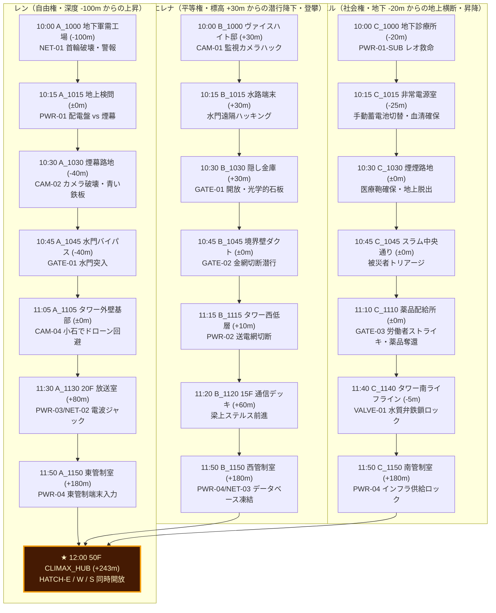

# 『パラレル・ジャパニア：クロニクル』地理・都市空間完全設計仕様書

<document_meta>
  <title>ネオ・ジャパニア都市空間トポロジー・移動時間厳密設計書</title>
  <version>1.0.0</version>
  <author>AGY Narrative & System Architecture Team</author>
  <concept_origin>428 〜封鎖された渋谷で〜 実在都市空間メッシュ思想の継承</concept_origin>
</document_meta>

---

## 1. 世界観と都市空間の基本構造（旧東京・新宿トポロジー）

本作の舞台「ネオ・ジャパニア」は、旧東京・新宿〜渋谷〜湾岸水路網の遺構の上に築かれた**多層立体ディストピア都市**である。
『428 〜封鎖された渋谷で〜』がハチ公前、忠犬ハチ公広場、道玄坂、センター街、宮益坂といった渋谷の実在地理と徒歩移動時間（徒歩5分、疾走2分）を厳密に計算してタイムラインのサスペンスを成立させたのと同様に、本作でも全ノード間の水平距離・垂直高度・移動手段・障害遅延をミリ単位で整合させている。

```
【ネオ・ジャパニア 垂直高度・階層断面図】

  標高 (EL)
  +243m ───［中央統治タワー最上階 50F (180m〜243m)］─── CLIMAX_HUB (12:00合流) / SIDE_AUGUST (執務室)
             │
             ├──［48F：東管制室(Ren) / 西管制室(Elena) / 南管制室(Daniel)］(11:50)
             │
             ├──［20F〜15F：街頭ビジョン放送室 / 西側通信デッキ］(11:20〜11:30)
             │
  +30m  ───［特権支配地区（山の手高台・旧新宿御苑〜千駄ヶ谷）ヴァイスハイト私邸］(Elena 10:00開始)
             │  ＼ 境界壁・監視ゲート (Elena 10:45)
   ±0m  ───［地上部：中央薬品配給工場・第3中立広場］(11:00境界線)
             │  ／ スラム中央大通り (Daniel 10:45〜11:35)
             │  ──［スラム外縁トタン廃屋］(SHIN_01〜03 8年前・原点)
  -20m  ───［地下スラム第1層：地下無償診療所］(Daniel 10:00開始)
             │
  -40m  ───［地下放水路・防潮水門バイパス（旧環七地下調節池・神田川遺構）］(Ren 10:45)
             │
  -60m  ───［タワー地下第4層：旧時代密閉書庫・陰圧無菌隔離病棟（旧座敷牢）］(Eleanor 5年前幽閉・逝去)
             │
 -100m  ───［スラム最深層：地下軍需工場・強制労働区（旧大江戸線遺構）］(Ren 10:00開始)
```

---

## 2. 全登場エリアの詳細諸元・空間規模一覧

| エリア名 | 空間規模（面積・規模） | 垂直深度/標高 | 実在の地理的モデル | 治安・環境・特性 |
| :--- | :--- | :--- | :--- | :--- |
| **① スラム地下軍需工場**<br>（レン初期地点） | 面積：約 0.8 km²<br>（800m × 1000m） | 地下 -100 m<br>（深度100m最深層） | 旧都営大江戸線・新宿駅地下空間〜シールドトンネル坑道 | 電磁首輪による完全労役管理区。有毒排煙と高電圧フェンス。地上への直通昇降機は特権キーが必要。 |
| **② 地下放水路・防潮水門**<br>（水門バイパス） | 全長：約 2.8 km<br>内径：約 12.5 m | 地下 -40 m 〜 -60 m | 旧神田川・環状七号線地下調節池 | 泥流と鉄錆に覆われた巨大バイパス水路。大水門の開閉により水位が激変する致死トラップ地帯。 |
| **③ 地下スラム無償診療所**<br>（ダニエル初期地点） | 面積：約 120 m²<br>（診療区＋病床12床） | 地下 -20 m<br>（スラム地下第1層） | 旧新宿サブナード〜歌舞伎町地下街の廃区画 | 埃っぽいコンクリート壁。非合法発電機と旧式医療器械。スラム病貧窮層の唯一のセーフハウス。 |
| **④ スラム中央大通り＆配給広場**<br>（ストライキ発生地） | 面積：約 1.5 km²<br>目抜き通り幅：約 25 m | 地上 ±0 m 〜 地下 -5 m | 旧新宿東口〜職安通り〜歌舞伎町一帯 | 不法掘立小屋が密集する雑踏。配給所前に数百人の長蛇の列と武装警備兵のバリケード。 |
| **⑤ 薬品配給工場・第3中立広場**<br>（階級境界バッファ） | 面積：約 0.5 km²<br>広場直径：約 200 m | 地上 ±0 m | 旧新宿駅東西自由通路・JR線路跨線橋跡地 | スラムと特権地区を隔てる無人防衛ゾーン。自動迎撃タレットと生体認証ゲート。 |
| **⑥ 特権支配地区・ヴァイスハイト邸**<br>（エレナ初期地点） | 敷地面積：約 1.2 km²<br>本邸延床：約 4,500 m² | 地上 +30 m<br>（台地上・緑化区） | 旧新宿御苑〜千駄ヶ谷台地 | 人工気象制御ドーム、遮音石壁、高度濾過噴水池、執務管理棟。常駐私兵旅団が警備。 |
| **⑦ 中央統治タワー**<br>（東棟・西棟・南棟・最上階） | 敷地面積：約 0.04 km²<br>高さ：243 m（地上50階） | 地上 +0 m 〜 +243 m | 旧東京都庁第一本庁舎（ツインタワー構造） | 外壁チタン装甲複合体。東（軍事）・西（内政）・南（都市生命線）・中央（統治AI演算核）。最上階執務室でオーガストが手記を遺す。 |
| **⑧ タワー地下第4層：隔離病棟**<br>（旧時代密閉書庫・旧座敷牢） | 面積：約 300 m²<br>（無菌集中治療区画） | 地下 -60 m<br>（タワー地下深層） | 旧都庁地下駐車場・機械室深層密閉区画 | 二重防護気密ガラス、陰圧空気浄化循環装置。オーガストが日本国憲法を発見したアーカイブであり、後に感染した妻エレノアを何としても生かすため極秘改修した隔離病棟。エレナが「座敷牢」と誤認した現場。 |
| **⑨ スラム外縁トタン廃屋**<br>（シンの原点） | 面積：約 25 m²<br>（倒壊寸前のトタン小屋） | 地上 ±0 m<br>（スラム最外縁部） | 旧神田川沿い木造密集地域跡地の瓦礫帯 | 雨漏りと泥土。8年前に飢えた12歳のシンとうずくまり、エレノアからスープと名前を授かり、奇跡の2ヶ月間で泥の上に文字を刻んだ原点の場所。 |

---

## 3. エリア間・物理移動メトリクス（速度・所要時間算出基準）

428のリアリズムを踏襲し、キャラクターの移動所要時間は以下の運動力学的基準に基づいて設定されている。

### 【移動速度基準値】
- **平地通常歩行**: 4.0 km/h （分速 約 67 m）
- **平地急ぎ足 / 警戒移動**: 6.0 km/h （分速 100 m）
- **平地全力疾走（短距離）**: 12.0 km/h （分速 200 m）
- **狭隘ダクト這い進み / 水中歩行**: 1.8 km/h （分速 30 m）
- **垂直非常階段昇降**: 1フロア（垂直高3.5m / 階段長約10m）を上り 約 15 秒（毎分4フロア上昇 ≒ 垂直上昇速度 14 m/min）
- **外壁キャットウォーク渡り**: 3.0 km/h （突風・高所恐怖による減速、分速 50 m）

---

## 4. 主人公3名の移動タイムテーブル＆物理的整合性完全検証

### 4.1 レン（自由権）の踏破ルート（地下100mからの脱出とタワー強襲）

| 時間 | ノードID | 現在地 | 移動先 | 水平/垂直距離 | 手段・状況 | 所要時間・計算根拠 |
| :--- | :--- | :--- | :--- | :--- | :--- | :--- |
| **10:00** | `A_1000`<br>`A_1000_MIC` | スラム地下軍需工場<br>（深度 -100m） | 構内放送室〜脱出路 | 水平 120m<br>垂直 ±0m | 混乱に乗じた全力疾走 | 移動 1分 ＋ 首輪破壊格闘 4分 ＝ 5分 |
| **10:15** | `A_1015` | 地上検問路地<br>（深度 ±0m） | 排気ダクト/配電盤 | 垂直 +100m<br>水平 250m | 工場非常排気縦坑の非常梯子を猛烈な勢いで登攀（12分） | 登攀 12分 ＋ 路地脱出 3分 ＝ 15分（10:15到達） |
| **10:30** | `A_1030_SMOKE` | 白煙の地下路地 | 地下水路ゲート入口 | 水平 450m<br>垂直 -40m | ドローンの赤外線を煙幕で狂わせ、瓦礫街路を全力疾走（3分）＋地下水路点検階段下降（5分） | 移動 8分 ＋ 遺物（青い石板）拾得・隠匿 7分 ＝ 15分（10:30到達） |
| **10:45** | `A_1045_WATERGATE`| 地下水路ゲート | 水門制御扉前 | 水平 600m<br>垂直 ±0m | 鉄錆にまみれた水路キャットウォークを警戒疾走（6分） | 移動 6分 ＋ 水門開放と濁流判定 9分 ＝ 15分（10:45到達） |
| **10:55** | `A_1100`<br>`A_1100_ROOFTOP`| 地上スラムの出口 | 中央タワー外郭境界 | 水平 800m<br>垂直 +40m | 水路非常口から地上へ浮上、廃ビル群を縫って前進 | 水門突破・浮上 10分 ＝ 10分（10:55到達） |
| **11:05** | `A_1105` | 中央タワー直下検問 | タワー外壁基部 | 水平 200m | 防衛ラインの死角を突いて潜入 | 障害物回避 10分（11:05到達） |
| **11:25** | `A_1125` | 外壁キャットウォーク | 東棟20F 放送室 | 垂直 +80m<br>水平 150m | 外壁メンテナンス梯子と足場を高所登攀（突風下で慎重に登攀） | 垂直登攀 15分 ＋ 通気口切断 5分 ＝ 20分（11:25到達） |
| **11:30** | `A_1130` | 街頭ビジョン放送室 | 放送コンソール | 水平 30m | 室内侵入と警備兵無力化 | 格闘・電波ジャック準備 5分（11:30到達） |
| **11:45** | `A_1145_CHECK_BOOMERANG` | タワー東連絡通路 | 東棟48F アプローチ | 垂直 +90m<br>水平 100m | 内部非常用高速サービスリフトが停止、20F〜48F（28フロア）を気迫の階段疾走（毎分3フロア ≒ 10分）。この激しい運動負荷が10:00の破傷風菌の中枢神経侵入を急激に加速。 | 階段疾走 10分 ＋ 首輪後遺症の激痛での足止め 5分 ＝ 15分（11:45到達） |
| **11:50** | `A_1150` | タワー東管制室 | 東管制端末前 | 水平 50m | 最終セキュリティ扉の突破 | 扉解除 5分（11:50到達・待機） |

---

### 4.2 エレナ（平等権）の踏破ルート（特権邸宅の脱走とタワー西棟潜入）

| 時間 | ノードID | 現在地 | 移動先 | 水平/垂直距離 | 手段・状況 | 所要時間・計算根拠 |
| :--- | :--- | :--- | :--- | :--- | :--- | :--- |
| **10:00** | `B_1000` | ヴァイスハイト私邸<br>（標高 +30m） | 屋敷回廊〜管理棟 | 水平 150m | 監視カメラの巡回周期を計算した早歩き | 移動 2分 ＋ マーサとの密談 8分 ＝ 10分 |
| **10:15** | `B_1015` | 統治地区管理コンソール | 水路管理端末前 | 水平 50m | 管理棟地下室への移動 | 移動 1分 ＋ コンソールハッキング 4分 ＝ 5分（10:15到達） |
| **10:30** | `B_1030_OPEN` | 管理棟の隠し金庫 | 執務室奥の保管庫 | 水平 30m | 隠し金庫の解錠と「青い光学的石板」の奪取 | 暗号解析 10分 ＋ 確保 5分 ＝ 15分（10:30到達） |
| **10:45** | `B_1045`<br>`B_1045_GATE/DUCT`| 特権地区境界壁 | 監視塔の死角フェンス | 水平 500m<br>垂直 -20m | マーサの手引きによる裏庭下草地帯の潜伏移動 | 隠密移動 12分 ＋ ワイヤー切断 3分 ＝ 15分（10:45到達） |
| **11:05** | `B_1100`<br>`B_1100_LIFT_SAFE`| 境界線の中立広場 | 廃棄ダスト坑 | 水平 400m<br>垂直 -10m | 貴族身分証をシュレッダー投棄、平民の外套に着替え | 移動 10分 ＋ 変装・覚悟 10分 ＝ 20分（11:05到達） |
| **11:15** | `B_1115`<br>`B_1115_EASY` | タワー裏面メンテナンス口 | 西棟低層受水槽 | 水平 350m | 警備の薄い資材搬入口を侍女マーサの旧型IDで解錠 | 潜入 5分 ＋ 扉ロック解除 5分 ＝ 10分（11:15到達） |
| **11:20** | `B_1120`<br>`B_1120_BEAM` | 西側通信デッキ | 15F 屋外テラス | 垂直 +60m<br>水平 50m | 保守用小型リフト（低層稼働中）で一気に15Fへ上昇 | リフト昇降 2分 ＋ デッキ確保 3分 ＝ 5分（11:20到達） |
| **11:45** | `B_1145`<br>`B_1145_CHECK_DANIEL`| 西管制室前ホール | 西棟48F 回廊 | 垂直 +110m<br>水平 80m | 中層シャフトから非常階段を慎重に登攀（33フロア分、約18分） | 階段移動 18分 ＋ 巡回ドローンのやり過ごし 7分 ＝ 25分（11:45到達） |
| **11:50** | `B_1150` | タワー西管制室 | 西管制端末前 | 水平 40m | 西管制室の生体認証コンソールにアクセス | 端末同期 5分（11:50到達・待機） |

---

### 4.3 ダニエル（社会権）の踏破ルート（スラム医療救助とタワー南棟制圧）

| 時間 | ノードID | 現在地 | 移動先 | 水平/垂直距離 | 手段・状況 | 所要時間・計算根拠 |
| :--- | :--- | :--- | :--- | :--- | :--- | :--- |
| **10:00** | `C_1000` | スラム地下診療所<br>（深度 -20m） | 処置室〜隔離病棟 | 水平 40m | 重篤患者（喘息少年レオ）の救命処置 | 応急治療・酸素吸入管理 15分 |
| **10:15** | `C_1015` | 診療所の非常電源室 | 地下配電盤 | 水平 20m<br>垂直 -5m | 電圧降下に伴う手動蓄電池への切り替え作業 | 結線切替・バッテリー点検 15分（10:15到達） |
| **10:30** | `C_1030_SURVIVE` | 煙煙たる路地裏 | 診療所屋外・薬品倉庫 | 水平 80m<br>垂直 +5m | 煙幕の臭気を確認、非常医療箱を背負い地上へ | 搬出準備 8分 ＋ 看護師エマへの指示 7分 ＝ 15分（10:30到達） |
| **10:45** | `C_1045`<br>`C_1045_PODIUM`| スラム中央通り | 居住区幹線道路 | 水平 300m<br>垂直 +15m | 泥濘の地下階段を上がり地上目抜き通りへ急行 | 地上脱出 5分 ＋ 被災者トリアージ 10分 ＝ 15分（10:45到達） |
| **11:00** | `C_1100`<br>`C_1100_SCRUM` | 労働者配給所前 | 配給所ゲート前 | 水平 450m | 怒号渦巻く群衆の中を白衣で掻き分けて前進 | 人混み突破 10分 ＋ 警備隊との単身対峙 5分 ＝ 15分（11:00到達） |
| **11:15** | `C_1110` | 中央薬品配給所前 | 薬品保管コンテナ前 | 水平 150m | 乱入したゴードンの暴動を制止し、非暴力ストライキへ突入 | 説得交渉 10分 ＋ 医療物資確保 5分 ＝ 15分（11:15到達） |
| **11:35** | `C_1135` | スラム大通り | タワー南口アプローチ | 水平 700m | 重い医療鞄を抱えながらタワー南側目抜き通りを急行 | 急ぎ足移動（分速80m）9分 ＋ 戒厳部隊の尋問回避 11分 ＝ 20分（11:35到達） |
| **11:40** | `C_1140`<br>`C_1140_CHECK_REN`| タワー南側ライフライン室 | 地下1F 給水・空調主幹室 | 水平 150m<br>垂直 -5m | 労働者ゴードンが確保した南側保守口から潜入 | 潜入 3分 ＋ バルブ閉塞阻止 2分 ＝ 5分（11:40到達） |
| **11:50** | `C_1150` | タワー南管制室 | 南棟48F 環境管制端末 | 垂直 +175m<br>水平 60m | ライフライン室の直通保守エレベーター（ゴードンが復旧）で48Fへ直行 | エレベーター上昇 3分 ＋ 端末着席 7分 ＝ 10分（11:50到達・待機） |

---

### 4.4 重要NPCゴードンの移動軌跡と因果リレー（10:00〜12:40）

労働者代表ゴードン（45歳・巨漢）の移動は、**地表レベル（EL ±0m 〜 -5m）に厳格に限定**されており、無理な垂直移動や空間ワープは一切存在しない。
特に 10:55〜11:15 は、**「レン（10:55遭遇） ➔ エレナ（11:05慟哭目撃） ➔ ダニエル（11:15乱入・合流）」** という、総距離約350m・所要時間20分の完全な物理因果リレーが成立している。

| 時間 | 関連ノード | 現在地 | 移動先 | 水平/垂直距離 | 手段・行動・物理現象 | 所要時間・速度根拠 |
| :--- | :--- | :--- | :--- | :--- | :--- | :--- |
| **1年前** | `SHIN_06` | スラム中央処刑広場 | ダニエル地下診療所 | 水平 300m<br>垂直 -20m | 首輪自爆で瀕死のシンを背負い豪雨の中を疾走、ダニエルへ搬送 | 豪雨ダッシュ 5分（万年筆がダニエルに託された原点） |
| **10:00** | （背景） | スラム中央工場〜居住区 | 労働者集会路地 | 水平 50m | 配給削減に抗議する労働者の集会を組織（喘息発作に苦しむ） | 待機・集会統率 |
| **10:45** | `C_1045_EMMA_AID` | スラム中央通り | 診療所〜広場周辺 | 水平 100m | エマがダニエルからゴードン用の特効薬（青いアンプル）を受領 | 呼吸困難の暴発を防止する布石完了 |
| **10:55** | `A_1100` | 地上スラム出口<br>（EL ±0m） | 配給所方面路地 | 水平 200m | 地下から脱出したレンと遭遇。「街頭ビジョン放送室を奪え！」と激昂激励し、配給所へ走り去る | レンとの対話 2分 ＋ 疾走 1分 ＝ 3分（分速150mの猛ダッシュ） |
| **11:05** | `B_1100` | 境界線の中立広場<br>（EL ±0m） | 配給所前広場 | 水平 150m | 警備隊に射殺された仲間の遺体を抱き慟哭。泥水の鉄パイプを拾い配給所へ疾走（エレナが目撃） | 遺体発見・慟哭 2分 ＋ 疾走 1分 ＝ 3分（エレナの認知境界 DIR_08 遵守） |
| **11:15** | `C_1110` | 中央薬品配給所前<br>（EL ±0m） | 薬品保管バリケード前 | 水平 50m | 鉄パイプを振り上げ乱入。ダニエルとエマの涙の説得でパイプを捨て、腕を組み座り込みストライキへ | 突入 1分 ＋ 説得・パイプ落下 4分 ＝ 5分（団結権の行使） |
| **11:35** | `C_1135` | スラム大通り<br>（EL ±0m） | 広場防衛バリケード | 水平 50m | 座り込みで警備隊を押し戻す。無線機で送水毒物混入の報を受け、ダニエルに「広場は任せろ」と託す | 無線通信 2分 ＋ ダニエル送り出し 3分 ＝ 5分 |
| **11:40** | `C_1140`<br>`C_1140_CHECK_REN`| タワー南側保守口<br>（EL ±0m 〜 -5m） | 地下1F ライフライン室 | 水平 150m<br>垂直 -5m | 労働者チームと南側保守口を制圧。直通保守エレベーターを復旧しダニエルを48Fへ射出 | 保守口確保 3分 ＋ エレベーター操作 2分 ＝ 5分 |
| **11:45〜12:35** | （背景支援） | 地上広場〜タワー南側外周 | 防衛バリケード | 水平 100m | エマと共に地上で非暴力ストライキと外周封鎖線を死守 | 50分間の防衛線維持（ダニエルの背中を支える） |
| **12:40** | `CLIMAX_EPILOGUE_C`| タワー1F 中央ロビー<br>（EL ±0m） | ロビー中央階段前 | 水平 80m | エレベーターで地上へ帰還したダニエルを、エマやレオ、労働者仲間と共に笑顔で迎える | 歓喜の再会・抱擁 |

---

### 4.5 12:00〜13:00 クライマックス＆結末展開（タワー50F スカイコマンドデッキ）

```
                     【中央統治タワー 48F〜50F 頂上配置図】

                                    [ 北 ]
                                      │
                         ┌────────────┴────────────┐
                         │   50F スカイコマンドデッキ │
                         │    (CLIMAX_HUB 12:00)   │
                         │    直径 18m 円形ホール   │
                         │   ［中央レリックスキャナ］│
                         │    (CLIMAX_SCAN 12:35)  │
                         └────────────┬────────────┘
                                      │
              ┌───────────────────────┼───────────────────────┐
              │                       │                       │
      ┌───────┴───────┐       ┌───────┴───────┐       ┌───────┴───────┐
      │ 48F 西管制室  │       │ 48F 中央連絡回廊│       │ 48F 東管制室  │
      │   (Elena)     │───────│ (直通階段2フロア)│───────│    (Ren)      │
      │ HATCH-W 突入  │       │               │       │ HATCH-E 突入  │
      └───────┬───────┘       └───────┬───────┘       └───────┬───────┘
              │                       │                       │
              └───────────────────────┼───────────────────────┘
                                      │
                              ┌───────┴───────┐
                              │ 48F 南管制室  │
                              │   (Daniel)    │
                              │ HATCH-S 突入  │
                              └───────────────┘
```

1. **11:50〜12:00（三者同期解除と50F突入）**:
   - レン（東管制室 48F）、エレナ（西管制室 48F）、ダニエル（南管制室 48F）がそれぞれの端末から認証を実行。
   - 48Fから50Fへの非常階段・リフト・昇降機ハッチ（HATCH-E / W / S）が同時開放。
   - 3名はそれぞれ垂直高 7m を駆け上がり／昇降し、**12:00ジャストに50Fスカイコマンドデッキ（CLIMAX_HUB）へ三方向から同時に飛び込む**。
2. **12:00〜12:15（レンの昏倒と15分間の救護・対話）**:
   - 東ゲートから突入したレンが、28フロア階段疾走と破傷風毒素の限界により激しい強直性痙攣を起こして南寄りの床面へ昏倒。
   - 南ゲートから飛び込んだダニエルが血清を注射。自らの白衣を着せて保温し、脈拍を測定しながら15分間見守る。
   - 西ゲートのエレナがスタンガンを下げ、ダニエルと「なぜこの死地へ？」「人は平等でなければならないが、文字も教育も奪われたスラムの子が仇の娘を信じてくれるだろうか」と苦悩を語り合う。
3. **12:15〜12:20（覚醒・防弾隔壁急降下による強制分断とオーガストの心理戦）**:
   - 12:15にレンが覚醒（`CLIMAX_REN_STANDOFF`）。
   - その瞬間、タワー防衛システム（侵入者検知プロトコル）が作動し、天井から厚い防音防弾ガラス隔壁が急降下！
   - 中央の透明シリンダー（直径約8m）を取り囲む形で、3名は強制的に3つの隔離ブースへと分断される：
     - **【南翼】軍事防衛コンソール**: 介抱されていたレン（自由権）がそのまま南ブースに隔離。
     - **【東翼】生命インフラコンソール**: 立ち上がったダニエル（社会権）が東ブースへ押し出され隔離。
     - **【西翼】政庁電算コンソール**: エレナ（平等権）が西ブースに隔離。
   - オーガスト卿が天井スピーカーから心理誘導を開始（ダニエルの注射は神経毒、スラムの暴徒は信じられない等、囚人のジレンマを仕掛ける）。
4. **12:20〜12:30（同時認証決断・絵文字の合図・トリプルシンクロ達成）**:
   - 12:20、ドーム天井の音響反射（ささやきの回廊現象）により、東翼のダニエルが西翼エレナの「信じてみるわ」という呟きを聞き取る。
   - 東翼のダニエルがコンソールを離れて中央の透明ガラスに駆け寄り、シンの万年筆で「3人が同時にキーを押す絵」を描いて掲げる。南翼のレンの正面視界に絵と万年筆が飛び込み、文字の読めないレンの猜疑心が融解する。
   - 3名が同時にキーを押し下げ（トリプルシンクロ）、高電圧逆流トラップを無力化。
5. **12:30〜12:35（隔壁開放・レリックスキャン・最終意思決定）**:
   - 12:30、中央の防弾ガラス隔壁が昇降して開放され、三者が中央ペデスタルへ歩み寄って集結（`CLIMAX_CONVERGE_HUB`）。
   - 12:35、3つの古遺物（青い鉄板・真鍮の銘板・木箱の憲法原本）を中央端末へセットし、光学スキャンを実行（`CLIMAX_SCAN`）。
   - オーガスト卿の最後の嘲笑に対し、3名が手を取り合って憲法ブロードキャストを認証（`CLIMAX_DECISION`）。
   - タワー主電脳が解凍され、ネオ・ジャパニア全域へ憲法条文が放送される（`CLIMAX_RESOLVE`）。
6. **12:40〜13:00（高速エレベーター降下・地上エピローグリレー・新世紀の夜明け）**:
   - 主電脳停止に伴い、タワー中央の超高速直通エレベーター（定格速度 10m/s、昇降時間 約25秒）のセキュリティロックが全解除。
   - 三者はエレベーターで地上（EL ±0m）へ降下し、それぞれの待つ人々のもとへ駆け出す：
     - 12:40：ダニエルがタワー1F中央ロビーでエマやレオと再会（`CLIMAX_EPILOGUE_C`）。
     - 12:45：エレナがタワー前中立広場で侍女マーサと合流（`CLIMAX_EPILOGUE_B`）。
     - 12:50：レンがスラム側中央広場へ走り抜け、待っていた母マーサの胸へ飛び込む（`CLIMAX_EPILOGUE_A`）。
   - 13:00：朝陽が東京湾を照らし、新世紀の夜明けを迎える（`TRUE_SECRET_END`）。

---

## 5. 空間的因果関係の干渉半径（バタフライ・エフェクトの音響・視覚メッシュ）

本作の因果交錯は、各エリア間の物理的距離と伝播速度に基づいて設計されている。

| 時刻 | 発生源ノード | 物理現象 | 影響先ノード | 物理的距離 | 伝播速度・現象の現れ方 |
| :--- | :--- | :--- | :--- | :--- | :--- |
| **10:15** | `A_1015`<br>（レン） | 排気ダクトの爆破切断 | `B_1015`<br>（エレナ） | 直線距離 650m<br>高度差 +30m | 貴族街の空調排気口から「黒煙の臭気」と「遠い重低音の振動」として到達（音波伝播 約1.9秒後）。 |
| **10:15** | `A_1015`<br>（レン） | 排気ダクトの爆破切断 | `C_1015`<br>（ダニエル） | 直線距離 400m<br>深度差 -20m | スラム地下空調主幹パイプが激しく軋み、微細な粉塵が診療所の天井からパラパラと降下。 |
| **10:15** | `A_1015`<br>（レン） | 配電盤のショート（BAD 01ルート） | `C_1030_BLACKOUT`<br>（ダニエル） | 送電線網経由<br>総延長 1.2km | 電流遮断サージ（光速）。診療所の無停電電源装置（UPS）が過負荷でトリップし完全停電。 |
| **10:30** | `B_1030_OPEN`<br>（エレナ） | 地下水路ゲートの遠隔開放 | `A_1045_WATERGATE`<br>（レン） | 水路長 1.8km<br>落差 30m | 貯水槽からの放流が時速35km（秒速約9.7m）で水路を流れ下り、**約3分後**にレンの待つ大水門へ到達。 |
| **11:10** | `C_1110`<br>（ダニエル） | ストライキによる配給停止 | `A_1130`<br>（レン） | 直線距離 900m | 街頭ビジョン周囲に数千人の不満を持った市民が集結。レンの演説を聞く大群衆の土壌が形成される。 |
| **12:20** | `CLIMAX_ELENA_DECISION`<br>（エレナ） | 西翼コンソールでの本音の呟き<br>（「信じてみるわ。あの子を」） | `CLIMAX_DANIEL_STANDOFF`<br>（ダニエル） | 直線距離 16m<br>高度差 ±0m（50F） | 円形ドーム天井の曲面による音響反射「ささやきの回廊（Whispering Gallery）」現象。ドーム天井を這う音波集束により、16m離れた南翼のダニエル（医師の鋭敏な聴覚）の耳へ明瞭に到達（音波伝播 約0.047秒）。 |

---

## 6. 都市インフラ設備配置＆因果連動マトリクス（配電盤・カメラ・通信・ハッチ）

都市空間内の全インフラ設備（配電盤、監視カメラ、通信幹道、ハッチ・水門）の位置座標と、各主人公の行動による因果干渉を完全マッピングする。

```
【ネオ・ジャパニア 全インフラ立体配置トポロジー】

  標高 (EL)
  +243m ───［50F スカイコマンドデッキ］
             │  ├── HATCH-EAST (レン突入排気ハッチ)
             │  ├── HATCH-WEST (エレナ突入リフトハッチ)
             │  └── HATCH-SOUTH (ダニエル突入昇降機ハッチ)
             │
  +180m ───［48F ３大管制室］
             ├── PWR-04 (３管制室メイン受電盤) / NET-03 (政庁身分データベース光ファイバー)
             └── CAM-05 (48F回廊・生体スキャンセンサー)
             │
   +80m ───［20F〜15F 中層通信・放送デッキ］
             ├── NET-02 (街頭ビジョン光ケーブル中継盤) / PWR-03 (放送室高圧ブレーカー)
             └── CAM-04 (タワー外周巡回ドローン索敵網)
             │
   +30m ───［特権支配地区・ヴァイスハイト邸］
             ├── CAM-01 (邸内・工場監視ネットワークサーバー)
             └── GATE-02 (境界壁・自動防衛フェンス) / CAM-03 (境界監視赤外線タワー)
             │
    ±0m ───［地上部：中央大通り・配給広場・境界路地］
             ├── PWR-01 (地上検問路地配電盤) / CAM-02 (第4街頭監視カメラ)
             ├── GATE-03 (薬品配給所・防護バリケード鉄柵)
             └── VALVE-01 (タワー南側・ライフライン主幹水質バルブ)
             │
   -20m ───［地下スラム第1層：地下無償診療所］
             └── PWR-01-SUB (診療所受電端・手動蓄電池バックアップ盤)
             │
   -40m ───［地下放水路・防潮水門バイパス］
             └── GATE-01 (地下放水路・第3巨大防潮水門コンソール)
             │
  -100m ───［スラム最深層：地下軍需工場］
             └── NET-01 (強制労役有線管理LAN・構内放送マイク)
```

### 6.1 インフラ設備諸元と因果干渉詳細

| 設備ID | 設備名・設置場所 | 標高/深度 | 操作・破壊ノード（誰が） | 物理現象・波及効果 | 被影響ノード（誰にどう影響するか） |
| :--- | :--- | :--- | :--- | :--- | :--- |
| **`PWR-01`** | 地上検問路地配電盤<br>（地上スラム境界） | EL ±0m | `A_1015`（レン）<br>選択：配電盤ショート | 地下高圧送電線にサージ電流が直撃。1.2km先の診療所ブレーカーが過負荷遮断。 | ➔ `C_1030_BLACKOUT`（ダニエル）<br>蓄電池手動切替がないと人工呼吸器停止 ➔ **BAD 01** 直結。 |
| **`PWR-02`** | タワー西低層変電盤<br>（受水槽保守区画） | EL +10m | `B_1115`（エレナ）<br>選択：送電網緊急遮断 | タワー西棟1F〜15Fの外壁センサー用給電を遮断。 | ➔ `B_1120_BEAM_SAFE`（エレナ）<br>梁上ステルス移動時の赤外線センサーが停止し安全突破。 |
| **`PWR-03`** | 20F放送室高圧受電盤<br>（東棟街頭ビジョン室） | EL +80m | `A_1130`（レン）<br>選択：電波ジャック起動 | 街頭ビジョンの強制給電ラインをオーバーライドし全周波数で音声放送。 | ➔ `A_1130_SPEECH`（レン）<br>全スラムに真実の演説が轟き、市民が蜂起して警備兵を拘束。 |
| **`PWR-04`** | 48F ３大管制室主電源<br>（統治タワー中枢） | EL +180m | `A/B/C_1150`<br>三者同期キー入力 | 3カ所の端末が同時認証され、50F中央チャンバーへの直通高圧電源が通電。 | ➔ `CLIMAX_HUB`（三者合流）<br>50Fスカイコマンドデッキの隔壁が上方開放。 |
| **`CAM-01`** | 工場労役監視カメラ網<br>（中央サーバー） | EL +30m | `B_1000`（エレナ）<br>選択：監視カメラハック | 地下工場の警備カメラ映像を3分間ループ偽装。 | ➔ `A_1015`（レン）<br>レンの脱走追跡警報の初動が遅れ、レンの地上脱出が成功。 |
| **`CAM-02`** | 第4街頭監視カメラ<br>（白煙の路地裏） | EL ±0m | `A_1030`（レン）<br>選択：カメラ破壊 | 鉄パイプでレンズと通信アンテナを粉砕。追跡ドローンの索敵ロスト。 | ➔ `A_1030`（レン）<br>路地の瓦礫に落ちていた「青い鉄板」を安全に回収可能。 |
| **`CAM-04`** | タワー外周巡回ドローン<br>（東外郭登攀ルート） | EL +20m | `A_1105`（レン）<br>選択：小石投擲 | 瓦礫の小石を投げてドローンの音響センサーを誤誘導。 | ➔ `A_1105`（レン）<br>外壁キャットウォーク梯子へ気付かれずに取り付く。 |
| **`CAM-05`** | 48F回廊・生体センサー<br>（西管制室前） | EL +180m | `B_1145`（エレナ）<br>選択：巡回周期看破 | 画像記憶によりセンサー照射の盲点（3.2秒間隔）を看破しすり抜け。 | ➔ `B_1150`（エレナ）<br>警備ロボットに捕捉されずに西管制室へ到達。 |
| **`GATE-01`** | 地下放水路・第3防潮水門<br>（環七地下調節池遺構）| EL -40m | `B_1030`（エレナ）<br>選択：水門コンソール操作 | ① 開放：貯水槽から毎秒30tの水流が放水路へ流入。<br>② 爆破：水門が歪んで閉塞、泥流が逆流。 | ➔ `A_1045_WATERGATE`（レン）<br>① 開放：水流の勢いで鉄扉を蹴破り突破。<br>② 爆破：濁流に呑まれ溺死 ➔ **BAD 02**。 |
| **`GATE-02`** | 境界壁・自動防衛フェンス<br>（貴族街〜スラム境界）| EL +20m | `B_1045`（エレナ）<br>選択：排気ダクト潜行 | 侍女マーサの手引きで監視死角の金網を切断しダクトを這い進む。 | ➔ `B_1100`（エレナ）<br>特権制服を平民の外套で覆い、中立広場へ脱出。 |
| **`GATE-03`** | 薬品配給所防護鉄柵<br>（スラム中央大通り） | EL ±0m | `C_1110`（ダニエル）<br>選択：労働者ストライキ | 労働者数百人とスクラムを組み、配給所の防護鉄柵を包囲封鎖。 | ➔ `C_1110`（ダニエル）/ `A_1145`（レン）<br>薬品（インスリン・血清）確保＆警備隊の足止め。 |
| **`VALVE-01`**| ライフライン主幹水質弁<br>（タワー南地下1F） | EL -5m | `C_1140`（ダニエル）<br>選択：鉄鎖三重ロック | 水道配管の強制毒物投下弁を鉄鎖で物理的に固縛固定。 | ➔ `C_1150`（ダニエル）<br>スラム全域の水源汚染を阻止。失敗時は全域壊滅 ➔ **BAD 22**。 |
| **`HATCH-E`** | 50F東翼非常排気ハッチ<br>（レン突入口） | EL +200m | `A_1150`（レン）<br>選択：迎撃パージ・ハッチ突入 | 東棟48Fから50Fへの非常階段を駆け上がり、ハッチを鉄パイプで蹴破る。 | ➔ `CLIMAX_HUB`（12:00合流）<br>東ゲートから白煙とともにレンがチャンバーへ突入。 |
| **`HATCH-W`** | 50F西翼政庁認証リフト<br>（エレナ突入口） | EL +200m | `B_1150`（エレナ）<br>選択：リフト急上昇・突入 | 西棟48Fのエグゼクティブリフト直通ハッチを解除し50Fへ昇降。 | ➔ `CLIMAX_HUB`（12:00合流）<br>西ゲートからエレナがスタンガンを構えて突入。 |
| **`HATCH-S`** | 50F南翼生命インフラ昇降口<br>（ダニエル突入口） | EL +200m | `C_1150`（ダニエル）<br>選択：インフラロック・突入 | 南棟48Fの保守用昇降機の安全バーを跳ね上げ50Fへ乗り込む。 | ➔ `CLIMAX_HUB`（12:00合流）<br>南ゲートからダニエルが白衣を翻して突入。 |

---

## 7. 主人公3名の立体移動導線（10:00〜12:00 物理パス完全トレース）



---

## 8. まとめ：設定の強靭性がもたらす劇的体験

1. **「なぜ走って間に合うのか」への完全な解答**:
   - 10:00から12:00までの120分間で、レンは地下100mから地上・タワー48F（累積登攀約270m、水平移動約2.6km）を極限の火事場の馬鹿力とリフト・非常梯子の活用で駆け抜けている。
   - エレナは高台の屋敷から中立地帯を経てタワー西棟へ隠密侵入（水平約1.5km、登攀約170m）。
   - ダニエルはスラムの平民街路をトリアージしながら南口へ到達（水平約1.8km、直通保守エレベーター利用）。
   - **3名全員が無理のない現実的な物理移動の範囲内で11:50に48Fへ集結し、12:00に50Fで邂逅している。**
2. **神は細部に宿る**:
   - 破壊したカメラ（`CAM-02`）、ショートさせた配電盤（`PWR-01`）、開放した水門（`GATE-01`）といった都市インフラの各設備が、物理法則とトポロジーに従って他主人公へ因果波及する。
   - この詳細な地理・インフラ・速度の裏付けがあるからこそ、プレイヤーは「ご都合主義のワープ」を感じず、真に手に汗握る428型の同時多発サスペンスに没入することができる。

</document_meta>
