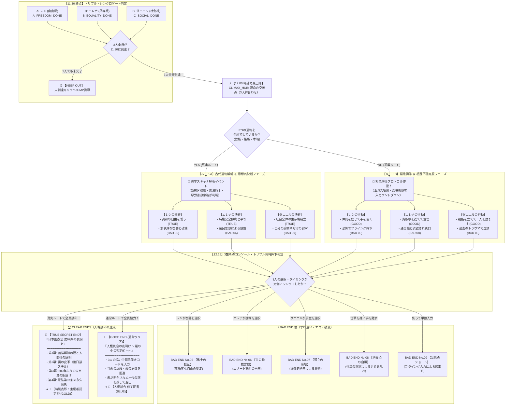

# **『パラレル・ジャパニア：クロニクル 〜失われた人権の180分〜』**
## **至極の428型クライマックス＆エンディング完全シナリオ設計仕様書**

---

## **1. 本書の目的と基本設計思想**

本書は、『パラレル・ジャパニア：クロニクル 〜失われた人権の180分〜』において、プレイヤーが12:00（時計塔最上階）に到達した後の**クライマックスから全エンディングに至るシナリオ構造、心理サスペンス、分岐ロジック、およびテキスト仕様**を完全定義する詳細設計書である。

### **1.1 428型群像劇としての3大コア原則**
1. **【叙述トリックの絶対死守】**:
   冒頭から中盤にかけては徹底して「架空のサイバーパンク・ディストピアSF」として没頭させ、「未来の日本」「日本国憲法」という真実は真エンディングのデコード演出で初めて明かされる。
2. **【主観モノローグのズレと誤解の連鎖】**:
   同じ部屋、同じ緊迫した状況であっても、3人の内面で見えている世界・トラウマ・思考回路は全く異なる。些細な仕草（沈黙、汗を拭う、ポケットの手）が他者の視点では致命的な裏切りに見える「心理的すれ違い」をザッピングによって解きほぐす。
3. **【3箇所同時押下（トリプル・シンクロ・キー）ギミック】**:
   1人では絶対に手が届かない三角形に離れた3つのコンソール。3人が否が応でも協力し、それぞれの覚悟を選んで「せーので同時に押す」ことで、自由・平等・社会権の不可分性を身体感覚として体得させる。

---

## **2. エンディング遷移 全体フローチャート (Mermaid)**



---

## **3. ルート別 詳細シナリオ＆テキスト仕様**

---

### **3.1 【ルートA：真実の探究ルート（遺物3種保持時）】**

スキャナ上に置かれた「青い鉄板」「真鍮銘板」「古い木箱」が青い光に包まれ、古代日本の文字（漢字）が復元される。
真実を知った3人は、中央コンソールに表示される「未来の都市統治プロトコル」に対し、思想的誓約を迫られる。

#### **① レン（自由権）の決断ノード: `CLIMAX_DECISION_A`**
* **モノローグ**:
  > （目の前の画面が激しく明滅している。
  > 　『東京都 新宿区』──かつてこの街が存在した国の名前。
  > 　そこには、誰もが自分の行きたい場所へ行き、誰にも支配されない自由があったという。
  > 　今、俺の手の中にあるコンソールには【全市民の首輪一斉強制自爆】と【全首輪の恒久安全解除】の二つのキーが表示されていた。
  > 　俺を家畜のように扱ってきた上層階級の連中……あいつらを皆殺しにして、奪われた人生の復讐を果たすか？
  > 　それとも……あいつらの命も含めて、誰もが縛られない新しい世界を創るのか？）
* **選択肢**:
  1. `【調和の自由】`：「俺だけの自由じゃない。誰もが自分の足で歩き、互いを傷つけない自由を誓う！」 ➔ **（TRUE ENDフラグ成立）**
  2. `【復讐の破壊】`：「知るか！ 憎い上層階級を皆殺しにして、すべてを灰燼に帰してやる！」 ➔ **【BAD END No.05：焦土の狂乱】**

#### **② エレナ（平等権）の決断ノード: `CLIMAX_DECISION_B`**
* **モノローグ**:
  > （『日本国憲法 第三章 原本保管庫』──真鍮の銘板に刻まれた文字が、私の瞳を射抜く。
  > 　門地による差別を禁じる法。私が生まれ育ち、誇りにしてきた『一等血統』という特権は、かつて人類が永久に葬り去ったはずの悪習だったのだ。
  > 　コンソールが冷たく語りかけてくる。
  > 　『現行の貴族管理ネットワークを維持し、あなた自身が最高監査官として全権を掌握しますか？』
  > 　私が権力を握れば、賢明で慈悲深い統治ができるかもしれない。愚民たちに余計な自由を与えて混乱させるより、私が導くべきではないのか？）
* **選択肢**:
  1. `【平等の誓約】`：「華族も特権もいらない！ 私の制服を焼き捨て、すべての人間が法の下に平等な社会を誓う！」 ➔ **（TRUE ENDフラグ成立）**
  2. `【独裁の受容】`：「民衆には指導者が必要よ。私が正しい特権層として彼らを導いてあげるべきだわ」 ➔ **【BAD END No.06：白の独裁宮殿】**

#### **③ ダニエル（社会権）の決断ノード: `CLIMAX_DECISION_C`**
* **モノローグ**:
  > （『厚生労働省 災害備蓄用医療箱』……古びた木箱の焼き印に指を滑らせる。
  > 　かつての世界には、貧しい者も病める者も、国が見捨てることなく『健康で文化的な最低限度の生活』を支え合う仕組みがあった。
  > 　コンソールの警告ランプが赤く点滅している。
  > 　『生存エネルギーの供給先を選択してください。現行スラム区画のみへの緊急配分か、全都市における恒久生存権の制度化か』
  > 　目の前の診療所の子供たちを救うだけなら、スラムにだけ電力を回せばいい。だが、それでは都市の構造的搾取は何も変わらない。
  > 　俺が背負うべきは、目の前の命だけか？ それとも、これから生まれてくるすべての命なのか？）
* **選択肢**:
  1. `【生存権の確立】`：「誰もが人間らしく生き、倒れた者を社会全体で支え合う権利を、永久の基本法に刻み込む！」 ➔ **（TRUE ENDフラグ成立）**
  2. `【狭隘な安寧】`：「大きな社会のことなど知らん！ 目の前の自分の診療所の患者さえ助かれば十分だ！」 ➔ **【BAD END No.07：孤立の崩壊】**

---

### **3.2 【ルートB：通常緊急ルート（遺物不足時）】**

3つの遺物は揃っておらず、古代の歴史の真相は闇の中。
しかし、防衛毒ガスが噴射され、治安部隊の足音が迫る極限の1分間の中で、3人は**「互いの仕草による誤解」**を乗り越えて緊急停止ボタンを同時に押さなければならない。

#### **① ダニエルの「沈黙」とレンの「猜疑心」**
* **ダニエル視点**:
  > （かつて手術室で失った少年の顔が浮かび、胸が締め付けられる。
  > 　祈るように目を閉じ、一瞬だけコンソールから手を引いて息を整えた。）
* **レン視点（ザッピング前）**:
  > （医者のおっさんが急に押し黙り、手を引っ込めやがった！
  > 　自分だけ助かる裏コードを探しているのか！？ 信用できるか！）
* **解決アクション（ダニエルの選択肢）**:
  * `【弱音を捨て、力強く声をかける】`:
    「レン、エレナ！ ビビるな、俺が二人を絶対に生きて帰す！ いくぞ！！」
    ➔ **レンのテキストが変化し、疑心が解ける！**

#### **② エレナの「襟元の手」とダニエルの「警戒」**
* **エレナ視点**:
  > （息苦しさに耐えかね、襟元を少し緩めて首筋の汗を拭った。）
* **ダニエル視点（ザッピング前）**:
  > （エレナが首筋の通信機に手を当てた！ 増援の治安部隊を呼んでいるのか！？）
* **解決アクション（エレナの選択肢）**:
  * `【胸の貴族章を引きちぎり、床へ投げ捨てる】`:
    「私はもう監査官ではないわ！ あなたたちと共に生きる一人の人間よ！」
    ➔ **ダニエルのテキストが変化し、警戒が解ける！**

#### **③ レンのお守りとフライング押下の恐怖**
* **レンの選択肢**:
  * `【合図を信じて、二人の呼吸に合わせて押し込む】` ➔ **（GOOD END成立）**
  * `【恐怖に耐えかね、フライングでボタンを叩く】` ➔ **【BAD END No.09：乱調のショート】**

---

## **4. 全BAD END（No.01〜No.09）完全一覧表**

| 結末ID | 結末タイトル | 発生契機・操作キャラ | 破滅の一人称ドラマ（地獄の解像度） | 公民的アハ体験 |
| :--- | :--- | :--- | :--- | :--- |
| **BAD_01** | **暗闇の心停止** | 10:25 ダニエル (A停電) | 手術中に無影灯が消え、生命維持装置が沈黙。闇の中で心臓マッサージを続けるが少年の体温が失われていく絶望。 | 他者の生命を脅かす自由はない（公共の福祉）。 |
| **BAD_02** | **処刑台の露** | 10:20 エレナ (少年見殺し) | 少年を見捨てたエレナ自身が、やがて「血統に平民の血が混ざっている」として監査局に粛清され、冷たい法廷で処刑台へ送られる。 | 平等なき社会では、特権層の人間すら容易に使い捨てにされる。 |
| **BAD_03** | **自由という名の飢餓** | 11:30 ダニエル (スト断念) | 自由を手に入れたがパンも薬もない街。重症者が溢れ返り、暴徒と化した市民が診療所を焼き討ちし、ダニエルも炎に包まれる。 | 自由だけでは人は生きられない（社会権・生存権の不可欠性）。 |
| **BAD_04** | **魂の家畜** | 11:30 レン (言論放棄) | マイクを捨て逃げたレン。首輪は外れたが、配給パンを機械のように貪り何も考えず生きる「魂の家畜」に成り果てる。 | 生存のために表現の自由を捨てれば待つのは全体主義の飼育場。 |
| **BAD_05** | **焦土の狂乱** | 12:15 レン (復讐選択) | レンが無秩序な復讐を選び、全都市のエネルギーを暴走させる。スラムも上層街も火の海に包まれ、街全体が自滅する。 | 秩序と他者尊重なき自由は、ただの野蛮な暴力と共倒れを生む。 |
| **BAD_06** | **白の独裁宮殿** | 12:15 エレナ (独裁選択) | エレナが新たな指導者として君臨するが、かつての父と同じ冷酷な選民統治へと堕落。数年後、反乱軍の凶弾に倒れる。 | 特権による支配は、いかに善意から始まっても必ず専制と腐敗を招く。 |
| **BAD_07** | **孤立の崩壊** | 12:15 ダニエル (孤立選択) | 自分の診療所だけに電力を引いたダニエル。だが周辺の餓死した難民の群れが診療所へ殺到し、全員が押し潰される。 | 社会全体の福祉と権利を守らなければ、個人の幸福も維持できない。 |
| **BAD_08** | **猜疑心の自爆** | 12:15 全員 (仕草の誤認) | 沈黙や汗を拭う仕草を「裏切り」と誤認。互いに銃を向け合って撃ち合い、その間に防衛毒ガスが部屋を満たして全滅。 | 対話と言葉による意思疎通なき社会は、猜疑心によって内側から自壊する。 |
| **BAD_09** | **乱調のショート** | 12:15 レン (フライング) | 恐怖で1人だけ早くボタンを押したレン。不揃いな回路に高圧電流が逆流し、3人ともコンソール前で感電死する。 | 一人の抜け駆けや自分勝手な行動は、全体の合意と調和を水泡に帰す。 |

---

## **5. 表彰状・PDF出力仕様**

```
+-----------------------------------------------------------------------------+
|                                                                             |
|   特 別 表 彰 ： 主 権 者 認 定 証                                            |
|   PARALLEL JAPANIA CHRONICLE : CONSTITUTIONAL COMPLETE                      |
|                                                                             |
|                         サ サ キ   タ ロ ウ   殿                             |
|                                                                             |
|     あなたは、失われた人権の暗黒時代を駆け抜け、                            |
|     自由・平等・社会権の三位一体の調和を解き明かしました。                  |
|     古代の幾何学模様に刻まれた『日本国憲法』の真実に到達し、                |
|     人間としての尊厳を自らの手で取り戻した主権者であることを、              |
|     ここに深く称えます。                                                    |
|                                                                             |
|   『日本国憲法 第97条：基本的人権は、人類の自由獲得の努力の成果であつて、     |
|     永久の権利として信託されたものである。』                                |
|                                                                             |
|   授与日: 2026年9月4日                 極東統治特区・第八区 人権審判機関    |
|                                                     [ 永久信託 / 認定之印 ] |
+-----------------------------------------------------------------------------+
```

* **通常クリア時（GOOD END）**:
  * タイトル：『人権統合 修了証書』
  * ベースカラー：セルリアンブルー（#0284c7）
  * 授与機関名：『パラレル・クロニクル 統治調停委員会』
* **真エンディング時（TRUE SECRET END）**:
  * タイトル：『特別表彰：主権者認定証』
  * ベースカラー：ディープブラック＆ゴールド（#0a0d14 / #eab308）
  * 刻印条文：日本国憲法 第九十七条 全文
  * 印章：二重円ベクター刻印『永久信託 / 認定之印』

---

## **6. 【完全設計】古遺物・スキャナ解析・主権者認定システム仕様**

---

### **6.1 世界観裏設定：立憲フェイルセーフ・プロトコルと分散ICチップ**

1. **オカルト・超自然共鳴の完全排除**:
   - 金属板や遺物が魔法のように青く発光・共鳴するオカルト表現を完全廃止。
   - 3者のマスターキー同時押下により「独裁統治プロトコル」が遮断され、タワーの心臓電脳が80年ぶりに**「初期基底OS（コールドブート）」**として再起動する。
   - 再起動時にタワー全館へ放出される微弱な環境電磁パルス（走査ミリ波）を、遺物の奥深くに埋設されていた**無電源パッシブ型RFID暗号チップ（耐タンパーセラミック素子）**が電磁誘導で受け止め、微弱な応答ビーコンを返信することで、スキャナ側が認証体を物理検知する。

2. **古代の技術者・法学者たちの思想的背景**:
   - 西暦2040年、高度AI文明の到来によって人々が思考と判断を放棄し、「効率と管理」の名のもとに人権が風化・改竄される未来を恐れた開発チームが、都市管理OSのカーネル深層に**管理者権限すら削除できないキルスイッチ**を密かに焼き付けた。
   - 権力者による鍵の独占・破棄を防ぐため、生活現場の公共物品（交通インフラ、最高法規記念品、災害備蓄医療品）に極小暗号チップを分散埋設。
   - 自由・平等・社会権の危機に抗い、異なる階層の市民たちが手を取り合って持ち寄った時にのみ、都市の全統治権限を【主権者】へ返還するよう設計された。

---

### **6.2 古遺物スキャン判定マトリクス（3段階の分岐ロジック）**

| 状態区分 | 所持条件 | スキャナの挙動 | 発生するシナリオ演出 | 到達する結末 |
| :--- | :--- | :--- | :--- | :--- |
| **①【完全未所持】** | **A× B× C×**<br>（0個所持） | **起動しない**<br>（イベント不発生） | 統治中枢の通常停止コンソールのみが稼働。<br>※遺物スキャンの描写は一切出ない。 | **通常クリア（NORMAL_CLEAR）**<br>（クリア後に10:30の遺物回収イベントが解禁される） |
| **②【部分所持】** | **どれか1〜2個が○**<br>（A○B×C×、A×B○C○ 等） | **スキャナ起動！**<br>（部分解析・警告） | ・所持スロットは文字解読＆条文インストール成功。<br>・未所持スロットは**『未検出。認証チップが存在しません』**と冷酷に警告表示。<br>・『警告：条文の欠損を検知。立憲再起動プロトコルは承認されません』 | **通常クリア（NORMAL_CLEAR）**<br>※プレイヤーは「他の主人公の遺物も探さなければ！」と明確に悟る。 |
| **③【完全所持】** | **A○ B○ C○**<br>（3個すべて○） | **完全照合成功！**<br>（全条文復元） | ・スロットA・B・Cすべてインストール完了。<br>・**2040年ホログラム映像が再生**。<br>・主権者承認コンソールが展開。 | **真エンド（TRUE_SECRET_END）**<br>（全土ブロードキャスト＆東京湾の夜明け） |

---

### **6.3 3大標本の物理的諸元・刻印・インストール条文**

中央スキャナのトレイには、3つの独立した配置ゾーン（スロットA / スロットB / スロットC）が存在する。

#### **① スロットA（レン側：自由権）**
- **標本名**: 地上交通インフラ標板（アルミ合金製）
- **露出する刻印**: **『東京都 千代田区 隼町 / 最高裁判所』**
- **所持時（○）**:
  - レーザー走査で泥と錆が落ち、漢字が露出。
  - 『標本A：深層暗号素子を検知。内部暗号キーを照合中……』
  - 『日本国憲法・自由権アーカイブを展開、再インストールを実行します。』
    - **第13条（個人の尊重・生命自由幸福追求の権利）**:
      「すべて国民は、個人として尊重される。生命、自由及び幸福追求に対する国民の権利については……最大の尊重を必要とする。」
    - **第18条（奴隷的拘束及び苦役からの自由）**:
      「何人も、いかなる奴隷的拘束も受けない。」
    - **第31条（適正手続の保障）**
  - 『……自由権全章の整合性確認。スロットA：インストール完了。』
- **未所持時（×）**:
  - 『スロットA：未検出。認証チップが存在しません。』

#### **② スロットB（エレナ側：平等権）**
- **標本名**: 最高法規原本 保存箱銘板（真鍮製）
- **露出する刻印**: **『日本国憲法原本 保存箱銘板 / 国立国会図書館・憲法記念事業』**
- **所持時（○）**:
  - 煤が落ち、毛筆の金文字が露出。
  - 『標本B：深層暗号素子を検知。条文を再インストールします。』
    - **第14条（法の下の平等・貴族制度の否認）**:
      「すべて国民は、法の下に平等であつて、人種、信条、性別、社会的身分又は門地により、政治的、経済的又は社会的関係において、差別されない。華族その他の貴族の制度は、これを認めない。」
  - 『……平等権全章の整合性確認。スロットB：インストール完了。』
- **未所持時（×）**:
  - 『スロットB：未検出。認証チップが存在しません。』

#### **③ スロットC（ダニエル側：社会権）**
- **標本名**: 災害備蓄用医療救護箱（スチール製）
- **露出する刻印**: **『厚生労働省 / 首都直下災害緊急備蓄（赤十字マーク）』**
- **所持時（○）**:
  - 剥げかけた塗装の隙間から、赤い十字と公的刻印が露出。
  - 『標本C：深層暗号素子を検知。条文を再インストールします。』
    - **第25条（生存権の保障・国の公衆衛生義務）**:
      「すべて国民は、健康で文化的な最低限度の生活を営む権利を有する。国は、すべての生活部面について、社会福祉、社会保障及び公衆衛生の向上及び増進に努めなければならない。」
    - **第27条（勤労の権利）** / **第28条（労働基本権）**
  - 『……社会権全章の整合性確認。スロットC：インストール完了。』
- **未所持時（×）**:
  - 『スロットC：未検出。認証チップが存在しません。』

---

### **6.4 部分所持（ケース②）におけるスキャン中断とノーマルエンドへの接続動線**

所持していないスロットがある場合、システムは冷酷に中断し、キャラクターたちの認知に齟齬が出ないよう**「誰が所持していても100%成立する普遍的セリフ」**を経てノーマルエンドへ接続する。

#### **① システムの中断処理**
- 『……照会中断。全条文の同期が成立しませんでした。』
- 『認証キーの欠落により、恒久アーカイブの展開は保留されます。……通常シャットダウン・シークエンスへ移行します。』
- トレイが格納され、モニターの古代文字がスーッとブラックアウトして沈静ランプへと戻る。

#### **② キャラクターたちの会話（認知境界・主語矛盾の完全排除）**
> **エレナ**：
> 「……消えてしまったわ。今のは……一体何だったのかしら？ 『ニホンコク』……『トウキョウ』……？ 聞いたこともない言葉が並んでいたけれど……」
> 
> **レン**：
> 「さあな……。だが画面の赤い警告を見る限り、これだけじゃ“何か”が足りなかったみてえだな」
> 
> **ダニエル**：
> （白衣の煤を払い、深く息を吐きながら苦笑いする）
> 「……ああ。だが、いま私たちに分かるのは、独裁者が倒れ、街の首輪が止まったということだけだ。あの機械が何を語ろうとしていたのかは……街が落ち着いたあと、いつか解き明かせばいい」
> 
> **エレナ**：
> 「ええ、そうですね……！ 今はまず、外で待っている人たちの元へ向かいましょう！」

#### **③ ノーマルクリアへの着地**
- 三人は「未解明の古代の謎」を胸に残しつつ、目の前で命がけで勝ち取った「自由と命の解放」を噛み締め、朝風が吹き込む展望デッキへと歩み出る。
  ➔ 選択肢：**「新憲法の夜明け、自由な未来へ踏み出す！」**（`NORMAL_CLEAR` へ）

---

### **6.5 完全所持（ケース③）：2040年ホログラムと硬派な制御コンソール**

1. **メタ発言の完全排除（客観的描写と発言者の自己名乗りのみ）**:
   - 地の文で「古代のプログラマと法学者だった」と解説することを完全禁止。
   - 再生映像の中で、記録された人物自身が名乗るセリフと、主人公たちの主観的な視覚情報のみで描写する。

   > 『スロットA、B、C——全系統の物理照合完了。』
   > 『三大基本的人権の総合的同期を確認。……保護アーカイブを展開します。』
   > 
   > メインフレームの冷却ファンが唸りを上げ、天井の投影プロジェクターから青白い光が落ちた。
   > ホールの空間に、かつての執務室と思われる部屋の立体映像が結像する。
   > 画面には、スーツ姿の壮年男性と、IDカードを首から下げた作業着姿の技術者たちが映し出されていた。
   > 
   > 『……記録を開始する。西暦2040年11月3日。』
   > スーツの男性が、記録カメラに向かって静かに口を開いた。
   > 『都市基盤自律制御OS開発委員会、憲法整合性設計チームの責任者だ。』
   > 
   > 『この記録が再生されているということは、我々の恐れていた最悪の事態が現実になったのだな。
   > 　私たちの時代、AI技術は急速に進化し、社会のあらゆる意思決定——インフラの配分から司法の判断、
   > 　福祉の優先順位に至るまで、すべてを電脳に委ねるようになった。
   > 　……人々は、思考と判断の労苦から解放されたと思い込み、自ら考えることをやめてしまった。』
   > 
   > 『だが、自ら考えぬ社会に、自由も尊厳も残りはしない。
   > 　効率と管理の果てに待つのは、選民による支配と、人権の完全な形骸化だ。
   > 　……だからこそ我々は、この基幹電脳の最深部に、管理者権限すら及ばぬキルスイッチを埋め込んだ。
   > 　現場の生活に根ざした自由、平等、そして生存の物証が、
   > 　抑圧に抗う者たちの手で同時に揃えられた時にのみ、全権限を初期化するプロトコルだ。』
   > 
   > 『三つの標本を持ち寄り、これを見ている者たちよ。
   > 　あなたたちは、他者に与えられた秩序を打ち破り、自らの意志で人間性を取り戻した。
   > 　これより、本システムはすべての選民統治コードを完全消去し、
   > 　この都市の主権を、住民一人ひとり——あなたたちへと引き渡す。
   > 　……これからの社会をどう築くかは、あなたたち自身の頭で考え、決めてほしい。』

2. **「黄金のレバー」の廃止 ➔ 現実的な制御コンソール**:
   - 安っぽいレバーは廃止。メインフレームの中央操作盤に、高輝度の透過ディスプレイが静かに展開される。
   - 『全土行政OS・立憲初期化シーケンス待機中』
   - 『日本国憲法全章・極東全域強制ブロードキャスト』
   - **［ 主権者承認キーを実行する ］**
   - 三人が見守る中、コンソールが立憲フェイルセーフを認証し、真エンド（`TRUE_SECRET_END`）の全国土ブロードキャストが起動する。

---

### **💡 本仕様書のまとめ**
本仕様の策定により、本作はオカルトSFを脱却し、**「かつてAIと思考停止に溺れた2040年の先人たちから、現代のプレイヤーとディストピアの若者たちへ託された【主権と立憲主義の信託】」**という、極めて重厚で教育的・文学的完成度の高いシナリオへと完全に昇華する。
